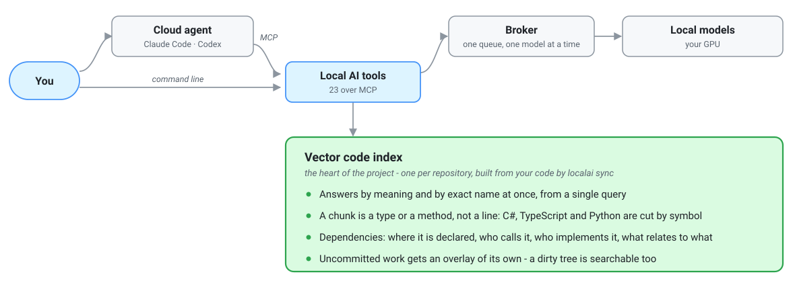

# Local AI Toolkit

**Local models that do the reading — for you, and for your cloud agent. A real saving in
cloud tokens, and in your own time.**

[Русская версия](README.ru.md)

[](LICENSE)

A cloud agent spends most of its tokens looking rather than thinking: opening candidate
files, searching the code, walking dependencies, scrolling a build log, describing a
screenshot, translating a page. LocalAi does that part on your own machine and hands back
the answer, so the agent starts from a result instead of paying to find one.

**Reading this repository whole would cost a cloud agent about 1 480 000 tokens. A question
answered from the local index costs about 2 000.**

A subscription to any cloud agent is optional: the same tools answer from the command line,
if you would rather work on your own.

---

## Two ways to use it

**As subagents to a cloud agent.** Claude Code, Codex and any other MCP client can call
LocalAi's tools directly. The agent hands them the simple, repetitive work and starts from
prepared results, instead of doing that drudgery itself on cloud tokens.

**Without a cloud agent, from the command line.** The same capabilities, but as helpers for
you: search code by meaning, triage a log, read an image, translate a document. It is the
same index and the same models either way, so nothing is lost by starting here and adding an
agent later.



**Why there is a broker in the middle.** There is one per machine and it holds the queue.
That is how Claude, Codex and the command line all work at once without tripping over each
other, and why one model sits in video memory rather than four fighting over it.

**Nothing leaves the machine.** Ollama listens on `127.0.0.1`, and neither your code nor the
prompts built from it go anywhere else. Left alone, the runtime makes no network calls at
all: the update check is off by default. Models and missing prerequisites are downloaded
when you ask for them.

---

## What a cloud agent gets

Twenty tools over MCP. The agent calls them itself, whenever a question is cheaper to ask
locally.

| Tool | What it does |
| --- | --- |
| `search_code` | search by meaning and by exact name at once |
| `get_code_chunk` | pull a match in full |
| `go_to_definition` | where the symbol under the cursor is declared |
| `find_references` | who calls it and where it is used |
| `find_implementations` | who implements or overrides it |
| `find_relationships` | the relationship graph: implementation, override, type |
| `lsp_open_document` | hand navigation the text of an unsaved file |
| `lsp_close_document` | give navigation back to the indexed snapshot |
| `ask_local` | mechanical work over files you name |
| `triage_log` | make sense of machine output of any length |
| `read_image` | read images from disk or one PDF page by page |
| `translate_local` | translate, structure intact |
| `index_status` | whether an index exists, what built it, how far behind HEAD |
| `index_refresh` | refresh the index after a commit |
| `index_unload` | free the memory a loaded index holds |
| `local_models_status` | what is installed, what is resident, what is missing |
| `local_model_preflight` | prove a model fits entirely in video memory |
| `local_models_sync` | fetch the recommended models that are missing |
| `local_model_experiment_report` | statistics for one task-and-model pair |
| `local_model_feedback` | decide a model's fate: promote, keep as fallback, disable |

## What the command line gets

Use `localai --help` or `codesearch --help` for the command list, and
`localai repo status --help` or `codesearch help search` for a command's syntax.
Help writes to stdout and exits successfully; extra or unknown help arguments are refused.
Help follows the saved language or `LOCALAI_LANGUAGE` (`en` / `ru`). Existing JSON output
contracts are unchanged; `--json` requests a machine response rather than prose help.

The set is **not the same**: some tools exist only here, some only over MCP.

| Command | What it does |
| --- | --- |
| `codesearch search --query "…"` | the same search by meaning and by name |
| `codesearch get-chunk --id …` | pull a match in full |
| `codesearch status` | where the index is, whether it drifted, whether the repo is connected |
| `codesearch scan` | what would go into the index at all |
| `codesearch index` / `overlay` | build an index by hand, outside LocalAi's management |
| `codesearch evaluate --cases …` | run the search-quality corpus |
| `localai semantic definition` / `references` / `implementations` / `relationships` | navigate by symbol |
| `localai ask "…" <file> …` | mechanical work over files |
| `localai triage <log>` | make sense of a log |
| `localai read-image "…" <file>` | read images or one PDF |
| `localai translate --in <file> --from … --to …` | translate |
| `localai sync` | build or refresh the index |
| `localai hooks install` | install the hooks that keep the index current |
| `localai repo status` | whether a repository is connected |
| `localai doctor` | what is wrong with the installation, read-only |
| `localai model status` / `pull` / `preflight` | models: installed, fetch, prove the fit |
| `localai policy show` / `set` | the model residency policy |
| `localai prune` | clear out stale generations and overlays |
| `localai telemetry` | a summary of local jobs |
| `localai update` | update the installation |

`localai sync --root <worktree>` prepares the requested worktree first. `SYNC_BASE`
reports whether the base is reused; `SYNC_PLAN` lists pending worktrees in processing order,
and `WORKTREE_PLAN` identifies reused or rebuilt overlays. `ACTIVE_READY` reports when
the requested tree can use the new generation, separately from the final sync duration.
Other worktrees continue using the previous generation until their overlays are ready.
Maintenance continues in the same sync process; do not start another sync while it runs.
An interrupted run keeps completed worktrees usable and can be restarted. An MCP wait
timeout alone does not prove that the sync failed: observe `localai repo status --follow`.

`codesearch evaluate --cases …` resolves C# symbol targets to their source declarations
before querying. Split chunks such as `[1/6]` and `[2/6]` belong to a single target. Use the
optional `signature` and `namespace` target fields to disambiguate names; signatures that
still match multiple declarations are rejected rather than scored. Path-only targets
continue to accept any hit in the specified file. These changes affect evaluation scoring;
search ranking and the calibrated threshold remain unchanged.

Evaluation corpora may include an optional `excludedPaths` list of repository-relative file
paths and directory prefixes ending in `/`. These are literal paths, not globs; either slash
style is accepted. When the `--cases` file is inside the repository, it is excluded
automatically; list other reference material explicitly. Exclusions apply before both vector
and lexical ranking. Normal search continues to include ordinary tests.

Exclusion paths must stay inside the repository and must not cover a declared relevant
target. Evaluation output records the source commit/tree and dirty-content hash separately
from the indexed commit/tree, plus the index generation/model, corpus SHA-256, resolved
annotations, search options, and effective exclusions. A run fails if its source snapshot,
index generation, or annotations change while it is running. Reproducing a dirty run also
requires retaining the uncommitted source files; a hash alone cannot restore them.

The [retained candidate-scope baseline](tests/CodeSearch.Tests/Fixtures/SearchEvaluation/baseline-candidate-scope-2026-09-16.json)
records Recall@10 72.2%, Precision@5 13.3%, and a 100% false-positive rate on six no-answer
cases. With one annotated target for each of the 18 answerable queries, Precision@5 has a
20% ceiling. These figures describe this 24-case corpus, not overall product quality;
thresholds remain unchanged. Concurrent broker work and unavailable queue/residency
telemetry make its timings unsuitable as an isolated performance benchmark. Independent
corpora and recalibration are tracked in [#601](https://github.com/MrAliev/local-ai-toolkit/issues/601).

**Not on the command line.** `lsp_open_document` and `lsp_close_document` take the text of an
unsaved buffer — and in a shell there is no such buffer, so there is nothing to hand over.

**Not over MCP.** Six commands are deliberately left to you, for exactly three reasons:

**It already happens by itself — no need to call it.**

- `localai prune` — tidying runs after every index build. Stale generations and overlays go
  by themselves, and the build prints how much it freed.
- `localai sync` — after a commit, checkout, merge or rebase the Git hooks run it. The agent
  is left `index_refresh` for exactly one case: edits saved but not yet committed.

**It is a product update, and it is run by hand.**

- `localai update` installs new binaries and re-registers the MCP servers with your clients.
  That is an install over an install, not an everyday operation, and you do it when you see
  fit. While there are no published releases it goes the same way the first install did:
  build a package and run `LocalAi.Installer.exe` over the top.

**It is information for you, in a shape made for reading.**

The agent has no use for it in that shape — it gets a report line for every call it makes,
and `index_status` answers for the index. A person needs the wider picture:

- `localai doctor` — what is wrong with the installation: reachability, models, permissions,
  paths. Read-only; it starts nothing and repairs nothing.
- `localai telemetry` — distinct jobs, attempts, known workflows, and confirmed delivered
  calls. Model/profile tables show attempt outcomes and durations; cloud input/output
  comparisons have separate totals and known/unknown coverage.
- `codesearch scan` — what would be indexed at all. You look at it while setting a repository
  up, to see the size of the job, not while asking a question about code.
- `codesearch evaluate` — the search-quality corpus. A tool for developing LocalAi itself,
  not for working with your code.

---

## Code search is not text search

A file is not sliced into equal slabs of text. It is **taken apart by declaration** — class,
method, function — and each one enters the index whole, with its name, its signature and its
exact lines. That is why a hit reads `OrderCloser.CloseAsync` with its whole body, rather
than a line that happened to match in the middle of somebody else's method.

- **C#** is parsed by **Roslyn**, the same compiler that builds the project. It walks a real
  syntax tree, and a chunk is either a whole type or one executable member: a method, a
  constructor, an operator, a property with a body.
- **TypeScript and Python** are mapped by the **SCIP** indexers. They report where each
  declaration begins and ends, and the chunk boundaries come from there — not guessed from
  indentation.
- **Everything else** — markup, configuration, documentation, any language with no indexer —
  cannot be taken apart that way, so it gets an honest sliding window: 60 lines with 12 lines
  of overlap, so a thought is not torn in half at a seam.

One thing the index cannot see: a file you have edited but not saved. Navigation can still
answer for it, but only when an agent hands over the buffer's text — there is no such path
from the command line, and language servers stay off until you enable them.

---

## With a cloud agent: what stops costing tokens

It is not only about volume. A question asked in words rarely maps onto a keyword — and a
keyword is exactly what an agent is reduced to searching for when there is no index.

**Measured on this repository.** The question "who is subscribed to a broker job finishing":

- Grepping for `Subscribe` finds **one file** under `src`, and it is not the answer.
- `search_code` returns `IBrokerQueue.CompleteAsync` and `BrokerJobPending` — neither of
  which contains the word "subscribe" anywhere. It matched by meaning.

| Question | Without LocalAi: where the tokens go | Tokens | With LocalAi: where the tokens go | Tokens |
| --- | --- | --- | --- | --- |
| "Who is subscribed to a job finishing?" | guess a keyword, open candidates whole — `DurableQueue.cs` alone is 49 KB | ≈ **12 400** for one file, and not the answer yet | three fragments, with paths and line ranges | ≈ **2 000** |
| "How does the order pipeline work?" | read every file mentioning "Order" and assemble the picture yourself | tens of thousands | a fragment per link in the chain, each with its place | ≈ **2 000** |
| "What does this codebase do?" | read all of it | ≈ **1 480 000** | index once, then ask | ≈ **2 000** a question |

The difference is not that the agent reads faster. It is that **only the fragments that
matched enter its context**, and the hunt through candidates is paid for by your GPU rather
than by your subscription.

### It works by default, and you can see it

**Nothing to switch on.** The installer tells the agent these tools exist and that they come
first. From there the agent decides for itself: it sees a "where does this live" question and
reaches for `search_code` instead of opening files.

**Runtime token reports use one shared record per call.** MCP tools and both CLIs emit a
compact notice with separate signed cloud INPUT and OUTPUT savings. Without an explicit
comparison scenario and supported profile, the value is `unknown`, not zero. Character-based
values are explicitly marked as heuristic estimates; measured text counts identify their
tokenizer profile. Legacy numeric JSON fields remain compatible and are not calibrated measurements.

The shared method compares cloud input and output separately. It requires an explicit
alternative reading scenario, source provenance, the complete returned payload, and a named
tokenizer or vision profile. Previously retrieved text and overlapping chunks are not counted
twice. Missing evidence produces `unknown` with a reason; unsupported image profiles do not
fall back to a universal area formula.

Existing numeric response fields retain their JSON shapes. New broker attempt records use
schema 2, with attempt/workflow identities and observed backend counts where available.
Attempts cannot prove delivery or cloud savings: their versioned value is `unknown`, and
their legacy scalar savings fields are zero. Older telemetry remains readable; its unsupported
scalar estimates are excluded from totals. Final call reports are stored separately, once
per call, and account for the complete returned volume. Multiple jobs in one call do not
multiply its savings. Incompatible comparison profiles are not summed. `localai prune`
applies the telemetry retention policy to both attempts and final reports.

MCP results carry schema-versioned data in `_meta["localai/usage"]`. Text tools include the
notice outside untrusted-content boundaries; JSON tools keep their content unchanged and
place the notice in metadata. Cancellation remains protocol cancellation. Supply a unique
GUID in request `_meta["localai/callId"]` before starting a cancellable call, then retrieve
the partial report with `localai telemetry --call-id <guid>`.

CLI stdout keeps its existing text or JSON contract; the compact report goes to stderr.
The installer's version-one `localai model` protocol permits no extra stderr records, so
those reports are only persisted. Reports are stored at `%LOCALAPPDATA%\LocalAi\telemetry\usage`;
they contain technical measurements and identifiers, never prompts or document contents.
A storage failure preserves the command result and is reported separately where the protocol
permits it.

Response size counts the full serialized MCP result, including its notice and metadata,
or all CLI stdout/stderr text in UTF-8. JSON-RPC framing is outside this boundary. The
self-inclusive MCP calculation is bounded; nonconvergence produces an unknown size.
Delivery records a completed file write or handoff to the output surface, not acknowledgement
by a remote client. Missing measurements remain unknown; partial reports describe the
evidence available at cancellation. An `index_memory_cache` hit describes cached index data
and does not imply that inference was skipped.

The [synthetic calibration corpus](tests/Fixtures/TokenCalibration/corpus.json) has
[reference counts and comparison results](tests/Fixtures/TokenCalibration/reference.json)
from tiktoken 0.12.0 for `cl100k_base` and `o200k_base`. It covers EN/RU, code, mixed text,
an empty input, a long response, source/path/outPath, prior and repeated reads, PNGs, and a
two-page PDF. Error statistics describe this corpus and these encodings; they do not establish
a universal tokenizer or provider-reported usage. The long sample repeats shorter fixtures
to exercise response size, not to add independent language coverage.

Image references use the [documented `gpt-4o` tile formula](https://developers.openai.com/api/docs/guides/images-vision) and are labeled formula estimates.
PDF references include text counts but leave the full input unknown because provider page
rendering is not observed. Unsupported vision profiles remain unknown at runtime. Character
estimates have no statistical interval; the search evaluator's existing numeric bounds are
explicitly labeled `heuristic_not_confidence_interval` in the versioned
`responseTokenEstimatePolicy` companion. Calibration does not replace comparison scenarios,
source provenance, delivery evidence, or complete response accounting.

To reproduce the references, install `tiktoken==0.12.0` and run
`python tools/calibrate-tokens.py --verify`. The tokenizer may download its hash-checked
encoding tables on first use; no model or provider API is called. `--write` deliberately
regenerates the synthetic assets and reference JSON. The normal .NET suite checks the retained
measurements, scenario arithmetic and report privacy without Python, a network connection, or a GPU.

### If something does not work the way you want

Nothing is nailed down — the settings live in `%LOCALAPPDATA%\LocalAi\settings`:

| What to change | How |
| --- | --- |
| The model for a kind of task | `model-routing.json` — its own chain of models per profile: `CodeAnalysis`, `LogTriage`, `VisualAnalysis`, `PlainTranslation` and a dozen more |
| The model for a single call | `localai ask "…" <file> --model <model>`, or `--profile <profile>` |
| A model's fate after a trial | `local_model_feedback`: promote it, keep it as a fallback only, or disable it for that task |
| Where a model is allowed to sit | `localai policy set --residency` — wholly in video memory, with offload, or on the processor |
| How long a model stays loaded | `localai policy set --idle-model-keep-alive-seconds` |
| Take the tools away from a client | unregister the MCP servers from Claude or Codex — the agent then simply does not see them |

To choose models for each task, copy the complete [model-routing.json](model-routing.json)
from the repository root to `%LOCALAPPDATA%\LocalAi\settings\model-routing.json`.
Edit `Candidates` and `Fallbacks` in the relevant `Routes` entry; declare any added
model in `Models`. This file replaces the complete catalog. Keep `SchemaVersion` at
`1`, a non-empty `CatalogVersion`, and one route for every task profile.

Without this file, LocalAi reads the built-in catalog. An invalid file reports an
error instead of falling back to defaults. Run `localai doctor` to check the file
and see its calculated version: `custom-` followed by a content hash. Formatting
changes do not change that version. Use `localai policy show` to inspect the other
policies.

Translation retries use the ordered `Fallbacks` for `PlainTranslation` or
`TechnicalTranslation` from one catalog snapshot. Every fragment carries that
snapshot's version; a broker with a different catalog rejects it before loading
or running a model. Apply the saved catalog as described below, then retry.

To apply the saved catalog, let active local calls finish and run `localai doctor`.
If its `model-catalog` check passes, run `localai-launcher.exe stop`. This stops
the broker and all running LocalAi tools belonging to the active installed version,
including its MCP servers. Reconnect the MCP servers in your client, or restart
the client if needed. The next local task starts the broker with the saved catalog.

**The limits, stated plainly — and who closes them.** Local models are markedly weaker than
cloud ones. They are good at *list this*, *summarise that*, *where does this live* — and
unreliable on architecture and subtle bugs.

Paired with an agent, though, none of that is left to luck: **the local model finds, the
cloud one judges**. A local answer reaches the agent as material rather than as truth — with
paths and line ranges it uses to open the source and check for itself. A local model's
mistake costs one extra read, not a wrong conclusion.

The product helps: every answer is signed with its model and its duration, and one produced
without enough video memory is marked, so a degraded answer cannot pass for a healthy one.

On the command line that second layer is missing: there, you are the judge. So verify
anything a decision rests on, in the code.

---

## From the command line: not tokens, but time

There is no bill here and nothing to save — you are doing the work yourself. The point is
elsewhere.

**You do not have to remember what the thing is called.** Ask the way you think: "where is
it decided how long to wait before retrying", "what happens when a download is cut off". You
cannot put that question to grep.

**The answer comes with coordinates.** Not "here is a file", but a path, a line range and a
symbol — open it exactly where it matters.

**The dull work leaves your hands.** Triage a thousand-line log, pull out the TODOs, read a
screenshot of an error, translate a document — one command each, while you do something
else.

**And it works with no internet.** A train, a plane, a VPN that is off: the models are on
disk.

---

## Dependencies

The installer checks each one and offers to install what is missing. Nothing needs to be in
place beforehand.

**Without these it does not work at all:**

| | Why |
| --- | --- |
| **Windows** | the installer and the launcher are Windows-first |
| **Git** | a repository is identified by its git directory, and the hooks live there |
| **Ollama** | every model runs on it; LocalAi only ever reaches it through the broker |
| **A GPU the model fits in** | by default a model that will not fit entirely in video memory is refused rather than run slowly |

**Needed per language — search works without them, but coarser:**

| | Why |
| --- | --- |
| **.NET SDK 10** | Roslyn cuts C# into types and members. Without it C# falls back to the line window |
| **Node.js 20** + **SCIP TypeScript** | declaration-level chunking for TypeScript and JavaScript |
| **Python 3.10+** + **SCIP Python** | declaration-level chunking for Python |

**Optional:**

| | Why |
| --- | --- |
| **GitHub CLI** | only if releases are private, or the release host is unreachable while the API is not. An ordinary installation needs no account: releases are public and fetched over HTTPS |

---

## Installing

There are no published releases at the moment, so there is one path: build from the
repository and install from the folder.

**1. Build a package.** Needs `pwsh` 7 and the .NET SDK 10.

```powershell
pwsh scripts/publish-localai-release-win-x64-self-contained.ps1 -ReleaseVersion 0.1.0
```

You get a `publish/` folder holding `LocalAi.Installer.exe` and the package itself.

### What it will compute on

The product is built for a graphics card but does not demand one. What you get is your
choice at install time — you pick the residency policy — and it can be changed later with
`localai policy set --residency`.

| Policy | Where the model lives | Speed |
| --- | --- | --- |
| `RequireFullVram` — the default | entirely in video memory | measured on this machine (RTX 5080, 16 GB): embedding **12–13 chunks/s**, a short question about one file **around 9 s** |
| `AllowPartialOffload` | part in video memory, part in system memory | in the product's own words, **slower**. Needs an adapter that fits at least part of the model; integrated graphics will do |
| `AllowCpu` | entirely on the processor | **much slower**, but it runs with no suitable adapter at all |

The first row is today's measurement on this machine. For the other two I have no numbers,
and did not invent any: those are the words the product itself uses for these modes in
`localai policy show`.

**The ceiling is the sum, not the biggest card.** Models run on Ollama, and it can spread one
model across several adapters, so two cards pool their video memory. The price is traffic
between them over the bus, which is why one card the model fits into entirely always beats
two it is smeared across.

**2. Run the installer.** The wizard walks through:

- which language you read — it continues in that one;
- which prerequisites are missing — and installs the ones you pick;
- which models to install — it offers the ones that fit your card;
- which agent clients to register — Claude Code, Codex.

It registers the MCP servers with those clients and adds an instruction block to
`~/.claude/CLAUDE.md` and `~/.codex/AGENTS.md`, so the agent knows these tools exist and when
to reach for them.

Check the finish screen before continuing: package installation, model validation and each
client's configuration have separate results. A copied package alone does not establish that
models or clients are ready. After cancellation or a partial failure, the screen explains the
next action and whether recorded changes can be rolled back. Technical logs retain their
original text; save the report, or copy the log if saving failed, before closing the window.

Removal also saves its result outside the runtime directory. If it stops partway through,
the report distinguishes completed, failed, unknown, not-started and retained items from the
execution journal. You can open its folder, save another copy or copy the details. Deleted
data is not automatically restored; continue to a clean installation only after removal succeeds.

**3. Connect a repository.** Indexing is opt-in per repository — nothing is read until you
ask.

```powershell
& "$env:LOCALAPPDATA\LocalAi\bin\launcher\localai-launcher.exe" run localai sync --root <repo>
& "$env:LOCALAPPDATA\LocalAi\bin\launcher\localai-launcher.exe" run localai hooks install --root <repo>
```

**4. Check it landed.**

```powershell
& "$env:LOCALAPPDATA\LocalAi\bin\launcher\localai-launcher.exe" run localai doctor
```

---

## Using it with a cloud agent

Nothing else to set up: the installer has registered the MCP servers and told the agent when
to use them. From there the agent decides — it sees a "where does this live" question and
reaches for `search_code` instead of reading files.

What is worth knowing so it works fully rather than halfway:

**Ask in words, not in names.** "Where is it decided how long to wait before retrying" beats
guessing a class name. Questions like that are exactly where an index beats grep.

**Uncommitted edits are visible, but not by themselves.** The index catches up on command:
`index_refresh` from the agent, or `localai sync` by hand. After a commit the hook does it.

**A refusal is not a breakage.** "No overlay matches this worktree" means the tree moved and
the index is behind; the answer is to build it, not to route around it.

**Verify anything a decision rests on.** A local model is wrong more often than a cloud one,
and the product does not hide it: every answer is signed with its model and its duration.

---

## Using it from the command line

### Step 1. How to run anything

Everything goes through the **launcher** — the stable entry point that does not move when the
product updates. The version directory under `bin\versions\` changes with every release, so
never write a path into it, neither in a script nor in a client:

```powershell
& "$env:LOCALAPPDATA\LocalAi\bin\launcher\localai-launcher.exe" run <command>
```

To stop repeating that, make an alias for the session:

```powershell
function lai { & "$env:LOCALAPPDATA\LocalAi\bin\launcher\localai-launcher.exe" run @args }
```

The examples below use `lai <command>`.

### Step 2. Where to run it from

**From anywhere.** Commands that work on a repository take `--root`:

```powershell
lai localai repo status --root C:\work\myapp
```

With no `--root`, the repository containing the current directory is used. So this works too:

```powershell
cd C:\work\myapp
lai localai repo status
```

**A worktree is the same repository.** A repository is identified by its shared git
directory, so all of its worktrees, Claude, Codex and the command line see one index. But for
a build, point `--root` at **the tree you are editing**: an overlay is built for one exact
state of the files.

### Step 3. Connect a repository

Indexing is opt-in per repository. Until you ask, nothing is read.

```powershell
lai localai repo status --root C:\work\myapp
```

```
NOT CONFIGURED: C:\WORK\MYAPP\.GIT
```

Connect it and install the hooks:

```powershell
lai localai sync --root C:\work\myapp
lai localai hooks install --root C:\work\myapp
```

The first build reads the whole repository and prints its progress in figures — the phase,
the number of chunks, the rate and an estimate of what is left. On a large project that is
minutes; you do not have to watch the window.

From then on the hooks keep the index current by themselves: after a commit, checkout, merge
or rebase. Hooks you already had are not overwritten — LocalAi joins the chain and calls them
first.

Check:

```powershell
lai codesearch status --root C:\work\myapp
```

### Step 4. Use it

The full list of commands is in the [What the command line gets](#what-the-command-line-gets)
table above. Here is what they look like in use.

#### Find code by meaning

```powershell
lai codesearch search --query "who is subscribed to a broker job finishing" --top 3
```

```
src\LocalAi.Broker.Core\DurableQueue.cs:1318-1323  [Method]  cos=0.616
  IBrokerQueue.CompleteAsync
  Task CompleteAsync( Guid jobId, string workerId, Guid leaseId, JsonElement body, …)
  chunk_id: cs1.AUAwZWNjOTAx…

src\LocalAi.Contracts\LocalRunObserver.cs:27-27  [Type]  cos=0.604
  BrokerJobPending
  public sealed record BrokerJobPending(bool Running): LocalRunStep
  chunk_id: cs1.AUAwZWNjOTAx…
```

The word "subscribe" appears nowhere in the code that was found — it matched by meaning.
`cos` is how close; `chunk_id` goes to `codesearch get-chunk` to pull the fragment in full:

```powershell
lai codesearch get-chunk --id cs1.AUAwZWNjOTAx…
```

#### Walk from a symbol

Once you have a place, keep going with navigation rather than another search. Lines and
columns count from one — exactly as search prints them and an editor shows them:

```powershell
lai localai semantic references --path src/LocalAi.Broker.Core/DurableQueue.cs --line 1318 --column 1
lai localai semantic implementations --path src/LocalAi.Broker.Core/DurableQueue.cs --line 1318 --column 1
```

#### Ask about files you already know

```powershell
lai localai ask "List the public members of this class, one per line." src/CodeSearch.Core/Chunking/GenericTextChunker.cs
```

The model's answer is written to stdout. A separate usage notice on stderr identifies the
call and the models actually used, reports elapsed time, and shows cloud INPUT and OUTPUT
token savings separately. Runtime calls use a **conditional first-read comparison**, not
account billing: INPUT is the tokenized source units minus the arguments and full response;
OUTPUT is the validated, delivered local answer minus the generated tool request. Either
difference can be negative; an unsuccessful, invalid or undelivered result earns no savings
estimate. A later cloud answer and transport framing outside that payload
are excluded from both sides. MCP counts its serialized request/result, including metadata;
CLI counts serialized arguments and stdout followed by stderr, including the usage notice.
These representations are explicit proxies, not a measurement of a client's model context.

Text uses the bundled `microsoft-ml-tokenizers-2.0.0:o200k_base` vocabulary, checked against
independent reference counts. Images use `openai-gpt-4o-tiles-v1` at high detail; PDF comparisons
use the rendered page images, not a provider's native PDF upload. Neither profile claims to
match the cloud model used by your account. Duplicate source units within a call count once;
triage counts unique fragment text without overlap. Search compares reading only the files
behind valid hits, not the entire repository. Missing evidence remains unknown with a reason;
administrative operations and code-only translation report not applicable.

The default `NotPresent` assumption means the source has not entered the cloud context.
For an already read source, pass `sourceContext: "AlreadyPresent"` to the supported MCP tool,
or `_meta: {"localai/sourceContext":"AlreadyPresent"}` on the request. Use `"Unknown"` if
context presence cannot be established. CLI uses `LOCALAI_SOURCE_CONTEXT` with the same values.
There is no cross-call context ledger: callers must supply this information on repeated reads.
Only counts, profile IDs and the scenario are persisted, never source/answer text. CLI response
capture is bounded to 8 Mi characters per stream; exceeding it makes the response token count
unknown. Existing JSON fields remain compatible; the canonical usage report and notice carry
this comparison, while older task-specific scalar estimates retain their legacy meaning.
Evidence is bounded to 16,384 distinct source units per call; longer streams report
`source_evidence_limit` instead of crediting a partial baseline.

#### Triage a log

```powershell
lai localai triage build.log --question "why did the build fail"
```

Reads output of any length: it measures free video memory and works through the file in
bounded pieces. It takes a stream too, so the log need not be saved at all:

```powershell
dotnet build 2>&1 | lai localai triage -
```

#### Read an image, translate a document

```powershell
lai localai read-image "What error is on this screenshot, and in which window?" C:\shots\error.png
lai localai translate --in docs\notes.md --from Russian --to English --markdown --out docs\notes.en.md
```

`read_image` and `localai read-image` also accept one PDF, up to 256 MiB.
Pass its path without other files and without `--together`. Pages are rendered
and sent to the model one at a time. In OCR mode, each page's reading is returned
in full, in source order, under a numbered page heading. Other modes merge the
page answers. The console reports the current page and total; the final notice
names the file and the number of pages read. PDFs have no eight-page limit.

Pages are rendered at up to 150 DPI, with at most 4 million pixels per page.
Encrypted or malformed PDFs report an error with the file path; password input
is not supported.

Languages are given as **names**, not codes: `--to Russian`, not `--to ru`.

With `--markdown`, a document containing only fenced code blocks and whitespace is
returned unchanged without calling a model or adding a translation note. Local token
usage is zero; cloud token savings are not applicable. In `--json`, this successful
result has `reason: "no_translatable_text"`, `modelCalls: 0`, and `null` for the model,
residency, and both cloud savings estimates. Results that use a model keep their existing fields.

#### Look at the state of things

```powershell
lai localai repo status --root C:\work\myapp   # is the repository connected
lai codesearch status --root C:\work\myapp     # where the index is, how far behind HEAD
lai localai model status                       # which models are installed and resident
lai localai policy show                        # residency and update policy
lai localai telemetry                          # a summary of local jobs
lai localai doctor                             # what is wrong with the installation
```

#### When something refuses

A refusal is a message, not a breakage. Three common ones:

| What you see | What it means | What to do |
| --- | --- | --- |
| `No overlay matches this worktree` | edits are saved, the index is behind | `lai localai sync --root <repo>` |
| `NOT CONFIGURED` | the repository is not connected | `lai localai sync --root <repo>`, then `hooks install` |
| `The model backend is unavailable` | the model backend refused a batch; the build waits for it and goes on by itself | nothing, usually — if the build did stop, run `lai localai sync --root <repo>` again; what was computed is kept in a checkpoint |

---

## What language it answers in

There are **two: English and Russian**. English is not one of two equals but the neutral one:
a locale with no translation is answered in English rather than refused.

**By default it follows the system.** A usable process override takes precedence over the saved
language; without a usable choice, the operating system's language is used, then English.
Regional names resolve to their language — `ru-RU`, `ru-KZ` and `ru` all read the same strings.

**How to change it.** Three ways, for three situations:

```powershell
lai localai policy set --language ru        # remembered: ru, en or system
$env:LOCALAI_LANGUAGE = "ru"                # for one session, over the remembered choice
lai localai ask "…" file.cs --language en   # one call, over both
```

The same choice decides what the local model answers in: a Russian machine gets a Russian triage
of an English log, with paths, line numbers, error codes and quoted lines untouched.

The saved language applies to new CLI and MCP processes. `LOCALAI_LANGUAGE` overrides it for
an individual process. Restart running MCP servers after changing the saved language.
CodeSearch help follows this choice; its other command-line prose currently remains in English.

The installer asks on its first screen, lets you switch on any screen after that, and remembers
the answer — removal opens in that same language, even months later.

**What is never translated.** Commands, option names, identifiers, enum values, paths, wire
formats, numbers and dates: the same in every language, because they are quoted verbatim and
parsed by programs. For the same reason `--json` **answers in English whatever the
machine speaks** — output meant for a program must not depend on whose machine produced it. Only
`--language` on the same command line changes that, because then the language came from the caller
rather than from the machine.

---

## Updating and removing

### Update

```powershell
lai localai update
```

It downloads a release, **verifies its signature**, installs a new version directory and
points the launcher at it. The paths written into your clients do not change — they point at
the launcher, not at a version.

The update check is **off** by default, so the installation never goes looking for new
versions on its own. To turn it on and set how often:

```powershell
lai localai policy set --update-check on
lai localai policy set --update-check-interval-hours 24
```

While there are no published releases, `update` has nothing to find — updating goes the same
way installing does: build a package and run the installer over the top.

### Clear the index, keep the product

```powershell
lai localai prune            # drop stale generations and overlays
lai localai prune --dry-run  # see what would go first
```

`prune` also removes the records of repositories whose working directories are gone.

### Remove it entirely

LocalAi registers in **Apps & features** as `LocalAi Developer Toolkit` — remove it from
there like any program. A wizard opens, and each part is decided **separately**, not with one
"yes":

| Part | What it is |
| --- | --- |
| Binaries, launcher, version pointer | the uninstall proper |
| Repository indexes and their overlays | hours of GPU work; only worth dropping if you are leaving for good |
| Runtime settings | residency, updates, language servers — what a reinstall would otherwise honour |
| Git hooks | per connected repository |
| Claude and Codex integration | separately for each: unregister the MCP servers and remove the instruction block |
| Release signing keys | **always asked** — never removed by default under any preset |

There are ready-made presets: remove everything; remove the binaries and keep the indexes;
stop the agents using LocalAi without touching the runtime. A preset is just a set of boxes
already ticked, and any of them can be changed.

**Models stay.** They belong to Ollama rather than to LocalAi, and you may want them for
something else. Remove those through Ollama.

**The installation record stays too** — deliberately, outside the runtime directory. It is
the log of what installs did to this machine.

---

## Documentation packages

```powershell
lai localai docs build --root R:\YourRepo           # up to 5 public C# types
lai localai docs build --root R:\YourRepo --limit 20
lai localai docs build --root R:\YourRepo --all
lai localai docs build --root R:\YourRepo --standalone-html
```

The semantic index must match the source files; run `lai localai sync --root R:\YourRepo`
after changing code. A unit is one precisely indexed public C# type, including its members
and partial declarations. Type selection follows source path and position. Other indexed
languages can supply references, but do not become documentation units in this version.
Preparation reads and parses candidate files until the requested number of public types is
selected, then also reads their partial declarations and required indexed definitions.
Git/index freshness checks still cover the worktree; `--limit` does not bypass them.

Build writes under the runtime's `repositories/<repository-id>/documentation` directory,
outside the worktree. The identity is the same Git common-directory identity used by the index.
Each unit contains EN/RU Markdown, HTML and PDF, SVG/PNG diagrams, and third-party notices.
By default HTML pages share one content-addressed stylesheet in `artifacts/_assets` with
both fonts embedded as data URLs, avoiding cross-file font requests when opened locally.
One copy serves every unit and retained package. `docs apply` copies this resource once
to `docs/generated/_assets`, preserving relative links. Keep this directory with the pages.
Use `--standalone-html` to embed fonts, the diagram and license notices in each HTML page
for copying individually; the link to the other language still needs that other page.
Changing this option rerenders validated text without another model call. Resource hashes
are checked before apply, and edited destination stylesheets are preserved and reported like
other manual edits. A build can repair a missing or damaged runtime stylesheet from bundled resources.
Open `index.en.html` or `index.ru.html` in the printed package directory: changes and their
reasons, failures with the fate of the previous document, a reuse count, and the contents.
Review the prose and translation for meaning; automatic checks prove references and syntax.

Source bodies, indexed references/relationships and related definitions, and the last ten
commit messages scoped to those files are hashed separately. Unchanged units reuse the exact
artifact bytes without a model call. Validated bilingual text is cached separately: a changed
snapshot label or main source coordinate rerenders it with current details, and a damaged
rendered file can be rebuilt without another generation call. A failed unit keeps its previous valid document, if one exists, and is
named in the report. Completed units survive an interrupted build. `--json` returns the report;
**check its `failed` count**: a completed report can contain failed units. Retained artifacts
kept after a failure keep their original snapshot labels and are marked in the report.
Documentation history is cleaned only by an explicit `docs prune --apply` command.

```powershell
lai localai docs pin --root R:\YourRepo --package <package-id>  # before opening a package
lai localai docs prune --root R:\YourRepo --keep 5 --dry-run
lai localai docs prune --root R:\YourRepo --keep 5 --apply
lai localai docs unpin --root R:\YourRepo --package <package-id> # after closing it
```

The package ID is the 32-character directory name printed by build. Pin packages before
opening them and unpin them after closing: arbitrary browser tabs and external readers
cannot be detected automatically. Prune without `--apply` is a preview. It lists every
candidate's bytes and keep/delete reasons; execution recomputes the plan under the same
lock used by build, apply and pin. Default retention is the five most recently written
package manifests (minimum one), plus current, pinned and applied versions. Latest type
checkpoints and the two most recent valid artifacts per type are always retained, along
with referenced text and shared resources. Explicit protections can exceed `--keep`.

Apply records each managed file's source package, including partial applications and
preserved manual edits. Legacy or incomplete provenance preserves all history until a
successful apply reconciles every old baseline entry. An interrupted build likewise
preserves history until a build completes. Cleanup refuses reparse points and malformed
protection metadata. It never touches the worktree; unrecognized entries are preserved.
Directories interrupted during deletion are retired atomically and reclaimed on the next
run. See [retention measurements and checks](scripts/quality/documentation-retention/README.md).

Text checkpoints are keyed by source/reference/history hashes, generator facts/graph, and
explicit prompt, validator and route versions. The route identity also includes the pinned
overview model sequence and the validated routing catalogue, including content changes that
leave `catalogVersion` unchanged. Renderer versions and the full current presentation input
invalidate only rendered files. Changes to coordinates embedded in cited facts still invalidate
the text. Old render-only caches remain readable and rebuild once on the next build.
See [cache versions and measurements](scripts/quality/documentation-cache/README.md) for
the version-bump rules, recovery behavior, and measurement boundaries.

Start with the default subset and use its measured elapsed time before choosing `--all`.
Generation uses the shared broker, its queue/progress and the configured residency policy.
Build does not download models or relax that policy. Overview generation uses `gpt-oss:20b`
with one repair attempt, then `qwen3.5:9b`; Russian translation uses the configured
`PlainTranslation` route. The underlying renderer and measured model comparison are described
in [the diagram benchmark](benchmarks/documentation-diagrams/README.md).

After reading the package:

```powershell
lai localai docs apply --root R:\YourRepo
```

Apply copies the available documents to `docs/generated/<symbol-hash>/`, runs no model and
creates no commit. It skips files edited since the previous apply and prints their paths;
files left by a different subset are retained. If sources or HEAD changed since build, build
again before applying. Symbolic links and junctions in the destination are refused. Review
the resulting Git diff and commit the accepted files together. No documentation hook is installed.

## Building and testing

```powershell
dotnet test LocalAi.slnx --configuration Release --max-parallel-test-modules 1 --timeout 20m
```

That is the answer before a pull request. While iterating, a single test project is
faster — `dotnet test tests/<name>/<name>.csproj --configuration Release`.

A test never asserts how fast the machine is. Wait for the condition, not for a duration —
a deadline a correct run can miss proves nothing, and reports itself as a fault in the code
under test.

---

### Independent quality corpora

The developer harness in `scripts/quality/run.ps1` creates separate C#, TypeScript, Python
and mixed Git repositories, with queries and reference answers outside the indexed trees.
Its 70 search cases are split 12/12/12/34; the mixed corpus repeats language-specific
questions, so these are not 70 independent questions.

Run from the repository root on Windows with PowerShell 7.4+, Git with a configured author
identity, the .NET 10 SDK, and a working LocalAi broker. The configured embedding model and
requested OCR model must be installed and satisfy the residency policy. Each invocation
needs a new output directory outside the repository. Avoid concurrent broker work when
comparing timings.

```powershell
dotnet build LocalAi.slnx --configuration Release
pwsh -NoProfile -File .\scripts\quality\test-runner.ps1

$qualityOutput = Join-Path (Split-Path -Parent (Get-Location).Path) ("LocalAi-quality-" + [Guid]::NewGuid().ToString("N"))

pwsh -NoProfile -File .\scripts\quality\run.ps1 `
  -OutputRoot $qualityOutput `
  -Mode All `
  -LocalAi .\src\LocalAi.Cli\bin\Release\net10.0\localai.exe `
  -CodeSearch .\src\CodeSearch.Cli\bin\Release\net10.0\codesearch.exe `
  -OcrModel glm-ocr:bf16
```

`Search` and `Ocr` select individual suites; `Prepare` creates the search repositories
without invoking models and needs neither executable. Every mode requires a fresh output
directory. Results, raw responses and provenance are retained under that directory.

The four OCR references cover short and long EN/RU text and include repeated lines.
Scoring preserves repetitions and reports character/word error rates (CER/WER), nonempty
line counts, annotated field-label recall and exact field-value accuracy. CLI completion
and wall time are separate from recognition accuracy; queue/run timings and truncation
evidence remain in retained responses when available. Missing diagnostics remain unknown.
Field metrics do not measure general semantic understanding.

The [retained 2026-09-16 baseline](tests/CodeSearch.Tests/Fixtures/SearchEvaluation/independent/baseline-2026-09-16)
used `qwen3-embedding:8b-q8_0`, with successful Roslyn/SCIP indexing and no outside-source hits:

| Corpus | Answerable / no-answer cases | Recall@10 | Precision@5 | No-answer false positives |
| --- | ---: | ---: | ---: | ---: |
| C#, TypeScript, Python (each) | 10 / 2 | 100% | 20% | 1/2 |
| Mixed | 30 / 4 | 96.67% (29/30) | 19.33% | 2/4 |

Precision@5 has a 20% ceiling with one annotated target. These small synthetic corpora
do not establish representative product quality. The search threshold remains `0.43`.

All four OCR cases passed the CLI completion check and reported `truncated=false`.
The requested model was `glm-ocr:bf16`; every retained response records the actual
model as `qwen3-vl:8b-instruct-q8_0`. The reason for that difference has not been established.

| Case | CER | WER | Field-value accuracy | Nonempty lines preserved |
| --- | ---: | ---: | ---: | ---: |
| Short EN | 0% | 0% | 100% | 2/2 |
| Short RU | 0% | 0% | 100% | 2/2 |
| Long EN | 0% | 0% | 100% | 40/40 |
| Long RU | 2.2176% | 10.4918% | 57.14% (4/7) | 40/40 |

A code-point comparison of the long RU result found 32 substitutions in zone designations:
Latin `A/B/C` became Cyrillic `А/В/С` in 10/11/11 positions respectively.

The harness source is commit `40cf87a8ee0f1e631f74f1b9c93783bab71a5b0a`. Runs used installed
broker build `17385b2a6070`, with CLI binary hashes recorded separately. Wall times describe
complete command execution. A model-inventory check overlapped the run; no additional
generative task was started. The original OCR invocation metadata arrays are preserved;
`notes.json` documents their shape before the runner fix. Scores were not rewritten.

---

## Licence

MIT. See [LICENSE](LICENSE).
