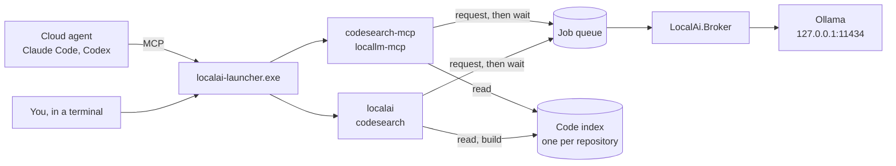
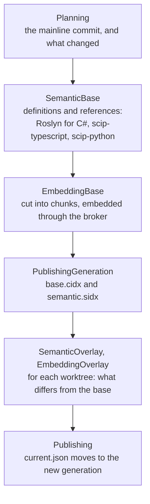
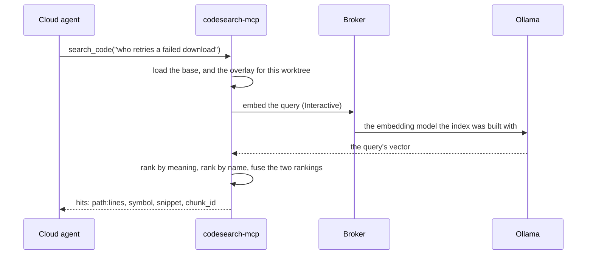
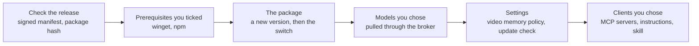

# Local AI Toolkit

**Local models that do the reading — for you, and for your cloud agent. A real saving in
cloud tokens, and in your own time.**

[Русская версия](README.ru.md)

[](LICENSE)

A cloud agent spends most of its tokens looking rather than thinking: opening candidate
files, searching the code, walking dependencies, scrolling a build log, describing a
screenshot, translating a page. Local AI does that part on your own machine and hands back
the answer, so the agent starts from a result instead of paying to find one.

**A cloud agent that answers a question by reading files pays for every file it opens. A
question answered from the local index brings back only the fragments that matched.**

A subscription to any cloud agent is optional: the same tools answer from the command line,
if you would rather work on your own.

<!-- contents:begin (generated, do not edit) -->
**Contents**

- [Two ways to use it](#two-ways-to-use-it)
- [What a cloud agent gets](#what-a-cloud-agent-gets)
- [What the command line gets](#what-the-command-line-gets)
- [Code search is not text search](#code-search-is-not-text-search)
- [With a cloud agent: what stops costing tokens](#with-a-cloud-agent-what-stops-costing-tokens)
  - [It works by default, and you can see it](#it-works-by-default-and-you-can-see-it)
  - [If something does not work the way you want](#if-something-does-not-work-the-way-you-want)
- [From the command line: not tokens, but time](#from-the-command-line-not-tokens-but-time)
- [How it works](#how-it-works)
  - [The pieces](#the-pieces)
  - [One queue in front of every model](#one-queue-in-front-of-every-model)
  - [The code index](#the-code-index)
  - [A search, step by step](#a-search-step-by-step)
  - [Which model does what](#which-model-does-what)
  - [How the saving is counted](#how-the-saving-is-counted)
  - [What the installer does](#what-the-installer-does)
- [Dependencies](#dependencies)
- [Installing](#installing)
  - [What it will compute on](#what-it-will-compute-on)
- [Using it with a cloud agent](#using-it-with-a-cloud-agent)
- [Using it from the command line](#using-it-from-the-command-line)
  - [Step 1. How to run anything](#step-1-how-to-run-anything)
  - [Step 2. Where to run it from](#step-2-where-to-run-it-from)
  - [Step 3. Connect a repository](#step-3-connect-a-repository)
  - [Step 4. Use it](#step-4-use-it)
- [What language it answers in](#what-language-it-answers-in)
- [Updating and removing](#updating-and-removing)
  - [Update](#update)
  - [Clear the index, keep the product](#clear-the-index-keep-the-product)
  - [Remove it entirely](#remove-it-entirely)
- [Impact evidence: C# pilot](#impact-evidence-c-pilot)
- [Documentation packages](#documentation-packages)
- [Building and testing](#building-and-testing)
  - [Independent quality corpora](#independent-quality-corpora)
- [Licence](#licence)

[Read it page by page](docs/README.md) — the same text, one section per page.
<!-- contents:end -->

---

## Two ways to use it

**As subagents to a cloud agent.** Claude Code, Codex and any other MCP client can call
Local AI's tools directly. The agent hands them the simple, repetitive work and starts from
prepared results, instead of doing that drudgery itself on cloud tokens.

**Without a cloud agent, from the command line.** The same capabilities, but as helpers for
you: search code by meaning, triage a log, read an image, translate a document. It is the
same index and the same models either way, so nothing is lost by starting here and adding an
agent later.


**Why there is a broker in the middle.** There is one per runtime directory —
`%LOCALAPPDATA%\LocalAi`, so one per Windows user — and it holds the queue.
That is how Claude, Codex and the command line all work at once without tripping over each
other, and why one model sits in video memory rather than four fighting over it.

**Nothing leaves the machine.** The broker sends your code and the prompts built from it to
Ollama at `http://127.0.0.1:11434/`, on this machine. Which network interfaces Ollama itself
listens on is Ollama's own setting. Left alone, the runtime makes no network calls at
all: the update check is off by default. Models and missing prerequisites are downloaded
when you ask for them.

---

## What a cloud agent gets

Twenty-three tools over MCP: twelve from `codesearch` and eleven from `locallm`. The agent
calls them itself, whenever a question is cheaper to ask locally.

| Tool | What it does |
| --- | --- |
| `search_code` | search by meaning and by exact name at once |
| `get_code_chunk` | pull a match in full |
| `go_to_definition` | where the symbol under the cursor is declared |
| `find_references` | who calls it and where it is used |
| `find_implementations` | who implements or overrides it |
| `find_relationships` | the relationship graph: implementation, override, type |
| `analyze_impact` | direct C# impact evidence with source coordinates, hashes and snapshot |
| `lsp_open_document` | hand navigation the text of an unsaved file |
| `lsp_close_document` | give navigation back to the indexed snapshot |
| `ask_local` | mechanical work over files you name |
| `triage_log` | make sense of machine output of any length |
| `read_image` | read images from disk or one PDF page by page |
| `index_documents` / `search_documents` | index scanned PDFs and find OCR phrases with file versions and page references |
| `translate_local` | translate, structure intact |
| `index_status` | whether an index exists, what built it, whether the mainline branch has moved since |
| `index_refresh` | refresh the index after a commit |
| `index_unload` | free the memory a loaded index holds |
| `local_models_status` | what is installed, what is resident, what is missing |
| `local_model_preflight` | prove where a model loads: entirely in video memory under the default policy |
| `local_models_sync` | fetch the recommended models that are missing |
| `local_model_experiment_report` | statistics for one task-and-model pair |
| `local_model_feedback` | decide a model's fate: promote, keep as fallback, disable |

## What the command line gets

Use `localai --help` or `codesearch --help` for the command list, and
`localai repo status --help` or `codesearch help search` for a command's syntax.
`help`, `--help` or `-h` before the command words, or `--help` or `-h` anywhere after them,
writes help to stdout and exits successfully; extra or unknown words after a leading `help`
are refused. `localai prune` and `localai update` also take `/?` as a request for their usage,
which they print to stderr with exit code 2.
Help follows the saved language or `LOCALAI_LANGUAGE` (`en` / `ru`). Existing JSON output
contracts are unchanged; `--json` requests a machine response rather than prose help.

The set is **not the same**: some tools exist only here, some only over MCP.

| Command | What it does |
| --- | --- |
| `codesearch search --query "…"` | the same search by meaning and by name |
| `codesearch get-chunk --id …` | pull a match in full |
| `codesearch status` | where the index is, whether it drifted, whether the repo is connected |
| `codesearch scan` | what would go into the index at all |
| `codesearch index` / `overlay` | build an index by hand, outside Local AI's management |
| `codesearch evaluate --cases …` | run the search-quality corpus |
| `localai semantic definition` / `references` / `implementations` / `relationships` | navigate by symbol |
| `localai semantic impact --path src/Type.cs --line 12 --json` | direct indexed C# references and incoming relationships |
| `localai ask "…" <file> …` | mechanical work over files |
| `localai triage <log>` | make sense of a log |
| `localai read-image "…" <file>` | read images or one PDF |
| `localai documents index` / `search` | build a PDF OCR index or find a literal phrase with source references |
| `localai translate --in <file> --from … --to …` | translate |
| `localai sync` | build or refresh the index |
| `localai hooks install` | install the hooks that keep the index current |
| `localai repo status` | whether a repository is connected |
| `localai doctor` | what is wrong with the installation, read-only |
| `localai diagnostics` | preview recorded diagnostics or save them as a ZIP |
| `localai hardware plan` | estimate model/context capacity from signed release metadata and this computer |
| `localai model status` / `pull` / `preflight` | models: installed, fetch, prove the fit |
| `localai policy show` / `set` | the model residency policy |
| `localai prune` | clear out stale generations and overlays, the queue archive, old telemetry, records of abandoned repositories and old versions |
| `localai telemetry` | a summary of local jobs |
| `localai update` | update the installation |

`localai sync --root <worktree>` prepares the requested worktree first. `SYNC_BASE`
reports whether the base is reused; `SYNC_PLAN` lists pending worktrees in processing order,
and `WORKTREE_PLAN` identifies reused or rebuilt overlays. `ACTIVE_READY` reports when
the requested tree can use the new generation, separately from the final sync duration.
Other worktrees continue using the previous generation until their overlays are ready.
Maintenance continues in the same sync process; do not start another sync while it runs.
An interrupted run keeps completed worktrees usable and can be restarted. An MCP wait
timeout alone does not prove that the sync failed: observe `localai repo status --follow`.

`codesearch evaluate --cases …` resolves C# symbol targets to their source declarations
before querying. Split chunks such as `[1/6]` and `[2/6]` belong to a single target. Use the
optional `signature` and `namespace` target fields to disambiguate names; signatures that
still match multiple declarations are rejected rather than scored. Path-only targets
continue to accept any hit in the specified file. These changes affect evaluation scoring;
search ranking and the calibrated threshold remain unchanged.

Evaluation corpora may include an optional `excludedPaths` list of repository-relative file
paths and directory prefixes ending in `/`. These are literal paths, not globs; either slash
style is accepted. When the `--cases` file is inside the repository, it is excluded
automatically; list other reference material explicitly. Exclusions apply before both vector
and lexical ranking. Normal search continues to include ordinary tests.

Exclusion paths must stay inside the repository and must not cover a declared relevant
target. Evaluation output records the source commit/tree and dirty-content hash separately
from the indexed commit/tree, plus the index generation/model, corpus SHA-256, resolved
annotations, search options, and effective exclusions. A run fails if its source snapshot,
index generation, or annotations change while it is running. Reproducing a dirty run also
requires retaining the uncommitted source files; a hash alone cannot restore them.

The [retained candidate-scope baseline](tests/CodeSearch.Tests/Fixtures/SearchEvaluation/baseline-candidate-scope-2026-09-16.json)
records Recall@10 72.2%, Precision@5 13.3%, and a 100% false-positive rate on six no-answer
cases. With one annotated target for each of the 18 answerable queries, Precision@5 has a
20% ceiling. These figures describe this 24-case corpus, not overall product quality;
thresholds remain unchanged. Concurrent broker work and unavailable queue/residency
telemetry make its timings unsuitable as an isolated performance benchmark. Independent
corpora were built in [#601](https://github.com/MrAliev/local-ai-toolkit/issues/601), now closed;
their baseline is under [Independent quality corpora](#independent-quality-corpora).

**Not on the command line.** `lsp_open_document` and `lsp_close_document` take the text of an
unsaved buffer — and in a shell there is no such buffer, so there is nothing to hand over.

**Not over MCP.** Seven commands are deliberately left to you, for three reasons:

**It already happens by itself — no need to call it.**

- `localai prune` — every successful sync removes the superseded generations, overlays and
  staging of the repository it synced, and says what it removed when it removed anything.
  `localai prune` does the same for every repository, and also clears the queue archive,
  telemetry past its retention, records of abandoned repositories, and old installed versions
  and launcher backups.
- `localai sync` — after a commit, checkout, merge or rebase the Git hooks installed by
  `localai hooks install` run it. The agent has `index_refresh`, which runs the same sync
  within a size bound: for edits saved but not yet committed, and after a commit no hook ran
  for. A cold build, or a branch switch that changes most of the tree, is refused with the
  command to run in the background instead.

**It is a product update, and it is run by hand.**

- `localai update` downloads the newest verified release, installs its binaries as a new
  version and switches the launcher to it. Models, prerequisites and client registrations are
  left as they are: clients reach the new version through the launcher they are already
  registered on. Run it when you choose to update. If the release also changes client
  instructions, run its `LocalAi.Installer.exe` with the relevant client selected: a
  runtime-only update does not rewrite those instructions.

**It is information for you, in a shape made for reading.**

The agent has no use for it in that shape — it gets a report line for every call it makes,
and `index_status` answers for the index. A person needs the wider picture:

- `localai doctor` — what is wrong with the installation: its version and files, the broker and
  its queue, the model catalog and whether each task has an installed model, the policy files,
  the last update check, and the repository you are in (or name with `--root`). Read-only; it
  starts nothing and repairs nothing.
  Each check ends `Ok`, `Warning`, `Unknown` or `Failed`. The verdict is `Failed` if any check
  failed, else `Warning` if any warned, else `Ok`; the exit code is 1 only for `Failed`.
  `Unknown` means this machine holds no trusted, current answer to what the check asks, and it
  changes neither the verdict nor the exit code. `task-models` takes the installed models from
  a list the broker records at start, every 15 minutes while it runs, and whenever it picks a
  model for a task or answers `localai model status`; when that list is more than 30 minutes
  old, the check is `Unknown`. `--json` returns the verdict with the counts `failed`, `warned`
  and `unknown`; an `Ok` verdict can come with `unknown` above zero.
- `localai telemetry` — distinct jobs, attempts, known workflows, and confirmed delivered
  calls. Model/profile tables show attempt outcomes and durations; cloud input/output
  comparisons have separate totals and known/unknown coverage.
- `codesearch scan` — what would be indexed at all. You look at it while setting a repository
  up, to see the size of the job, not while asking a question about code.
- `codesearch evaluate` — the search-quality corpus. A tool for developing Local AI itself,
  not for working with your code.

---

## Code search is not text search

A file is not sliced into equal slabs of text. It is **taken apart by declaration** — class,
method, function — and each of those gets its own chunk, with its name, its signature and its
exact lines. A declaration too long for one chunk — 6,000 characters with its header — is cut
into overlapping parts numbered like `[1/3]`. That is why a hit reads `OrderCloser.CloseAsync`,
or one numbered part of it, rather than a line that happened to match in the middle of
somebody else's method.

- **C#** is parsed by **Roslyn**, the same compiler that builds the project. It walks a real
  syntax tree. A type gets one chunk: its declaration and a line for each member — fields as
  written, everything else by its signature. Each method, constructor, destructor, operator,
  conversion operator and indexer gets a chunk of its own, and so does a property with real
  logic in it: an accessor with a body, or an expression body longer than 80 characters. A
  file that declares no type becomes one whole-file chunk.
- **TypeScript and Python** are mapped by the **SCIP** indexers, `scip-typescript` and
  `scip-python`. Where an indexer reports a declaration's extent, the chunk follows it; where
  it reports only the name, the chunk runs from that declaration to the line before the next
  one. Nothing is guessed from indentation.
- **Everything else** — markup, configuration, documentation, any language with no indexer —
  cannot be taken apart that way, so it gets an honest sliding window: 60 lines with 12 lines
  of overlap, so a thought is not torn in half at a seam.

One thing the index cannot see: a file you have edited but not saved. Navigation can still
answer for it, but only when an agent hands over the buffer's text — there is no such path
from the command line, and language servers stay off until you enable them.

---

## With a cloud agent: what stops costing tokens

It is not only about volume. A question asked in words rarely maps onto a keyword — and a
keyword is exactly what an agent is reduced to searching for when there is no index.

**Measured on this repository on 2026-09-06.** The question "who is subscribed to a broker
job finishing":

- Grepping for `Subscribe` finds **one file** under `src`, and it is not the answer.
- `search_code` returns `IBrokerQueue.CompleteAsync` and `BrokerJobPending` — neither of
  which contains the word "subscribe" anywhere. It matched by meaning.

| Question | Without Local AI: where the tokens go | With Local AI: where the tokens go |
| --- | --- | --- |
| "Who is subscribed to a job finishing?" | guess a keyword, open candidates whole — `DurableQueue.cs` alone is 52 KB, about **13 100** tokens at four bytes a token, and not the answer yet | three fragments, with paths and line ranges |
| "How does the order pipeline work?" | read every file mentioning "Order" and assemble the picture yourself | a fragment per link in the chain, each with its place |
| "What does this codebase do?" | read all of it | index once, then ask |

The difference is not that the agent reads faster. It is that **only the fragments that
matched enter its context**, and the hunt through candidates is paid for by your GPU rather
than by your subscription.

### It works by default, and you can see it

**Nothing to switch on.** The installer tells the agent these tools exist and that they come
first. From there the agent decides for itself: it sees a "where does this live" question and
reaches for `search_code` instead of opening files.

**Runtime token reports use one shared record per call.** MCP tools and both CLIs, except for
`localai model` commands, show one estimate: “Approximately N cloud tokens saved.” It is the
input savings plus output savings for the same call. If the result is negative, the notice
says “No token savings; approximately N additional cloud tokens”, without a negative counter.
If either part is unknown, the total cannot be estimated; administrative calls are inapplicable.
For example, 1,000 fewer input tokens and 40 additional output tokens means about 960 saved.
This is a comparison with doing the same work in the cloud, not account usage or a bill.
The detailed signed counts and tokenizer/vision profiles remain in the JSON report.

`localai sync` announces each indexing phase and repeats its current status every 15 seconds.
Known work reports completed/total and a percentage for that phase; embeddings also report
rate and ETA. Work with no known total reports its activity and elapsed time, without an
invented percentage. `localai repo status --follow` uses the same phase descriptions.
The shared method compares cloud input and output separately. It requires an explicit
alternative reading scenario, source provenance, the complete returned payload, and a named
tokenizer or vision profile. Previously retrieved text and overlapping chunks are not counted
twice. Missing evidence produces `unknown` with a reason; unsupported image profiles do not
fall back to a universal area formula.

Existing numeric response fields retain their JSON shapes. New broker attempt records use
schema 2, with attempt/workflow identities, observed backend counts where available, and the
residency proof of the load the attempt ran on. A model's offload in the call report comes
from its own attempt's proof or, when the attempt carries none, from the job receipt's proof
for the same model and context. Without either it is `unknown` with a reason:
`no_residency_check` for a job whose receipt carries no routing, such as embeddings, and
`not_recorded` otherwise. A proof made for another model or context is never used.
Attempts cannot prove delivery or cloud savings: their versioned value is `unknown`, and
their legacy scalar savings fields are zero. Older telemetry remains readable; its unsupported
scalar estimates are excluded from totals. Final call reports are stored separately, once
per call, and account for the complete returned volume. Multiple jobs in one call do not
multiply its savings. Incompatible comparison profiles are not summed. `localai prune`
applies the telemetry retention policy to both attempts and final reports.

MCP results carry schema-versioned data in `_meta["localai/usage"]`. Text tools include the
notice outside untrusted-content boundaries; JSON tools keep their content unchanged as the
first block and add the notice after it as a separate text block, with the same text in
`_meta["localai/usageNotice"]`. Cancellation remains protocol cancellation. Supply a unique
GUID in request `_meta["localai/callId"]` before starting a cancellable call, then retrieve
the partial report with `localai telemetry --call-id <guid>`.

CLI stdout keeps its existing text or JSON contract; the compact report goes to stderr.
The installer's version-one `localai model` protocol permits no extra stderr records other
than the reason a command failed with `broker_failure`, so those reports are only persisted.
Reports are stored at `%LOCALAPPDATA%\LocalAi\telemetry\usage`; they contain technical
measurements and identifiers, never prompts or document contents.
A storage failure preserves the command result and is reported separately where the protocol
permits it.

Response size counts the full serialized MCP result, including its notice and metadata,
or all CLI stdout/stderr text in UTF-8. JSON-RPC framing is outside this boundary. The
self-inclusive MCP calculation is bounded; nonconvergence produces an unknown size.
Delivery records a completed file write or handoff to the output surface, not acknowledgement
by a remote client. Missing measurements remain unknown; partial reports describe the
evidence available at cancellation. An `index_memory_cache` hit describes cached index data
and does not imply that inference was skipped.

The [synthetic calibration corpus](tests/Fixtures/TokenCalibration/corpus.json) has
[reference counts and comparison results](tests/Fixtures/TokenCalibration/reference.json)
from tiktoken 0.12.0 for `cl100k_base` and `o200k_base`. It covers EN/RU, code, mixed text,
an empty input, a long response, source/path/outPath, prior and repeated reads, PNGs, and a
two-page PDF. Error statistics describe this corpus and these encodings; they do not establish
a universal tokenizer or provider-reported usage. The long sample repeats shorter fixtures
to exercise response size, not to add independent language coverage.

Image references use the [documented `gpt-4o` tile formula](https://developers.openai.com/api/docs/guides/images-vision) and are labeled formula estimates.
PDF references include text counts but leave the full input unknown because provider page
rendering is not observed. Unsupported vision profiles remain unknown at runtime. Character
estimates have no statistical interval; the search evaluator's existing numeric bounds are
explicitly labeled `heuristic_not_confidence_interval` in the versioned
`responseTokenEstimatePolicy` companion. Calibration does not replace comparison scenarios,
source provenance, delivery evidence, or complete response accounting.

To reproduce the references, install `tiktoken==0.12.0` and run
`python tools/calibrate-tokens.py --verify`. tiktoken may download its encoding tables on
first use; the script calls no model or provider API. `--write` deliberately
regenerates the synthetic assets and reference JSON. The normal .NET suite checks the retained
measurements, scenario arithmetic and report privacy without Python, a network connection, or a GPU.

### If something does not work the way you want

Nothing is nailed down — the settings live in `%LOCALAPPDATA%\LocalAi\settings`:

| What to change | How |
| --- | --- |
| The model for a kind of task | `model-routing.json` — its own chain of models per profile: `CodeAnalysis`, `LogTriage`, `VisualAnalysis`, `PlainTranslation` and a dozen more |
| The model for a single call | `localai ask "…" <file> --model <model>`, or `--profile <profile>` |
| A model's fate after a trial | `local_model_feedback`: promote it, keep it as a fallback only, or disable it for that task |
| Where a model is allowed to sit | `localai policy set --residency` — wholly in video memory, with offload, or on the processor |
| How long a model stays loaded | `localai policy set --idle-model-keep-alive-seconds` |
| Take the tools away from a client | unregister the MCP servers from Claude or Codex — the agent then simply does not see them |

To choose models for each task, copy the complete [model-routing.json](model-routing.json)
from the repository root to `%LOCALAPPDATA%\LocalAi\settings\model-routing.json`.
Edit `Candidates` and `Fallbacks` in the relevant `Routes` entry; declare any added
model in `Models`. This file replaces the complete catalog. Keep `SchemaVersion` at
`1`, a non-empty `CatalogVersion`, and one route for every task profile.

Without this file, Local AI reads the built-in catalog. An invalid file reports an
error instead of falling back to defaults. Run `localai doctor` to check the file
and see its calculated version: `custom-` followed by a content hash. Formatting
changes do not change that version. Use `localai policy show` to inspect the other
policies.

Translation retries use the ordered `Fallbacks` for `PlainTranslation` or
`TechnicalTranslation` from one catalog snapshot. Every fragment carries that
snapshot's version; a broker with a different catalog rejects it before loading
or running a model. Apply the saved catalog as described below, then retry.

To apply the saved catalog, let active local calls finish and run `localai doctor`.
If its `model-catalog` check passes, run `localai-launcher.exe stop`. This stops
the broker and all running Local AI tools belonging to the active installed version,
including its MCP servers. Reconnect the MCP servers in your client, or restart
the client if needed. The next local task starts the broker with the saved catalog.

**The limits, stated plainly — and who closes them.** Local models are markedly weaker than
cloud ones. They are good at *list this*, *summarise that*, *where does this live* — and
unreliable on architecture and subtle bugs.

Paired with an agent, though, none of that is left to luck: **the local model finds, the
cloud one judges**. A local answer reaches the agent as material rather than as truth — with
paths and line ranges it uses to open the source and check for itself. A local model's
mistake costs one extra read, not a wrong conclusion.

The product helps: every answer is signed with its model and its duration, and one produced
without enough video memory is marked, so a degraded answer cannot pass for a healthy one.

On the command line that second layer is missing: there, you are the judge. So verify
anything a decision rests on, in the code.

---

## From the command line: not tokens, but time

There is no bill here and nothing to save — you are doing the work yourself. The point is
elsewhere.

**You do not have to remember what the thing is called.** Ask the way you think: "where is
it decided how long to wait before retrying", "what happens when a download is cut off". You
cannot put that question to grep.

**The answer comes with coordinates.** Not "here is a file", but a path, a line range and a
symbol — open it exactly where it matters.

**The dull work leaves your hands.** Triage a thousand-line log, pull out the TODOs, read a
screenshot of an error, translate a document — one command each, while you do something
else.

**And it works with no internet.** A train, a plane, a VPN that is off: the models are on
disk.

---

## How it works

Local AI is a few small programs around two things it keeps on your disk: one queue of work
for the local models, and one code index per repository. This section follows a request
through them.

### The pieces



- **The launcher**, `%LOCALAPPDATA%\LocalAi\bin\launcher\localai-launcher.exe`, is the one
  path everything is registered against. `run <tool>` reads `bin\current.json` and starts the
  tool from the version it names under `bin\versions`, and it starts exactly four:
  `localai`, `codesearch`, `codesearch-mcp` and `locallm-mcp`. An update adds a version and
  moves the pointer, so nothing that points at the launcher has to change.
- **The MCP servers** are what Claude Code and Codex start. The installer registers them as
  `localai-launcher.exe run codesearch-mcp` and `run locallm-mcp`: twelve code-search tools
  and eleven local-model tools.
- **The broker**, `LocalAi.Broker`, is the only program that talks to Ollama. Nothing installs
  it as a service: the first tool that needs a model starts it in a hidden window, and it
  stays. There is one per runtime directory; a second copy finds the first one's lock and
  leaves.
- **The job queue** is a set of folders under `%LOCALAPPDATA%\LocalAi`. A tool writes its
  request there and waits for the answer; the broker takes the requests from it.
- **Ollama** runs the models, at `http://127.0.0.1:11434/` unless the broker is started with
  another address.

### One queue in front of every model

Every model call goes through the same queue — a search query, the embeddings of an index
build, a question to `ask_local`. That is how Claude, Codex and the command line use the
models at once without loading them over each other.

Each request carries a priority. A search query is `Interactive`, a question to a local model
is `Foreground`, and the embeddings of an index build are `Background`. The broker picks the
next job by priority first, then by whether its model is already in video memory, then by
the shortest expected job:

- a question you are waiting on does not queue behind an index build; it costs a model swap,
  and the trade is deliberate;
- among jobs of equal urgency, the model already loaded keeps working;
- a job that has waited long enough goes first whatever its priority;
- before it switches models, the broker waits a moment for more work for the same model.

Two identical requests that arrive while the first is still queued or running become one job.

By default a model has to fit entirely in video memory, and one that does not is refused
rather than run slowly. `localai policy set --residency` relaxes that, and an answer produced
under a relaxed policy names its shortfall beside the model.

### The code index

`localai sync` builds it — whether you run it, a Git hook runs it, or the agent calls
`index_refresh` — in this order:



- **The base** is built from a snapshot of the mainline commit: the branch the repository's
  manifest names, otherwise `dev`, otherwise `main`. Definitions come first on purpose, since
  a failed indexer aborts the build and should do so before the long embedding phase is paid
  for. An interrupted build resumes from its checkpoint.
- **An overlay** belongs to one worktree in one state — its tree and its uncommitted edits —
  and holds only the files that differ from the base, with the list of those it deleted. A
  search lays it over the base, so a branch costs its diff rather than a second index.
- **Chunks.** C# is parsed by Roslyn. Each type gets a chunk with its doc comment, its
  declaration and a one-line summary of every member; each method, constructor, operator,
  indexer and property with a real body gets its own. Fields and auto-properties stay in the
  type's chunk. TypeScript, JavaScript and Python files are cut on the definitions the SCIP
  indexers found. Everything else is cut into windows of 60 lines that overlap by 12.
- **Vectors** come from `qwen3-embedding:8b-q8_0`, 4096 numbers per chunk, at `Background`
  priority. The model is written into the index, and a search embeds its query with that
  model and no other.

On disk it lives under `%LOCALAPPDATA%\LocalAi\repositories\<id>`. The id comes from the
repository's Git common directory, so every worktree and every client share it.

| Path | What it holds |
| --- | --- |
| `current.json` | which generation is live |
| `generations\<generation>\` | `base.cidx`, `semantic.sidx`, and `manifest.json` with their checksums |
| `overlays\<generation>\<worktree>\<tree>\` | one overlay per worktree state; `clean` when nothing is uncommitted |
| `staging\` | a build in progress, and the checkpoint it resumes from |

### A search, step by step



- The base and the overlay must come from the same model and the same base commit;
  otherwise the search refuses rather than answer from code that is not there.
- **By meaning:** the cosine similarity between the query's vector and every chunk's.
- **By name:** each word of the query scores 3 in a chunk's symbol, 2 in its signature, and 1
  in its text or its path.
- The top 250 of each ranking are fused by reciprocal rank (k = 60). That is why one query
  finds both what you described and what you named.
- If the query cannot be embedded, the search answers from the ranking by name alone, and
  the answer records that no embeddings were used.

### Which model does what

`model-routing.json` holds the routes; the candidates are tried first, the fallbacks after.

| Profile | Used by | Candidates | Fallbacks |
| --- | --- | --- | --- |
| `VectorEmbedding` | the index and search queries | `qwen3-embedding:8b-q8_0` | `qwen3-embedding:8b-q8_0` |
| `ShortSummary` | `ask_local`, by default | `qwen3.5:9b`, `qwen2.5-coder:14b` | `qwen2.5-coder:14b`, `qwen3.5:9b` |
| `Extraction` | `ask_local` | `qwen3.5:9b`, `qwen2.5-coder:14b` | `qwen2.5-coder:14b`, `qwen3.5:9b` |
| `Classification` | `ask_local` | `qwen2.5-coder:14b`, `qwen3.5:9b` | `qwen3.5:9b`, `qwen2.5-coder:14b` |
| `CodeAnalysis`, `CodeReview` | `ask_local` | `gpt-oss:20b`, `qwen2.5-coder:14b` | `qwen3.5:9b` |
| `MultiFileSynthesis`, `Planning` | `ask_local` | `gpt-oss:20b`, `qwen3.5:9b`, `qwen2.5-coder:14b` | `qwen3.5:9b`, `qwen2.5-coder:14b` |
| `LogTriage` | `triage_log` | `qwen2.5-coder:14b` | `qwen3.5:9b` |
| `VisualAnalysis` | `read_image` | `qwen3-vl:8b-instruct-q8_0` | `qwen3.5:9b` |
| `Ocr` | `read_image` | `qwen3-vl:8b-instruct-q8_0`, `glm-ocr:bf16` | `qwen3-vl:8b-instruct-q8_0`, `qwen3.5:9b` |
| `ImageTranslation` | `read_image` | `qwen3-vl:8b-instruct-q8_0` | `translategemma:12b`, `qwen3.5:9b` |
| `PlainTranslation` | `translate_local`, plain text | `translategemma:12b` | `qwen3.5:9b` |
| `TechnicalTranslation` | `translate_local`, markdown | `translategemma:12b` | `qwen2.5-coder:14b`, `qwen3.5:9b` |

### How the saving is counted

Every answer ends with a line naming the model, the time it took and the cloud tokens it
saved. The saving compares two ways of getting the same answer:

- **Input.** Without the tool, the cloud agent would have read the sources itself: the files,
  the log, the image. With it, the agent reads its own call and the whole answer. Text is
  counted with the `o200k_base` tokenizer, images with the GPT-4o tile formula; both names
  are printed in the line.
- **Output.** What the local model wrote is what the agent would otherwise have written,
  against the call it writes instead.
- The count assumes the agent had not read the sources yet. A caller that already has them
  says so with `sourceContext: AlreadyPresent`, and that part is not counted.
- It is an estimate, labelled as one, and it is not what your account was charged.

### What the installer does



- The release manifest is signed with ECDSA P-256 and checked against the key built into the
  installer; the package has to match the manifest.
- Prerequisites are installed machine-wide, only the ones you ticked, and Local AI never
  removes them: other programs may depend on them.
- Every step goes into a run journal. A run cut off halfway is reported the next time the
  installer starts, with an offer to undo what can be undone, and two runs cannot overlap.
- Removal takes Local AI out in this order: its processes, its entries in the client
  configurations, the Git hooks, its files, the PATH entry, the Apps & features entry, and
  the uninstaller's own copy last.

---

## Dependencies

The installer checks each one. Git, Ollama, the GitHub CLI, the .NET SDK, Node.js and Python
it offers to install through WinGet, and the two SCIP indexers through npm once Node.js is
there; where WinGet is missing, it names each one's official download page instead.

**Without these it does not work at all:**

| | Why |
| --- | --- |
| **Windows** | Windows 10 or 11 on x64; the installer reports anything else as unsupported |
| **Git** | a repository is identified by its git directory, and the hooks live there |
| **Ollama** | every model runs on it; Local AI only ever reaches it through the broker |
| **A GPU the model fits in** | under the default policy, `RequireFullVram`, a model that does not fit entirely in video memory is refused rather than run slowly. The policy can be relaxed — see below |

**Needed per language — search works without them, but coarser:**

| | Why |
| --- | --- |
| **.NET SDK 10** | the C# semantic index behind precise navigation is built by loading the solution through the installed SDK. Cutting C# into types and members does not need it: Roslyn does that inside Local AI |
| **Node.js 20** + **SCIP TypeScript** | declaration-level chunking for TypeScript and JavaScript |
| **Python 3.10+** + **SCIP Python** | declaration-level chunking for Python |

**Optional:**

| | Why |
| --- | --- |
| **GitHub CLI** | used only when the anonymous HTTPS download of a release fails — a private repository, or a release host that is unreachable while the API is not. The installer tries HTTPS without an account first, and installing from a folder needs neither |

The residency policy can be relaxed deliberately: `localai policy set --residency
AllowPartialOffload` or `AllowCpu`. A model that then runs partly or wholly outside video
memory is marked `[partial_offload]` or `[cpu]` beside its name in the call's report line.

---

## Installing

Install a signed package from [GitHub Releases](https://github.com/MrAliev/local-ai-toolkit/releases/latest).
Installing a published release requires neither a .NET SDK nor the private release signing key.

**1. Download the release.** From the same release, download `LocalAi.Installer.exe`,
`release-manifest.json`, `release-manifest.sig` and `localai-package.zip`. Keep the three
package files together and point the installer's package page at that folder. The installer
verifies the manifest against its built-in release key before accepting the package.

**Optional: build from source.** This is for maintainers with the release signing key.
It needs `pwsh` 7 and a .NET 10 SDK of version 10.0.302 or later (`global.json` pins it).
Choose the intended build version in place of this example:

```powershell
pwsh scripts/publish-localai-release-win-x64-self-contained.ps1 -ReleaseVersion 0.2.2 -SignManifest
```

You get the installer at `publish/LocalAi.Installer/LocalAi.Installer.exe` and the release
folder `publish/release`: the package, and the manifest and signature that `-SignManifest`
writes with the release signing key. Without `-SignManifest` there is no manifest, and the
installer will not take the folder. Point the installer's package page at `publish/release`.

Add `-CompressBinaries` to reduce executable size on disk, with a possible startup penalty;
compression is off by default. Both modes remain self-contained: the bundled .NET runtime,
package layout, native libraries and validation rules are preserved. Existing language-tooling
requirements remain unchanged.

The first Windows x64 pilot (2026-09-23, SDK 10.0.401, source `ac6b47fc3dd0`) compared otherwise
identical `0.0.0-size` builds. Runtime artifacts, including the launcher and native libraries,
decreased **573.57 → 287.31 MiB (49.9%)**. The folder-install payload (installer + ZIP, excluding
small manifest/signature files) decreased **386.27 → 308.75 MiB (20.1%)**; the ZIP alone decreased
249.54 → 244.87 MiB. Five alternating launches per variant used a new process, an empty bundle
extraction directory, a PATH containing only System32, and an unavailable global .NET root:

| Startup path | Uncompressed median | Compressed median |
| --- | ---: | ---: |
| `localai --help` | 168.606 ms | 228.417 ms |
| `codesearch --help` | 161.615 ms | 208.985 ms |
| launcher usage refusal | 31.951 ms | 66.372 ms |
| broker usage refusal | 38.803 ms | 78.899 ms |
| CodeSearch MCP initialization | 226.948 ms | 290.966 ms |

Usage output and MCP initialization/tool descriptions matched across variants; these entry
points started without a global SDK/runtime. The OS file cache was **not** cleared, so these
are process/extraction-cache cold starts, not a clean-boot measurement. Installer UI startup
and a clean-machine offline installation remain part of final acceptance (#618); the opt-in
pilot does not replace it. Both ZIPs passed the
production package verifier with an ephemeral test trust key, without modifying the installed
runtime or using the release signing key. Measurements and artifact hashes are retained in
[results.json](scripts/quality/standalone-size/results.json); reproduce the comparison with
[compare.py](scripts/quality/standalone-size/compare.py) after publishing two distinct output
folders with identical release/version arguments, adding `-CompressBinaries` only to the second.
This is a storage/startup tradeoff, not a cloud-token savings measurement.

### What it will compute on

The product is built for a graphics card but does not demand one. What you get is your
choice at install time — you pick the residency policy — and it can be changed later with
`localai policy set --residency`.

| Policy | Where the model lives | Speed |
| --- | --- | --- |
| `RequireFullVram` — the default | entirely in video memory | measured on the development machine during a full build of this repository: embedding **12.4–12.9 chunks/s** (#389) |
| `AllowPartialOffload` | part in video memory, part in system memory | in the product's own words, **slower**. Needs an adapter that holds at least part of the model: a load is accepted only when Ollama reports some of it in video memory |
| `AllowCpu` | entirely on the processor | **substantially slower**, but it works without a usable adapter |

The first row is the measurement recorded in #389. For the other two I have no numbers, and
did not invent any: those are the words the product itself uses for these modes in the usage
text of `localai policy`, which it prints for an argument it does not recognise.
`localai policy show` names the current policy and, when it is relaxed, warns that responses
may be substantially slower than a fully resident load.

**The ceiling is one card, not the sum.** When Local AI estimates whether a model fits in video
memory — on the installer's models page and in `localai hardware plan` — it counts only the
card with the most dedicated video memory and never adds cards together: two 4 GB cards are
planned as one 4 GB card. After a model loads, the broker compares one figure Ollama reports,
how much of the model is in video memory, with the model's size, and does not look at which
card holds it.

**2. Run the installer.** The wizard walks through:

- the language: it starts in the one you chose last time, otherwise in Russian on a Russian
  system and English on any other, and the English/Русский links on every screen switch it;
- which prerequisites are missing — and installs the ones you pick;
- which models to install — it offers the ones that fit your card;
- which agent clients to register — Claude Code, Codex.

It registers the MCP servers with those clients and adds an instruction block to
`~/.claude/CLAUDE.md` and `~/.codex/AGENTS.md`, so the agent knows these tools exist and when
to reach for them.

Check the finish screen before continuing: package installation, model validation and each
client's configuration have separate results. A copied package alone does not establish that
models or clients are ready. After cancellation or a partial failure, the screen explains the
next action and whether recorded changes can be rolled back. Technical logs retain their
original text; save the report, or copy the log if saving failed, before closing the window.

Removal also saves its result outside the runtime directory. If it stops partway through,
the report distinguishes completed, failed, unknown, not-started and retained items from the
execution journal. You can open its folder, save another copy or copy the details. Deleted
data is not automatically restored; continue to a clean installation only after removal succeeds.

**3. Connect a repository.** Indexing is opt-in per repository — nothing is read until you
ask.

```powershell
& "$env:LOCALAPPDATA\LocalAi\bin\launcher\localai-launcher.exe" run localai sync --root <repo>
& "$env:LOCALAPPDATA\LocalAi\bin\launcher\localai-launcher.exe" run localai hooks install --root <repo>
```

The first build reads the whole repository and prints its progress in figures. After that the
hooks keep the index current after a commit, checkout, merge or rebase.

**4. Check it landed.**

```powershell
& "$env:LOCALAPPDATA\LocalAi\bin\launcher\localai-launcher.exe" run localai doctor
```

---

## Using it with a cloud agent

Nothing else to set up: the installer has registered the MCP servers and told the agent when
to use them. From there the agent decides — it sees a "where does this live" question and
reaches for `search_code` instead of reading files.

What is worth knowing so it works fully rather than halfway:

**Ask in words, not in names.** "Where is it decided how long to wait before retrying" beats
guessing a class name. Questions like that are exactly where an index beats grep.

**Uncommitted edits are visible, but not by themselves.** The index catches up on command:
`index_refresh` from the agent, or `localai sync` by hand. After a commit the hook does it.

**A refusal is not a breakage.** "No overlay matches this worktree" means the tree moved and
the index is behind; the answer is to build it, not to route around it.

**Verify anything a decision rests on.** A local model is wrong more often than a cloud one,
and the product does not hide it: every answer is signed with its model and its duration.

---

## Using it from the command line

### Step 1. How to run anything

Everything goes through the **launcher** — the stable entry point that does not move when the
product updates. The version directory under `bin\versions\` changes with every release, so
never write a path into it, neither in a script nor in a client:

```powershell
& "$env:LOCALAPPDATA\LocalAi\bin\launcher\localai-launcher.exe" run <command>
```

To stop repeating that, make an alias for the session:

```powershell
function lai { & "$env:LOCALAPPDATA\LocalAi\bin\launcher\localai-launcher.exe" run @args }
```

The examples below use `lai <command>`.

### Step 2. Where to run it from

**From anywhere.** Commands that work on a repository take `--root`:

```powershell
lai localai repo status --root C:\work\myapp
```

With no `--root`, the repository containing the current directory is used. So this works too:

```powershell
cd C:\work\myapp
lai localai repo status
```

**A worktree is the same repository.** A repository is identified by its shared git
directory, so all of its worktrees, Claude, Codex and the command line see one index. But for
a build, point `--root` at **the tree you are editing**: an overlay is built for one exact
state of the files.

### Step 3. Connect a repository

Indexing is opt-in per repository. Until you ask, nothing is read.

```powershell
lai localai repo status --root C:\work\myapp
```

```
NOT_CONFIGURED: C:\WORK\MYAPP\.GIT — offer CodeSearch, LocalLm, shared broker, mainline generations, branch overlays, hooks, Claude MCP and Codex MCP.
```

Connect it and install the hooks:

```powershell
lai localai sync --root C:\work\myapp
lai localai hooks install --root C:\work\myapp
```

The first build reads the whole repository and prints its progress in figures: chunks
embedded out of the total, the rate and an estimate of the minutes left. You do not have to
watch the window: `localai repo status --follow` shows the phase and its figures while it
runs.

From then on the hooks keep the index current by themselves: after a commit, checkout, merge
or rebase. Hooks you already had are not overwritten — Local AI joins the chain and calls them
first.

Check:

```powershell
lai codesearch status --root C:\work\myapp
```

### Step 4. Use it

The full list of commands is in the [What the command line gets](#what-the-command-line-gets)
table. Here is what they look like in use.

#### Find code by meaning

```powershell
lai codesearch search --query "who is subscribed to a broker job finishing" --top 3
```

What it printed on 2026-09-06; line numbers and scores move as the code changes:

```
src\LocalAi.Broker.Core\DurableQueue.cs:1318-1323  [Method]  cos=0.616
  IBrokerQueue.CompleteAsync
  Task CompleteAsync( Guid jobId, string workerId, Guid leaseId, JsonElement body, …)
  chunk_id: cs1.AUAwZWNjOTAx…

src\LocalAi.Contracts\LocalRunObserver.cs:27-27  [Type]  cos=0.604
  BrokerJobPending
  public sealed record BrokerJobPending(bool Running): LocalRunStep
  chunk_id: cs1.AUAwZWNjOTAx…
```

The word "subscribe" appears nowhere in the code that was found — it matched by meaning.
`cos` is how close; `chunk_id` goes to `codesearch get-chunk` to pull the fragment in full:

```powershell
lai codesearch get-chunk --id cs1.AUAwZWNjOTAx…
```

#### Walk from a symbol

Once you have a place, keep going with navigation rather than another search. Lines and
columns count from one — exactly as search prints them and an editor shows them. Pass the
start line a hit prints; for `CompleteAsync` that is line 1392 today:

```powershell
lai localai semantic references --path src/LocalAi.Broker.Core/DurableQueue.cs --line 1392 --column 1
lai localai semantic implementations --path src/LocalAi.Broker.Core/DurableQueue.cs --line 1392 --column 1
```

#### Ask about files you already know

```powershell
lai localai ask "List the public members of this class, one per line." src/CodeSearch.Core/Chunking/GenericTextChunker.cs
```

For extraction/classification, opt into a checked flat JSON object with
`--profile Extraction` (or `Classification`) and `--schema contract.json`.
MCP `ask_local` accepts the same JSON as the optional `outputSchema` string.
For example, classify a supplied issue into `bug` or `question` with this contract:

```json
{"schemaVersion":1,"fields":[{"name":"label","type":"String","allowedValues":["bug","question"]}]}
```

```powershell
lai localai ask "Classify this issue." issue.txt --profile Classification --schema contract.json --json
```

Version 1 is a bounded flat-object contract, **not general JSON Schema**: up to 64
case-sensitive fields, `String`, `Integer` (signed Int64), `Number`, or `Boolean`;
`required` defaults to true, `allowedValues` is an exact string enum. Nested values,
nulls, extra/duplicate fields, code fences and extra prose fail validation. The schema
is limited to 32,768 characters and the response to 1,048,576 characters. Unknown
schema keywords are rejected before inference. Cancellation is preserved.

The broker checks each attempt, including fallback. With `--json`, success adds
`data.validation`, and a rejected result exits 65 with `error.code=result_rejected` and
`error.validation` and no answer data. Without `--json`, success prints `validation: <status>`
on stderr, and a rejected result exits 65, prints `result_rejected:` with the validation on
stderr and nothing on stdout. MCP returns `{answer,validation}` inside its untrusted-content
boundary. Statuses are `Valid`, `Empty`, `InvalidJson`, `SchemaMismatch`; only `Valid`
carries a parsed `value`. Rejected output earns no cloud-token savings estimate.
**Valid means the structure matches, not that the classification or extracted facts
are correct**: check them against the supplied source. Without a schema, legacy
CLI/MCP output is unchanged and the broker records `NotRequested`. This opt-in feature
requires an updated broker as well as the client. Full translation retains its own
validator; a broker success does not replace it.

The model's answer is written to stdout. A separate usage notice on stderr identifies the
call and the models actually used, reports elapsed time, and shows cloud INPUT and OUTPUT
token savings separately. Runtime calls use a **conditional first-read comparison**, not
account billing: INPUT is the tokenized source units minus the arguments and full response;
OUTPUT is the validated, delivered local answer minus the generated tool request. Either
difference can be negative; an unsuccessful, invalid or undelivered result earns no savings
estimate. A later cloud answer and transport framing outside that payload
are excluded from both sides. MCP counts its serialized request/result, including metadata;
CLI counts serialized arguments and stdout followed by stderr, including the usage notice.
These representations are explicit proxies, not a measurement of a client's model context.

Text uses the bundled `microsoft-ml-tokenizers-2.0.0:o200k_base` vocabulary, checked against
independent reference counts. Images use `openai-gpt-4o-tiles-v1` at high detail; PDF comparisons
use the rendered page images, not a provider's native PDF upload. Neither profile claims to
match the cloud model used by your account. Duplicate source units within a call count once;
triage counts unique fragment text without overlap. Search compares reading only the files
behind valid hits, not the entire repository. Missing evidence remains unknown with a reason;
administrative operations and code-only translation report not applicable.

The default `NotPresent` assumption means the source has not entered the cloud context.
For an already read source, pass `sourceContext: "AlreadyPresent"` to the supported MCP tool,
or `_meta: {"localai/sourceContext":"AlreadyPresent"}` on the request. Use `"Unknown"` if
context presence cannot be established. CLI uses `LOCALAI_SOURCE_CONTEXT` with the same values.
There is no cross-call context ledger: callers must supply this information on repeated reads.
Only counts, profile IDs and the scenario are persisted, never source/answer text. CLI response
capture is bounded to 8 Mi characters per stream; exceeding it makes the response token count
unknown. Existing JSON fields remain compatible; the canonical usage report and notice carry
this comparison, while older task-specific scalar estimates retain their legacy meaning.
Evidence is bounded to 16,384 distinct source units per call; longer streams report
`source_evidence_limit` instead of crediting a partial baseline.

#### Triage a log

```powershell
lai localai triage build.log --question "why did the build fail"
```

Reads a log file of any length. It goes through the models the routing catalog names for log
triage in route order — candidates, then fallbacks — and for each installed one trial-loads its
context sizes from largest to smallest, up to the limit in `log-triage.json`, until the broker
accepts a load (by default, only when the model loads entirely into video memory). It then
works through the file in pieces sized to the accepted context.
It takes a stream too, so the log need not be saved at all:

```powershell
dotnet build 2>&1 | lai localai triage -
```

#### Read an image, translate a document

```powershell
lai localai read-image "What error is on this screenshot, and in which window?" C:\shots\error.png
lai localai translate --in docs\notes.md --from Russian --to English --markdown --out docs\notes.en.md
```

`read_image` and `localai read-image` also accept one PDF, up to 256 MiB.
Pass its path without other files and without `--together`. Pages are rendered
and sent to the model one at a time. In OCR mode, each page's reading is returned
in full, in source order, under a numbered page heading. Other modes merge the
page answers. The console reports the current page and total; the final notice
names the file and the number of pages read. PDFs have no eight-page limit.

Use `--pages "1,3-5"` (MCP: `pages: "1,3-5"`) to read selected PDF pages.
Numbers start at one and ranges include both ends. Pages are processed in document
order without duplicates, keeping their original numbers in headings and progress.
Only selected pages are rendered. Invalid ranges or numbers beyond the document
are refused before calling a model. Omit the option to read every page.

```powershell
lai localai read-image "Transcribe the text" manual.pdf --profile Ocr --pages "1,3-5"
```

For PDF OCR, add `--out transcript.txt` (MCP: `outPath`) to save the complete UTF-8
transcript and receive a short file pointer. The output directory must already
exist. An existing output file is replaced atomically after every selected page
finishes; errors or cancellation keep the old file. The source PDF cannot be the
output. Nothing is silently shortened or returned inline on a write failure.
File contents remain untrusted data. Without an output path, OCR returns the
transcript inline as before.

Add `--checkpoint ocr-progress` (MCP: `checkpointDirectory`) to resume PDF OCR.
Repeat the same request after a stop: completed pages are loaded from disk without
rendering or calling a model again; only unfinished pages are processed. A fully
completed session can publish the transcript to another output file without inference.
The checkpoint contains page text and receipts, and allows only one active writer.
Use an empty directory for a new session and keep the output file outside it.
Changes to PDF bytes, selected pages, question, language, model override, routing
catalog or processor build are refused; use a new directory for those requests.
Each checkpoint record is limited to 4 MiB; oversized records fail without truncation.

```powershell
lai localai read-image "Transcribe the text" manual.pdf --profile Ocr --checkpoint ocr-progress --out transcript.txt
```

Pages are rendered at up to 150 DPI, with at most 4 million pixels per page.
Encrypted or malformed PDFs report an error with the file path; password input
is not supported.

See the [PDF parser and OCR measurements](scripts/quality/pdf/README.md) for separate
text-layer, damaged-document and raster-limit checks, plus the limits of that evidence.

Document search indexes **PDF, TXT, Markdown** (`.md`, `.markdown`) **and DOCX**. Keep the index
outside the source folder; only supported files directly in that folder are included.
PDFs still use OCR by default. Other supported formats are read directly without a model.

```powershell
lai localai documents index --source C:\Documents\Scans --index C:\Documents\SearchIndex
lai localai documents index --source C:\Documents\Text --index C:\Documents\TextIndex --pdf-mode TextLayer
lai localai documents search --index C:\Documents\SearchIndex --query "invoice number" --limit 10 --json
```

MCP equivalents are `index_documents(sourceDirectory, indexDirectory, model?, pdfMode?)` and
`search_documents(indexDirectory, query, limit?, sourceContext?)`. Search finds a
case-insensitive literal phrase, returns at most one excerpt per source unit, and makes no
model call. Every PDF hit identifies the file, its SHA-256 version, one-based page,
normalized whole-page region `(0,0,1,1)`, extraction kind and source excerpt.
OCR hits also name the extraction model and mark transcription accuracy unverified.
`ocrOffset`, `matchLength` and `textOffset` count UTF-16 code units in the page's OCR
text; they are not coordinates of words in the PDF. No paraphrases or generated answers
are mixed with that text. OCR can misread or omit text; a missing match proves only
that the phrase was absent from the indexed OCR.

Explicit `--pdf-mode TextLayer` (MCP `pdfMode: "TextLayer"`) reads embedded PDF text
with PdfPig 0.1.16. It **never falls back to OCR**: pages with no extracted text are
listed in the index result's `emptyPages`; reindex with `--pdf-mode Ocr` to recognize
page images. Embedded text can contain hidden characters or a different reading order.
For these formats, `textKind` distinguishes `ocr`, `pdf-text` and `plain-text`; `textVerification` is
`unverified`, `layout-unverified` or `source-text` respectively. Text-layer extraction
does not claim a match to the visible page.

TXT/Markdown hits have null `page`, `region`, `model` and `ocrOffset`; their one-based
`startLine`/`endLine` describe the excerpt and `matchStartLine`/`matchEndLine` describe
the match. `matchOffset`, `textOffset` and `matchLength` count UTF-16 code units in the
decoded text file or extracted PDF page. Text is preserved, including line endings;
UTF-8 and BOM-marked UTF-16/UTF-32 are supported. Invalid encodings and NUL-containing
input are refused. Plain-text search returns at most one excerpt per file.

DOCX search reads main-body paragraphs and paragraphs in top-level table cells.
It joins adjacent text runs, preserves tabs and explicit breaks, and returns at most
one excerpt per paragraph. `textKind: "docx-text"` and `textVerification: "layout-unverified"`
identify this extraction. Each hit's `docxSource` contains the declared main `part`,
`namespaceUri` for the `w` XPath prefix, and an exact `xpath`. One-based `paragraph`
counts direct paragraphs in the body or cell; `table`, `row` and `cell` count direct
XML siblings and are null for body paragraphs. Merged-cell positions describe XML,
not visual grid columns. File SHA-256 pins these references to that version.
`page`, `region`, `model`, `ocrOffset` and line fields are null. UTF-16 offsets refer
to the extracted paragraph. Pages, numbering, styles, hidden text and reading order
are not rendered or verified; text from hidden runs can be present.

DOCX extraction is deliberately partial. A paragraph containing unsupported inline
content (such as fields, drawings, notes or tracked revisions) is omitted in full
to prevent false phrase matches across a skipped fragment. Unsupported blocks,
content controls and nested tables are omitted. Header/footer, note, comment, style,
media and other unindexed package parts are listed in `extractionNotices`, with exact
part names and structural locations where available. External relationships are
reported and never fetched; hyperlink display text can still be read. Notices are
limited to 64 per file; `additionalNotices` counts the remainder across files.
Both index and search return notices, including searches with no hits. Search includes
notices only for sources that still pass its freshness checks. No match does not prove
the phrase is absent from the complete Word document.

Repeat `documents index` to refresh. Unchanged documents are reused; changed documents
are re-read and deleted entries disappear. Changing PDF mode invalidates extraction
reuse. Version-one and version-two indexes remain searchable; refresh atomically upgrades storage
to version three. The CLI/MCP response schema remains version one with additive fields;
`indexSchemaVersion` names the stored format. Search checks file hashes before returning
hits and reports changed, deleted or unreadable sources in `excludedSources`. Refresh
after changes; newly added files become searchable after that refresh. Publication is
atomic and cancellation keeps the previous snapshot; interrupted new OCR work is
repeated on the next run. Stored text remains local in `snapshot.json`. Its page hashes
detect accidental corruption, not deliberate tampering by someone able to rewrite it.

Pilot limits: 32 files, 128 pages per PDF, 256 MiB per PDF, 8 MiB per other file, 1 GiB
in total, 64,000 extracted characters per PDF page and 8 million in the index.
Results contain at most 2,000 characters
per excerpt and accept a 1–256-character phrase. Indexing reports token savings as not
applicable. Search compares only the source units represented in returned hits with the
complete tool request/response; this conditional estimate can be negative and is not
account usage. It does not count the entire corpus or replay earlier OCR usage.
DOCX additionally allows up to 256 archive entries, 8 MiB per expanded part,
32 MiB total declared expansion, 4096 direct body/cell paragraphs and 64,000 characters
per extracted paragraph. Consumed XML is also bounded by actual bytes, 100,000 reader
nodes and depth 64 per part. DTDs, ambiguous/unsafe package paths and duplicate entries
are refused. No archive content is written to source paths. Index summary `pages` counts
PDF pages; `paragraphs` counts extracted DOCX paragraphs, and `docxDocuments` counts DOCX files.
PDF parsing has cooperative cancellation between
pages, not a hard process deadline or memory sandbox.

Languages are given as **names**, not codes: `--to Russian`, not `--to ru`.

Translation checks reject copied source prose when the requested language names differ,
including copies disguised by whitespace, punctuation or an appended attribution note.
Each fragment is checked, so translating one fragment does not excuse copying another.
Numeric literals must keep their spelling and order, including table cells and repeated
values; decimal localization or reordering is conservatively refused. Fenced code is
preserved separately, and model tags in generated attribution do not count as source
numbers. Invalid output follows only the catalog's fallback order; if no attempt passes,
the tool returns an explicit failure and does not write the translated file. Rejected
work retains its inference accounting and earns no successful translation credit.
These are deterministic checks, **not verification of meaning or target language**.
Unchanged names or words shared between languages can also be refused; same-language
requests skip the copied-prose check. Code-only Markdown remains a no-model preservation
operation. Documentation translations use the same unchanged-text and numeric checks.

For resumable translation, add `--checkpoint translation-progress` (MCP
`translate_local`: `checkpointDirectory`). Repeat the same request after cancellation
or a failed output write. Fragments passing structure and content checks are saved atomically and
reused; protected fenced code is copied unchanged. A fully cached result makes no model
call and does not replay old token counts or timings. Structural validation does not
certify the translation's meaning or language.

Use an empty directory for a new session. Changes to input text, source/target languages,
Markdown mode, routing catalog, processor build or UI language require a new directory.
Checkpoint records contain translated text and receipts, are limited to 4 MiB each,
and allow one writer at a time. Keep the output outside the checkpoint directory;
aliases of the source or checkpoint files are refused. File output is published by
atomic replacement, preserving the old file on cancellation or failure.

```powershell
lai localai translate --in manual.md --from English --to Russian --markdown --checkpoint translation-progress --out manual.ru.md
```

With `--markdown`, a document containing only fenced code blocks and whitespace is
returned unchanged without calling a model or adding a translation note. Local token
usage is zero; cloud token savings are not applicable. In `--json`, this successful
result has `reason: "no_translatable_text"`, `modelCalls: 0`, and `null` for the model,
residency, and both cloud savings estimates. Results that use a model keep their existing fields.

#### Look at the state of things

```powershell
lai localai repo status --root C:\work\myapp   # is the repository connected
lai codesearch status --root C:\work\myapp     # where the index is, whether the mainline has moved past it
lai localai model status                       # which models are installed and resident
lai localai policy show                        # residency and update policy
lai localai telemetry                          # a summary of local jobs
lai localai doctor                             # what is wrong with the installation
```

`lai localai diagnostics` displays the complete diagnostic manifest and projected data without
saving a bundle. `lai localai diagnostics --out C:\support\localai.zip` saves those same contents
as a ZIP in an existing folder; it refuses to replace an existing destination. Add `--json` for
the existing machine envelope with `saved`, `manifest` and `contents` fields. Help, cancellation
and the administrative cloud-token report apply; collecting a bundle calls no model or network
service. Collection does not modify its sources; the usual CLI usage report is still recorded.
No new MCP tool or changes to existing MCP responses are introduced by this pilot.

The ZIP contains `manifest.json` and five JSON projections: collector/.NET/OS versions and the
recorded installed release, active queue state counts, recorded repository/index build states,
recognized broker error categories, and aggregate metric status counts. Cloud INPUT and OUTPUT
remain separate; measured and estimated samples have separate minimum/maximum values, including
negative savings. Unknown and inapplicable values retain their own counts. There is no summed
savings claim across calls or workflows. The current diagnostics call finishes after collection
and therefore is not included in its own snapshot.

Prompts, documents, answers, raw logs, exception messages, paths, repository/model names,
job/call IDs, settings and environment variables are excluded. There is no include-content
option. Repository ordinals identify entries only within this snapshot. The collector commit
and active version directory are installation version identifiers, not job/call IDs. These
records **do not prove current service health or index freshness**: files are read independently,
with capture timestamps and explicit missing/unreadable/invalid/linked/limited source counts.
Links are not followed. The first pilot samples at most 1,024 active jobs, 256 repositories,
2,048 retained usage reports, 1 MiB per source file (smaller bounds for states/reports), and
32 MiB of source bytes overall. Truncated samples are not necessarily the newest records.
The two broker log rotations contribute recognized categories only; unknown categories become
`Other`. Manifest file sizes and SHA-256 hashes describe the exact projected ZIP entries, not
the private source files. A cancelled or failed export does not publish a partial ZIP.

#### Estimate capacity on the target computer

`localai hardware plan --release <folder> [--disk <existing-path>] [--json]` verifies the release manifest's signature and combines its model sizes with the current `model-routing.json` and residency policy. It estimates model/context combinations using fresh GPU capacity and available physical RAM measurements, with conservative memory reserves. Every combination requires preflight on this machine before use; existing or transferred residency proofs are ignored. The command loads no models, makes no network requests and changes no residency policy.

The release folder must contain compatible `release-manifest.json` and `release-manifest.sig` files signed by the embedded release key. The ZIP is not read or verified by this command. `--disk` selects an existing local directory; the default is LocalApplicationData. UNC/device paths and mapped network drives are rejected. The JSON envelope contains `plan`, `catalogSource`, `policySource`, `dependencies` and explanatory notices. Missing or corrupt policy files retain the strict default, with `fileFound`/`fileUsed` showing the source; an invalid configured catalog is refused. This administrative command reports cloud-token savings as not applicable.

Capacity uses the largest eligible single GPU, without summing adapters. The shared recommendation engine adds 1 GiB of runtime reserve and 256 KiB per context token to the signed base estimate. RAM is assessed conservatively against the same complete-model estimate. `fits`, `exceeds` and `unknown` are estimates; `residencyProof` is always `preflight-required`. Unknown hardware or unsigned model/context costs remain unknown. Disabled/Never catalog entries are excluded. Policy changes require the existing explicit `localai policy set` command.

Dependency checks establish executable presence on local PATH entries only; versions and usability remain unverified. The disk estimate is a lower bound covering recommended model downloads (once per model) and the package size recorded in the signed manifest. Unpacked runtime files, dependency installers, indexes and temporary-space reserves are not fully included. `complete` remains false even when the known minimum fits. Existing model files are not credited against downloads, and optional/manual models are listed without being included in the default disk total.

#### Prepare and verify transferred offline materials

```powershell
lai localai offline bundle --source C:\prepared --out E:\localai-offline --json
lai localai offline verify --bundle E:\localai-offline --manifest-sha256 <trusted-hash> --json
```

The source must contain `release-manifest.json`, `release-manifest.sig`, `localai-package.zip`,
and `offline-components.json`. The release signature is checked against the embedded release key;
the copied package's length and SHA-256 must match that signed manifest. The ZIP is not extracted
or inspected here; the normal installer remains responsible for package-content verification.
Source and destination must be local, the output parent must exist, and the output folder must be
new. No downloads or bundled executables are started. Run these commands with the published
self-contained CLI; this transfer step does not need a global .NET SDK.

An example source inventory (replace the declared version and supply the actual file):

```json
{
  "schemaVersion": 1,
  "components": [
    {
      "kind": "dependency",
      "id": "dependency.ollama",
      "version": "user-verified-version",
      "files": ["dependencies/ollama/OllamaSetup.exe"]
    }
  ]
}
```

`kind` is `dependency`, `model` or `runtime`. Dependency IDs come from the existing catalog:
`dependency.git`, `dependency.ollama`, `dependency.github-cli`, `dependency.dotnet-sdk-10`,
`dependency.nodejs-20`, `dependency.scip-typescript`, `dependency.python-3-12`, and
`dependency.scip-python`. A model ID is an exact enabled tag from the current `model-routing.json`.
A runtime component uses ID `localai` and the signed release version; it can list additional
runtime files, such as `LocalAi.Installer.exe`. The three signed release files are always included.
Every supplied component needs a version label and an explicit file list: no wildcards or recursive
folder expansion. Versions and component membership are declarations, not compatibility evidence.
Model artifacts must already be obtained through the normal authorized model workflow; this command
does not invoke Ollama, import a model store, or copy broker state/residency proofs automatically.

The bundle preserves relative paths and adds `offline-manifest.json`. Only declared files are copied;
all catalog dependencies and enabled models are listed as `included` or `missing`. Files shared by
components are copied/count once. `transferredBytes` counts listed materials; `totalBundleBytes`
also includes the inventory itself. These are transfer/storage lower bounds, not installed-space
requirements: expansion, SDK workloads, model import, indexes and temporary space are unaccounted.
Inventory limits are 8 MiB, 8,192 material files and 1 TiB total material bytes. Preparation publishes
by moving a completed staging folder; failures/cancellation do not publish a partial output.

Keep the reported `manifestSha256` separately in a trusted location. The inventory is not a new
publisher signature: copying a hash alongside an altered inventory would not establish trust.
`offline verify` first requires that independent hash, then checks every file and the signed runtime
metadata/package hash. Missing, extra, modified or linked files, unsafe paths and case collisions
are refused. Verification reflects the bytes observed during that invocation; it does not authorize
later execution of a changed file. Both commands use the standard JSON envelope and administrative
cloud INPUT/OUTPUT reporting (not applicable).

Missing components stay explicit even when integrity verification succeeds. `completeForInstallation`
remains false and `installationState` remains `installation-unverified`. Clean-machine/no-network
acceptance is still pending in #612.
These commands establish a reproducible transfer inventory and byte integrity, not a fully installable
or usable offline environment.

#### Plan the offline environment and its known disk budget

```powershell
lai localai offline plan --bundle E:\localai-offline --manifest-sha256 <trusted-hash> --disk C:\prepared --json
```

This read-only command re-verifies the bundle and lists the sequence: catalog dependencies, the
normal runtime installer, model import, separate Ollama root configuration and broker preflight.
All dependencies and enabled models in the current catalog are accounted for, including missing
inventory rows; this is catalog coverage, not a recommendation to install every optional component.
Installed dependency versions are not detected. Included dependency recipes and the model graph
use the same validators as the individual application commands. Unsupported recipes and invalid
model graphs remain explicit; planning never launches an installer or model, copies model files,
changes configuration, or applies the sequence. `--mode apply` is not supported here.

`--disk` must name an existing local directory without links, junctions or mounted-directory
aliases. The disk report is a single-volume planning scenario, not a reservation or a cross-volume
installation check. The known budget separates runtime artifact bytes, ZIP expansion, unique model
files, the largest sequential dependency staging payload, retained npm materials and the two
copies of a bundled uninstaller. Archive expansion comes from the
trusted ZIP's bounded central/local-header and layout checks shared with the normal installer;
it does not replace decompression, package-metadata verification or Authenticode validation.

The conservative known additional-space budget is:

```text
runtime artifacts + unique model files
  + retained npm materials
  + 2 * bundled LocalAi.Installer.exe (when the runtime component lists it)
  + max(2 * compressed runtime package + runtime ZIP expansion,
        runtime ZIP expansion + largest validated dependency staging payload)
```

The two compressed copies reserve the normal directory-feed/verifier preparation flow; the runtime
stage is additional to installed artifacts and stays retained while selected dependencies execute.
Model import publishes its copied stage by renaming it,
so shared blobs and the model stage are not counted twice. Existing bundle storage is reported by
`offline bundle` separately. Missing/invalid material sizes, dependency installed/temporary sizes,
old-version/launcher backups, indexes, caches and filesystem overhead remain explicit unknowns.
Below-budget free space yields `below-known-budget`; unavailable space yields `unknown`; enough
space still yields `incomplete`. `readyForInstallation` and disk `complete` remain false. A successful
JSON envelope means the plan was generated, not that the environment is ready. Selected execution
is available through `offline execute` below; clean-machine/no-network acceptance remains outstanding in #612. Cloud INPUT/OUTPUT
accounting is administrative (not applicable).

#### Apply a bundled dependency or import model artifacts

```powershell
lai localai offline install-dependency --bundle E:\localai-offline --manifest-sha256 <trusted-hash> --component dependency.ollama --json
lai localai offline import-models --bundle E:\localai-offline --manifest-sha256 <trusted-hash> --out C:\localai-models --json
```

Both commands default to `--mode plan`; add `--mode apply` to execute the displayed operation.
Each invocation verifies the complete bundle again against the separately trusted inventory hash.
Use the published self-contained CLI. Both commands report administrative cloud INPUT/OUTPUT as
not applicable and do not invoke a model.

Dependency application requires `offline-actions.json` in the source and its explicit inclusion in
the `runtime` component's `files` before building the bundle. For example:

```json
{
  "schemaVersion": 1,
  "actions": [{
    "component": "dependency.ollama",
    "kind": "exe",
    "installer": "dependencies/ollama/OllamaSetup.exe",
    "arguments": []
  }]
}
```

The empty argument list above is an interactive-launch example, not a verified unattended recipe.
Supply the vendor's documented arguments for the exact full offline installer you prepared. The
installer and every companion file must belong to that dependency's inventory entry and share one
directory with unique filenames. Nested payload directories are unsupported. Application runs one
EXE or MSI on Windows, after copying and hashing the selected files in a protected temporary folder
and retaining file handles against replacement throughout execution. MSI uses the system `msiexec`
with `/i`, `/qn`, `/norestart`; recipe arguments may only be uppercase `PROPERTY=value` entries.
There is no shell-script, package-manager or network fallback in the EXE/MSI command. Pinned SCIP
npm caches use the separate `offline install-npm` command below.
The inventory hash trusts the supplied recipe and bytes, not their publisher or declared version.
The external installer may access the network or make partial changes; network isolation, installed
version and usability are not established here, and Local AI cannot automatically roll changes back.

Installer exits 0, 3010 and 1641 produce `state=completed`; the latter two set `rebootRequired=true`.
Other failures return a nonzero CLI exit with `ok=false` while preserving result details. Cancellation
and timeout produce `cancelled` and `timed-out`. If termination cannot be confirmed, the state is
`termination-unconfirmed`; `retainedDirectory` identifies preserved installer files. Resolve the
process state before retrying or removing those files. The command does not elevate privileges.

Model components must list the complete Ollama schema-2 manifest/blob graph, rooted at
`models/manifests/<host>/<namespace>/<model>/<tag>` and `models/blobs/sha256-<digest>`. Config and layer
digests, sizes and inventory hashes must agree; extra files such as residency proofs are rejected.
Only enabled catalog tags are accepted. Short names default to `registry.ollama.ai/library` and
`latest`. This Windows path subset permits 1–80 ASCII letters, digits, underscores, dots and hyphens
per segment, starting with a letter, digit or underscore; host ports and digest-qualified tags are
unsupported. Action documents and individual model manifests are limited to 1 MiB each.

Import requires a new local output folder outside the bundle, with an existing parent. Verified
files are copied to staging and published by a directory move; existing stores are never merged
or replaced. `OLLAMA_MODELS`, the active runtime and policy are unchanged. Configure the Ollama
model root separately, then run the existing broker preflight on the target machine; backend/model
startup and residency proof are separate steps. The Windows wizard's dependency flow is unchanged.
Clean-machine installation without network access or a preinstalled SDK remains an acceptance task.

#### Execute selected offline steps with a durable journal

```powershell
lai localai offline execute --bundle E:\localai-offline --manifest-sha256 <trusted-hash> --request C:\prepared\request.json --out C:\prepared\run-01 --json
```

The default `--mode plan` validates the selection without creating the run folder or applying
changes. Add `--mode apply` to execute it on Windows. Example `request.json` (at most 1 MiB):

```json
{
  "schemaVersion": 1,
  "dependencies": ["dependency.ollama"],
  "installRuntime": true,
  "modelsOutput": "C:\\localai-models"
}
```

Choose only required EXE/MSI catalog dependencies. Schema 1 requests keep the original behavior;
use schema 2 and an explicit `npm` array to include npm components in the same journaled run.
For example, a request selecting only SCIP TypeScript is:

```json
{
  "schemaVersion": 2,
  "dependencies": [],
  "installRuntime": false,
  "modelsOutput": null,
  "npm": [{
    "component": "dependency.scip-typescript",
    "node": "C:\\Program Files\\nodejs\\node.exe",
    "npmCli": "C:\\Program Files\\nodejs\\node_modules\\npm\\bin\\npm-cli.js",
    "output": "C:\\localai-scip-typescript"
  }]
}
```

Schema 2 makes older executors refuse the request instead of silently ignoring npm selections.
Node/npm must already exist when planning; this does not bootstrap a missing toolchain. Each npm
selection follows the pinned cache rules below and requires its own new prefix. Duplicate component
selections and overlapping run/model/npm destinations are refused before effects. The plan reports
`dependencyOrder`: selected EXE/MSI and npm components use catalog order regardless of array order,
then runtime and model steps follow. npm intent and outcomes use the same durable journal; failure
or uncertain termination prevents later steps, and retained files appear in `steps[].retainedDirectory`.
PATH setup is optional below; toolchain/functional compatibility remains a separate requirement.

To register the selected tools, use `"schemaVersion": 3` and add `"registerPaths": true` to the
same request. At least one runtime or npm selection is required; older schemas reject this option.
The default is false, preserving existing requests. `userPath` in the plan shows the original
and proposed user PATH and the selected directories: the runtime launcher directory, each npm
selection's Node directory and its `node_modules/.bin`. The Node executable must be named
`node.exe`. Literal directory names containing PATH delimiters, quotes, percent signs or line
breaks are refused. Existing entries keep their order; duplicate directories are not added.

The `configuration:user-path` step runs after all selected installations/imports succeed, with
durable intent before its effect. It checks that the directories and launcher/npm command shims
exist without links, checks that user PATH still equals the execution plan's snapshot, appends
the missing entries and reads the stored value back. A detected concurrent change stops the step;
Windows registry updates are not an atomic compare-and-set. Failed writes/readback are reported
in `steps[].detail`, leave the step pending and never trigger a retry or rollback. PATH may already
have changed after a failed write/readback. Earlier installed files remain. Machine PATH and
existing process environments are unchanged. Start a new session before using the commands;
earlier PATH entries can still resolve a different Node/SCIP version. Compatibility and broker
preflight remain required, and `readyForUse=false` remains explicit.

To bind imported models to broker-managed Ollama launches, use `"schemaVersion": 4` and
`"configureModels": true`, with a non-null `modelsOutput`. Runtime installation must be selected
or its destination root must already exist. The default is false; schemas 1–3 refuse this option.
The plan's `modelSetup` names the imported directory, `ollama-launch.json` and the prior file hash.
After import, `configuration:ollama-model-root` discovers Ollama through the installer's verified
installed-application probe (registry entry, approved directory and executable identity), never
through PATH. Its journal intent precedes the probe and the write. Missing/unverified Ollama,
a detected concurrent record change, a write error or a failed readback stops later steps with
the configuration still pending. Imported files remain. The record is published by a flushed
temporary-file rename; the before/after checks are not an atomic compare-and-set with other writers.

Schema 2 of `ollama-launch.json` stores the explicit model directory. On a future broker-managed
launch, the broker validates that this local directory exists without links and sets `OLLAMA_MODELS`
only in its child process. An unavailable directory prevents launch instead of falling back to the
default store. A later installer update preserves the configured directory. User/system
`OLLAMA_MODELS` and an already listening backend are unchanged. Use a runtime that supports this
record schema; older runtimes refuse it. Stop an existing Ollama backend deliberately before using
the configured launch, then run the existing model preflight through the target broker. This option
does not stop/start a backend, run inference or transfer residency proofs. A configured directory
does not establish model compatibility or readiness.

To add the Windows uninstall entry for the current user, use `"schemaVersion": 4`,
`"registerUninstall": true` and `"installRuntime": true`. The bundle's runtime component must
explicitly include the release's self-contained `LocalAi.Installer.exe` at the bundle root.
Its bytes and SHA-256 are covered by the independently trusted bundle pin. Before any dependency
runs, the file is copied into protected staging, rehashed and retained; applicable release
Authenticode requirements still apply. The plan's `uninstall` section shows its hash, destination,
registry subkey and previous entry. An existing entry for another installation root is refused.

After runtime activation, `configuration:uninstall` records intent, copies the retained installer
to `installer/uninstall/LocalAi.Installer.exe` and registers Local AI Toolkit in the current user's Windows
installed-app list. It opens no installer UI. Registry snapshot checks and registry/file readback
detect changes and failures; they are not an atomic transaction. Failure stops later steps, and
partial runtime, file or registry changes may remain without automatic rollback. Functional
uninstall acceptance is still required. The disk plan reserves both installer copies and retained
npm project/lock/cache files; installed npm trees, generated files and vendor temporary space remain
unknown, so it never claims complete disk readiness.

To check selected imported models on the target installation, use `"schemaVersion": 5` and
`"preflight": [{ "model": "<bundled-model-tag>", "contextTokens": 8192 }]`, replacing the placeholder
and context with a pair present in both the current catalog and signed release manifest. This option
requires `installRuntime=true`, `configureModels=true` and import of every selected model. Older request
schemas refuse it. Planning lists the selections without starting a process.

After import and model-root setup, each `preflight:<model>:<context>` step records intent, holds the
verified launcher and active-version lease, checks model status and requests broker preflight. A missing
model or a pending pull stops the sequence; this path never downloads a model. The target root is passed
explicitly to the shared broker, and the target residency policy is read without changing it. `model status`
and `model preflight` accept a final `--runtime-root <dir>` for this purpose; it must be an existing local
directory without links, given as an absolute path. The option is refused by `model pull`.

Successful steps record `proof` (model, context, catalog, model/VRAM bytes and verification time) and
`residencyPolicy`; rejected or invalid responses never become accepted proofs. Partial/CPU placement
is accepted only under the target policy. Failure stops later selections and PATH setup. The original
plan retains its pre-execution requirements; step proofs report what completed. Other model/context
pairs remain unchecked. An already running Ollama is not restarted: successful residency checks do not
prove which model source or directory it used. Source/directory verification, complete dependency/disk
evidence and clean-machine offline acceptance remain required; `readyForUse=false` is unchanged.

The command does not add optional components. An empty
dependency array, `installRuntime=false` or `modelsOutput=null` omits the corresponding steps, but
at least one step (including an npm selection) must remain. Dependencies run in catalog order, followed by runtime activation
and import of all included, enabled models. The dependency recipe and model rules above still apply.
Every supplied path must be local. Model and run outputs require new, separate folders with existing
parents, outside the bundle and runtime installation. Existing run folders are never resumed.

Before any dependency executes, a selected runtime passes the normal full signed-package, metadata
and applicable Authenticode verification in protected staging. Its verified files remain retained
through execution. Runtime activation uses the current user's default Local AI installation and may
stop running tools and change the active version. PATH is changed only by the explicit schema-3
option above. Windows uninstall registration is optional as described above; other wizard settings remain separate.
Model-root setup is optional as described above; it does not change user/system `OLLAMA_MODELS`.

The run folder contains `plan.json`, `journal-*.json` and, when recording succeeds, `result.json`.
Each step's intent is flushed before its effect. Failure, cancellation, timeout, reboot request,
unconfirmed process termination or a journal write failure prevents subsequent steps. Reboot and
uncertain outcomes leave an incomplete journal; uncertain effects remain Running. The result
preserves completed steps, pending identifiers, runtime outcome and retained dependency files in
`steps[].retainedDirectory`. Confirm process/installer state before retrying or deleting retained
files. There is no automatic replay, resume or rollback of the whole run; partial changes can remain.
`recordingComplete=false` means available records may be incomplete.

CLI exits are 0 for a plan or completed selected steps, 130 for cancellation, 75 for timeout or reboot,
74 for recording failure and 70 for failed/uncertain execution. Such nonzero results use `ok=false`
and retain the result details. Invalid requests use 2 or 65; an existing output uses 73.
Even `state=applied` reports `readyForUse=false`: dependency versions/prerequisites, complete disk
requirements and offline usability remain unverified. Select model-root setup and target preflight
explicitly or complete them separately. Only the selected preflight step invokes models; no residency
proof is transferred from the preparation machine. The command adds no network fallback or privilege elevation. External vendor installers can
still use the network. Cloud INPUT/OUTPUT accounting is administrative (not applicable).

#### Install pinned SCIP packages from an offline npm cache

```powershell
lai localai offline install-npm --bundle E:\localai-offline --manifest-sha256 <trusted-hash> --component dependency.scip-typescript --node "C:\Program Files\nodejs\node.exe" --npm-cli "C:\Program Files\nodejs\node_modules\npm\bin\npm-cli.js" --out C:\localai-scip-typescript --json
```

The default is `--mode plan`; `--mode apply` installs on Windows into a new local prefix with an
existing parent, outside the bundle. Existing prefixes, global packages and PATH are preserved.
Supply existing local Node/npm paths explicitly; their provenance and versions are not verified
by this command. Node must be compatible with the selected package. This command invokes no models
and reports administrative cloud INPUT/OUTPUT as not applicable.

Only the current catalog's pinned `dependency.scip-typescript` and `dependency.scip-python` packages
are supported. For each component, declare these files under its dependency inventory entry:

```text
npm/<component-id>/package.json
npm/<component-id>/package-lock.json
npm/<component-id>/cache/_cacache/<every prepared cache file>
```

List each cache file explicitly; the inventory does not expand globs. Do not include `node_modules`,
logs or `.npmrc`. The component version must equal the catalog version. `package.json` allows only
name, version, private and dependencies; dependencies must contain exactly the selected package
at that exact version, without a range. For TypeScript the dependencies object is
`{"@sourcegraph/scip-typescript":"0.4.0"}`; for Python it is
`{"@sourcegraph/scip-python":"0.6.6"}`. Use a version-3 lockfile with matching root dependencies
and package version. Registry package entries require HTTPS `registry.npmjs.org` URLs and SHA-512
integrity values. Git/file links, workspaces and arbitrary package sets are unsupported.

Prepare the project and cache on a connected machine in a new folder, running Node's `npm-cli.js`
with `install --ignore-scripts --global=false --no-audit --no-fund --logs-max=0 --cache ./cache
--registry=https://registry.npmjs.org` from that folder. Use the working directory, not `--prefix`,
for this preparation command. Include only the declared project, lock and cache files in the transferred bundle.

Application re-verifies the complete pinned bundle, copies selected materials into protected
staging, and runs `npm ci --offline --ignore-scripts --global=false --no-audit --no-fund` through
Node with a private cache, separate empty user/global configs and an explicit working directory.
Missing cache entries fail without an online fallback. On success, installed package name/version
are checked; Python receives the existing hash-pinned Windows compatibility patch. The completed
stage is published by moving it to the new prefix. Package commands are under `node_modules/.bin`;
PATH configuration and functional checks remain separate. The prefix also retains its private cache.

Failed/cancelled/timed-out npm runs retain staging for diagnosis. `result.retainedDirectory` names
it. `termination-unconfirmed` means npm may still be running; establish its state before retrying
or deleting files. No failure publishes the destination. `readyForUse=false` remains explicit even
after success. Offline flags are not a firewall test, cache availability is not functional acceptance,
and installed/temporary disk requirements remain incomplete. `offline plan` now recognizes these
materials and their staging bytes, while reporting the separate toolchain/prefix requirement.
The same operation can be selected in a schema-2 `offline execute` request and recorded in its journal.

#### When something refuses


A refusal is a message, not a breakage. Three common ones:

| What you see | What it means | What to do |
| --- | --- | --- |
| `No overlay matches this worktree` | edits are saved, the index is behind | `lai localai sync --root <repo>` |
| `NOT_CONFIGURED` | the repository is not connected | `lai localai sync --root <repo>`, then `hooks install` |
| `The model backend is unavailable` | the model backend refused a batch; the build waits for it and goes on by itself | nothing, usually — if the build did stop, run `lai localai sync --root <repo>` again; what was computed is kept in a checkpoint |

---

## What language it answers in

There are **two: English and Russian**. English is not one of two equals but the neutral one:
a locale with no translation is answered in English rather than refused.

**By default it follows the system.** A `LOCALAI_LANGUAGE` set for the process is used instead
of the saved language; when it is not set, the saved language is used. If the language in
effect is not one of the two, the operating system's language is used, then English — an
unsupported `LOCALAI_LANGUAGE` does not fall back to the saved one.
Regional names resolve to their language — `ru-RU`, `ru-KZ` and `ru` all read the same strings.

**How to change it.** Three ways, for three situations:

```powershell
lai localai policy set --language ru        # remembered: ru, en or system
$env:LOCALAI_LANGUAGE = "ru"                # for one session, over the remembered choice
lai localai ask "…" file.cs --language en   # one call, over both
```

The same choice decides what the local model answers in: a Russian machine gets a Russian triage
of an English log, with paths, line numbers, error codes and quoted lines untouched.

The saved language applies to new CLI and MCP processes. `LOCALAI_LANGUAGE` overrides it for
an individual process. Restart running MCP servers after changing the saved language.
CodeSearch help follows this choice; its other command-line prose currently remains in English.

The installer offers the choice on its first screen, lets you switch on any screen after that,
and remembers it — removal opens in that same language, even months later.

**What is never translated.** Commands, option names, identifiers, enum values, paths, wire
formats, numbers and dates: the same in every language, because they are quoted verbatim and
parsed by programs. For the same reason `--json` **answers in English whatever the
machine speaks** — output meant for a program must not depend on whose machine produced it. Only
`--language` on the same command line changes that, because then the language came from the caller
rather than from the machine.

---

## Updating and removing

### Update

```powershell
lai localai update
```

It downloads a release, **verifies its signature**, installs a new version directory and
points the launcher at it. The paths written into your clients do not change — they point at
the launcher, not at a version. It refuses while the broker has queued work; `--wait` waits
for the queue to drain (up to 30 minutes), and `--force` installs the newest release even when
it is not newer than the installed one.

The update check is **off** by default, so the installation never goes looking for new
versions on its own. To turn it on and set how often:

```powershell
lai localai policy set --update-check on
lai localai policy set --update-check-interval-hours 24
```

`update` uses the published GitHub releases. To update client instructions as well, download
the installer and package from the same release and run the installer with the relevant
client selected. A runtime-only update preserves the existing client instructions.

### Clear the index, keep the product

```powershell
lai localai prune            # drop stale generations, overlays, queue archive, old telemetry and old versions
lai localai prune --dry-run  # see what would go first
```

`prune` also removes the record of a repository whose Git directory is gone, and of one that
never published a generation and has not been updated for longer than the archive retention.
A deleted worktree loses only its overlays, and a volume that cannot be reached leaves the
record alone.

### Remove it entirely

Local AI registers in **Apps & features** as `Local AI Toolkit` — remove it from
there like any program. A wizard opens, and each part is decided **separately**, not with one
"yes":

| Part | What it is |
| --- | --- |
| Binaries, launcher, version pointer | the uninstall proper |
| Repository indexes and their overlays | hours of GPU work, and the documentation packages stored with them; only worth dropping if you are leaving for good |
| Runtime settings | residency, updates, language servers — what a reinstall would otherwise honour |
| Queue, archive, quarantine, telemetry | transient broker state; nothing to preserve |
| Everything else in the runtime root | anything the installer does not recognise, listed by path |
| Git hooks | per connected repository |
| Claude and Codex integration | separately for each: unregister the MCP servers and remove the instruction block |
| Release signing keys | **always asked** — never removed by default under any preset |

There are ready-made presets: remove everything except the signing keys; remove the binaries,
the transient state and anything unrecognised, keeping the indexes and settings; take Local AI
out of Claude, Codex and the Git hooks without touching the runtime. A preset is just a set of boxes
already ticked, and any of them can be changed.

**Models stay.** They belong to Ollama rather than to Local AI, and you may want them for
something else. Remove those through Ollama.

**The installation record stays too** — deliberately, outside the runtime directory. It is
the log of what installs did to this machine.

---

## Impact evidence: C# pilot

```powershell
lai localai semantic impact --root R:\YourRepo --path src/Type.cs --line 12 --column 1 --limit 200 --json
```

The matching MCP tool is `analyze_impact`. The position selects one precise C# symbol
in the current index; refresh with `localai sync` after saved edits. Lines and UTF-16
columns start at 1, with end-exclusive ranges. The report contains the snapshot,
all indexed partial definitions, and direct references plus incoming implementation,
override and base-type relationships. Each evidence item includes its ID, source
coordinate and indexed document SHA-256. Relationship coordinates point to declarations,
not to an invented call site. The default limit is 200 (maximum 10000); `totalEvidence`
and `truncated` disclose omitted results. MCP and human-readable CLI output protect
source-derived data with nonce-bound untrusted-content markers.

This first pilot excludes transitive reachability, unsaved buffers, other languages
and unverified locations. It does not predict runtime breakage, and an absent edge
does not prove that code is unaffected. By default, the tool invokes no model.
Add `--explain`, or set MCP `explain=true`, to request heuristic review questions for
up to 16 returned evidence items. Use `--limit 16` to request an explicitly partial graph
when there are more; `totalEvidence` and `truncated` remain visible. An optional `--model`
(MCP `model`) selects a local model without relaxing the residency policy.

The model selects from fixed review topics; the program renders relationship descriptions,
questions and evidence citations. Model-written claims and source locations are not accepted.
Review questions are not confirmed issues. Missing/unknown/duplicate selections, wrong
relationship topics, extra prose and incomplete JSON reject the explanation (CLI exit 65)
without delivering model text. The source snapshot is rechecked after inference. Empty
graphs make no model call; the explanation prompt is capped at 16000 characters. Model
attempts remain in usage reporting; no measured cloud-token saving is claimed for this pilot.
Without `--explain`, existing graph output and navigation interfaces remain unchanged.

## Documentation packages

```powershell
lai localai docs build --root R:\YourRepo           # up to 5 public C# types
lai localai docs build --root R:\YourRepo --limit 20
lai localai docs build --root R:\YourRepo --all
lai localai docs build --root R:\YourRepo --standalone-html
```

The semantic index must match the source files; run `lai localai sync --root R:\YourRepo`
after changing code. A unit is one precisely indexed public C# type, including its members
and partial declarations. Type selection follows source path and position. Other indexed
languages can supply references, but do not become documentation units in this version.
Preparation reads and parses candidate files until the requested number of public types is
selected, then also reads their partial declarations and required indexed definitions.
Git/index freshness checks still cover the worktree; `--limit` does not bypass them.

The first scope pilot selects a literal repository-relative file or directory:

```powershell
lai localai docs build --root R:\YourRepo --path src/YourLibrary --plan --json
lai localai docs build --root R:\YourRepo --path src/YourLibrary --all
```

`--path` is case-sensitive, accepts either slash, and matches complete path segments;
it does not expand globs or accept absolute paths or `..`. Selection happens before
the default five-type limit (`--limit` or `--all` can change it). Partial declarations
and required indexed dependencies can lie outside the selected path. An empty selection
is reported as `scope_empty`. Symbol and commit-difference selectors are outside this pilot.
`--plan` lists selected symbol IDs, declaration paths and dependency paths without model
inference or creating a documentation package. Its JSON also includes the repository
snapshot and source/reference/history hashes, so the selection can be checked against
the indexed sources. A scoped build prints its plan before generation. Changed dependency
definitions invalidate the affected text cache; applying a scoped package preserves manual
edits and leaves other units in the destination untouched. Existing commands and MCP
interfaces retain their behavior; this pilot adds CLI options only.

Build writes under the runtime's `repositories/<repository-id>/documentation` directory,
outside the worktree. The identity is the same Git common-directory identity used by the index.
Each unit contains EN/RU Markdown, HTML and PDF, SVG/PNG diagrams, and third-party notices.
By default HTML pages share one content-addressed stylesheet in `artifacts/_assets` with
both fonts embedded as data URLs, avoiding cross-file font requests when opened locally.
One copy serves every unit and retained package. `docs apply` copies this resource once
to `docs/generated/_assets`, preserving relative links. Keep this directory with the pages.
Use `--standalone-html` to embed fonts, the diagram and license notices in each HTML page
for copying individually; the link to the other language still needs that other page.
Changing this option rerenders validated text without another model call. Resource hashes
are checked before apply, and edited destination stylesheets are preserved and reported like
other manual edits. A build can repair a missing or damaged runtime stylesheet from bundled resources.
Open `index.en.html` or `index.ru.html` in the printed package directory: changes and their
reasons, failures with the fate of the previous document, a reuse count, and the contents.
Review the prose and translation for meaning; automatic checks prove references and syntax.

Source bodies, indexed references/relationships and related definitions, and the last ten
commit messages scoped to those files are hashed separately. Unchanged units reuse the exact
artifact bytes without a model call. Validated bilingual text is cached separately: a changed
snapshot label or main source coordinate rerenders it with current details, and a damaged
rendered file can be rebuilt without another generation call. A failed unit keeps its previous valid document, if one exists, and is
named in the report. Completed units survive an interrupted build. `--json` returns the report;
**check its `failed` count**: a completed report can contain failed units. Retained artifacts
kept after a failure keep their original snapshot labels and are marked in the report.
Within a repository's record, documentation history is cleaned only by an explicit
`docs prune --apply` command. The record itself can still go: when `localai prune` removes an
abandoned repository record, or the uninstaller removes repository indexes, its documentation
goes with it.

```powershell
lai localai docs pin --root R:\YourRepo --package <package-id>  # before opening a package
lai localai docs prune --root R:\YourRepo --keep 5 --dry-run
lai localai docs prune --root R:\YourRepo --keep 5 --apply
lai localai docs unpin --root R:\YourRepo --package <package-id> # after closing it
```

The package ID is the 32-character directory name printed by build. Pin packages before
opening them and unpin them after closing: arbitrary browser tabs and external readers
cannot be detected automatically. Prune without `--apply` is a preview. It lists every
candidate's bytes and keep/delete reasons; execution recomputes the plan under the same
lock used by build, apply and pin. Default retention is the five most recently written
package manifests (minimum one), plus current, pinned and applied versions. Latest type
checkpoints and the two most recent valid artifacts per type are always retained, along
with referenced text and shared resources. Explicit protections can exceed `--keep`.

Apply records each managed file's source package, including partial applications and
preserved manual edits. Legacy or incomplete provenance preserves all history until a
successful apply reconciles every old baseline entry. An interrupted build likewise
preserves history until a build completes. Cleanup refuses reparse points and malformed
protection metadata. It never touches the worktree; unrecognized entries are preserved.
Directories interrupted during deletion are retired atomically and reclaimed on the next
run. See [retention measurements and checks](scripts/quality/documentation-retention/README.md).

Text checkpoints are keyed by source/reference/history hashes, generator facts/graph, and
explicit prompt, validator and route versions. The route identity also includes the pinned
overview model sequence and the validated routing catalogue, including content changes that
leave `catalogVersion` unchanged. Renderer versions and the full current presentation input
invalidate only rendered files. Changes to coordinates embedded in cited facts still invalidate
the text. Old render-only caches remain readable and rebuild once on the next build.
See [cache versions and measurements](scripts/quality/documentation-cache/README.md) for
the version-bump rules, recovery behavior, and measurement boundaries.

Start with the default subset and use its measured elapsed time before choosing `--all`.
Generation uses the shared broker, its queue/progress and the configured residency policy.
Build does not download models or relax that policy. Overview generation uses `gpt-oss:20b`
with one repair attempt, then `qwen3.5:9b`; Russian translation uses the configured
`PlainTranslation` route. The underlying renderer and measured model comparison are described
in [the diagram benchmark](benchmarks/documentation-diagrams/README.md).

After reading the package:

```powershell
lai localai docs apply --root R:\YourRepo
```

Apply copies the available documents to `docs/generated/<symbol-hash>/`, runs no model and
creates no commit. It skips files edited since the previous apply and prints their paths;
files left by a different subset are retained. If sources or HEAD changed since build, build
again before applying. Symbolic links and junctions in the destination are refused. Review
the resulting Git diff and commit the accepted files together. No documentation hook is installed.

## Building and testing

```powershell
dotnet test LocalAi.slnx --configuration Release --max-parallel-test-modules 1 --timeout 20m
```

That is the answer before a pull request. While iterating, a single test project is
faster — `dotnet test tests/<name>/<name>.csproj --configuration Release`.

A test never asserts how fast the machine is. Wait for the condition, not for a duration —
a deadline a correct run can miss proves nothing, and reports itself as a fault in the code
under test.

---

### Independent quality corpora

The developer harness in `scripts/quality/run.ps1` creates separate C#, TypeScript, Python
and mixed Git repositories, with queries and reference answers outside the indexed trees.
Its 70 search cases are split 12/12/12/34; the mixed corpus repeats language-specific
questions, so these are not 70 independent questions.

Run from the repository root on Windows with PowerShell 7.4+, Git with a configured author
identity, the .NET 10 SDK, and a working Local AI broker. The configured embedding model and
requested OCR model must be installed and satisfy the residency policy. Each invocation
needs an output directory outside the repository that is empty or does not exist yet. Avoid concurrent broker work when
comparing timings.

```powershell
dotnet build LocalAi.slnx --configuration Release
pwsh -NoProfile -File .\scripts\quality\test-runner.ps1

$qualityOutput = Join-Path (Split-Path -Parent (Get-Location).Path) ("LocalAi-quality-" + [Guid]::NewGuid().ToString("N"))

pwsh -NoProfile -File .\scripts\quality\run.ps1 `
  -OutputRoot $qualityOutput `
  -Mode All `
  -LocalAi .\src\LocalAi.Cli\bin\Release\net10.0\localai.exe `
  -CodeSearch .\src\CodeSearch.Cli\bin\Release\net10.0\codesearch.exe `
  -OcrModel glm-ocr:bf16
```

`Search` and `Ocr` select individual suites; `Prepare` creates the search repositories
without invoking models and needs neither executable. Every mode requires an output
directory outside the repository that is empty or does not exist yet. Results, raw responses and provenance are retained under that directory.

The four OCR references cover short and long EN/RU text and include repeated lines.
Scoring preserves repetitions and reports character/word error rates (CER/WER), nonempty
line counts, annotated field-label recall and exact field-value accuracy. CLI completion
and wall time are separate from recognition accuracy; queue/run timings and truncation
evidence remain in retained responses when available. Missing diagnostics remain unknown.
Field metrics do not measure general semantic understanding.

The [retained 2026-09-16 baseline](tests/CodeSearch.Tests/Fixtures/SearchEvaluation/independent/baseline-2026-09-16)
used `qwen3-embedding:8b-q8_0`, with successful Roslyn/SCIP indexing and no outside-source hits:

| Corpus | Answerable / no-answer cases | Recall@10 | Precision@5 | No-answer false positives |
| --- | ---: | ---: | ---: | ---: |
| C#, TypeScript, Python (each) | 10 / 2 | 100% | 20% | 1/2 |
| Mixed | 30 / 4 | 96.67% (29/30) | 19.33% | 2/4 |

Precision@5 has a 20% ceiling with one annotated target. These small synthetic corpora
do not establish representative product quality. The search threshold remains `0.43`.

All four OCR cases passed the CLI completion check and reported `truncated=false`.
The requested model was `glm-ocr:bf16`; every retained response records the actual
model as `qwen3-vl:8b-instruct-q8_0`. The reason for that difference has not been established.

| Case | CER | WER | Field-value accuracy | Nonempty lines preserved |
| --- | ---: | ---: | ---: | ---: |
| Short EN | 0% | 0% | 100% | 2/2 |
| Short RU | 0% | 0% | 100% | 2/2 |
| Long EN | 0% | 0% | 100% | 40/40 |
| Long RU | 2.2176% | 10.4918% | 57.14% (4/7) | 40/40 |

A code-point comparison of the long RU result found 32 substitutions in zone designations:
Latin `A/B/C` became Cyrillic `А/В/С` in 10/11/11 positions respectively.

The harness source is commit `40cf87a8ee0f1e631f74f1b9c93783bab71a5b0a`. Runs used installed
broker build `17385b2a6070`, with CLI binary hashes recorded separately. Wall times describe
complete command execution. A model-inventory check overlapped the run; no additional
generative task was started. The original OCR invocation metadata arrays are preserved;
`notes.json` documents their shape before the runner fix. Scores were not rewritten.

---

## Licence

MIT. See [LICENSE](LICENSE).

- [Code signing policy](docs/code-signing-policy.md): what is signed, by whom, and how.
- [Privacy](docs/privacy.md): every connection Local AI makes to another computer.
- [Security policy](SECURITY.md): how to report a vulnerability.
- [Contributing](CONTRIBUTING.md): how work gets into `main`.
