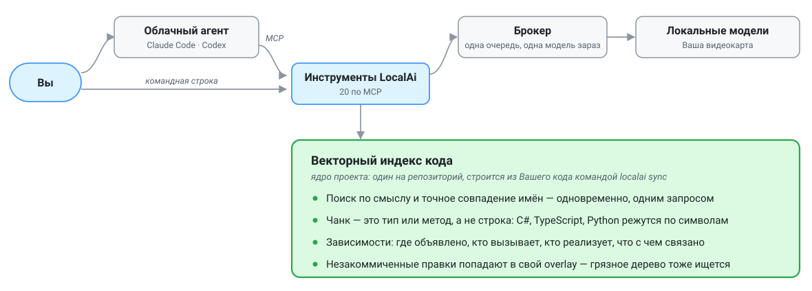

# Local AI Toolkit

**Локальные модели читают за Вас и за Вашего облачного агента. Это существенная экономия
облачных токенов и Вашего времени.**

[English version](README.md)

[](LICENSE)

Облачный агент тратит бо́льшую часть токенов не на размышления, а на чтение и поиск:
открыть подходящие файлы, поискать по коду, пройти по зависимостям, пролистать лог сборки,
описать скриншот, перевести страницу. LocalAi делает эту работу на Вашей машине и отдаёт
готовый ответ — агент начинает с результата, а не платит за то, чтобы его найти.

**Прочитать этот репозиторий целиком стоило бы облачному агенту около 1 480 000 токенов.
Ответ на вопрос из локального индекса — около 2 000.**

Облачная подписка на какого-либо AI-агента при этом не обязательна: те же инструменты отвечают из командной строки, если Вы предпочитаете работать самостоятельно.

---

## Два способа использования

**Как субагентов для облачного агента.** Claude Code, Codex и любой другой MCP-клиент
вызывают инструменты LocalAi напрямую. Агент отдаёт им простую рутину и работает уже с
подготовленными данными, вместо того чтобы делать эту грязную работу самостоятельно,
тратя облачные токены.

**Без облачного агента, из командной строки.** Те же возможности, но как помощники для Вас:
искать по коду по смыслу, разобрать лог, прочитать картинку, перевести документ. Индекс и
модели те же самые, так что начать отсюда и подключить агента позже ничего не стоит.



**Зачем в середине брокер.** Он один на всю машину и держит очередь. Поэтому Claude, Codex
и командная строка работают одновременно, не мешая друг другу, а в видеопамяти лежит одна
модель, а не четыре, дерущиеся за место.

**Наружу ничего не уходит.** Ollama слушает `127.0.0.1`, и ни код, ни запросы к моделям
машину не покидают. Сам, без Вашей команды, рантайм в сеть не ходит вовсе: проверка
обновлений выключена по умолчанию. Модели и недостающие программы качаются тогда, когда Вы
об этом просите.

---

## Что доступно облачному агенту

Двадцать один инструмент по MCP. Агент вызывает их сам, когда видит, что вопрос дешевле задать
локально.

| Инструмент | Что делает |
| --- | --- |
| `search_code` | поиск по смыслу и по точному имени одновременно |
| `get_code_chunk` | забрать найденный фрагмент целиком |
| `go_to_definition` | где объявлен символ под курсором |
| `find_references` | кто его вызывает и где употребляет |
| `find_implementations` | кто реализует и переопределяет |
| `find_relationships` | граф связей: реализация, переопределение, тип |
| `analyze_impact` | прямые C#-связи для анализа влияния: координаты, хеши и снимок |
| `lsp_open_document` | отдать навигации несохранённый текст файла |
| `lsp_close_document` | вернуть навигацию снимку индекса |
| `ask_local` | механическая работа по названным файлам |
| `triage_log` | разобрать машинный вывод любой длины |
| `read_image` | прочитать изображения с диска или один PDF постранично |
| `index_documents` / `search_documents` | индексировать сканированные PDF и искать фразы OCR со ссылками на версию файла и страницу |
| `translate_local` | перевести, сохранив структуру |
| `index_status` | есть ли индекс, чем собран, отстал ли от HEAD |
| `index_refresh` | обновить индекс после коммита |
| `index_unload` | освободить память под загруженным индексом |
| `local_models_status` | что установлено, что загружено, чего не хватает |
| `local_model_preflight` | доказать, что модель влезает в видеопамять целиком |
| `local_models_sync` | доставить недостающие рекомендованные модели |
| `local_model_experiment_report` | статистика по паре «задача — модель» |
| `local_model_feedback` | решить судьбу модели: продвинуть, оставить запасной, отключить |

## Что доступно из командной строки

Список команд: `localai --help` или `codesearch --help`. Синтаксис отдельной команды:
`localai repo status --help` или `codesearch help search`.
Справка выводится в stdout и завершается успешно; лишние или неизвестные аргументы справки
отклоняются. Язык справки определяется сохранённым выбором или `LOCALAI_LANGUAGE` (`en` / `ru`).
Контракты JSON сохранены: `--json` запрашивает машинный ответ вместо текстовой справки.

Набор **не совпадает** с MCP: часть инструментов существует только здесь, часть — только
там.

| Команда | Что делает |
| --- | --- |
| `codesearch search --query "…"` | тот же поиск по смыслу и имени |
| `codesearch get-chunk --id …` | забрать фрагмент целиком |
| `codesearch status` | где лежит индекс, отстал ли, подключён ли репозиторий |
| `codesearch scan` | что вообще попадёт в индекс |
| `codesearch index` / `overlay` | собрать индекс вручную, вне управления LocalAi |
| `codesearch evaluate --cases …` | прогнать корпус оценки качества поиска |
| `localai semantic definition` / `references` / `implementations` / `relationships` | навигация по символу |
| `localai semantic impact --path src/Type.cs --line 12 --json` | прямые ссылки и входящие связи C# из индекса |
| `localai ask "…" <file> …` | механическая работа по файлам |
| `localai triage <log>` | разобрать лог |
| `localai read-image "…" <file>` | прочитать изображения или один PDF |
| `localai documents index` / `search` | собрать индекс OCR для PDF или найти фразу со ссылкой на источник |
| `localai translate --in <file> --from … --to …` | перевести |
| `localai sync` | собрать или обновить индекс |
| `localai hooks install` | поставить хуки, чтобы индекс обновлялся сам |
| `localai repo status` | подключён ли репозиторий |
| `localai doctor` | что не так с установкой, только чтение |
| `localai diagnostics` | просмотреть записанные диагностические данные или сохранить их в ZIP |
| `localai hardware plan` | оценить модели и контекст по подписанным данным релиза и этому компьютеру |
| `localai model status` / `pull` / `preflight` | модели: что стоит, доставить, проверить посадку |
| `localai policy show` / `set` | политика размещения модели в видеопамяти |
| `localai prune` | убрать устаревшие поколения и overlay |
| `localai telemetry` | сводка по локальным заданиям |
| `localai update` | обновить установку |

`localai sync --root <worktree>` сначала подготавливает указанную рабочую копию.
`SYNC_BASE` сообщает о повторном использовании базы; `SYNC_PLAN` перечисляет ожидающие
копии в порядке обработки, а `WORKTREE_PLAN` — переиспользуемые и пересобираемые overlay.
`ACTIVE_READY` показывает, когда указанная копия может читать новое поколение, отдельно
от итоговой длительности синхронизации. Остальные копии читают прежнее поколение до
готовности своих overlay. Обслуживание продолжается в том же процессе синхронизации;
не запускайте вторую синхронизацию одновременно. Прерванный запуск сохраняет готовые
копии доступными и допускает повторный запуск. Сам по себе таймаут ожидания MCP не
доказывает сбой синхронизации: следите через `localai repo status --follow`.

`codesearch evaluate --cases …` перед поиском сопоставляет эталонные символы C# с их
объявлениями в исходниках. Части `[1/6]` и `[2/6]` относятся к одному эталону. Необязательные
поля `signature` и `namespace` уточняют неоднозначные имена; если сигнатура всё ещё подходит
к нескольким объявлениям, оценщик отклоняет такой эталон. Для эталона только с путём
по-прежнему подходит любой результат из указанного файла. Меняется подсчёт метрик оценки;
ранжирование поиска и калиброванный порог остаются прежними.

Корпус оценки может содержать необязательный список `excludedPaths`: пути к файлам
относительно корня репозитория и префиксы каталогов, заканчивающиеся на `/`. Это буквальные
пути без glob-шаблонов; оба вида разделителей принимаются. Если файл `--cases` находится
внутри репозитория, он исключается автоматически; остальные эталонные материалы нужно
перечислить явно. Исключения применяются до векторного и лексического ранжирования.
Обычный поиск по-прежнему включает тесты.

Пути исключения не должны выходить за пределы репозитория или охватывать объявленный
эталонный результат. Отчёт сохраняет коммит и дерево исходников, хеш незакоммиченного
содержимого отдельно от коммита и дерева индекса, а также поколение и модель индекса,
SHA-256 корпуса, уточнённые аннотации, параметры поиска и фактические исключения.
Изменение снимка исходников, поколения индекса или аннотаций во время оценки прерывает
запуск. Для воспроизведения запуска с незакоммиченными изменениями нужно также сохранить
сами исходные файлы: одного хеша для их восстановления недостаточно.

[Сохранённый базовый прогон с фильтрацией кандидатов](tests/CodeSearch.Tests/Fixtures/SearchEvaluation/baseline-candidate-scope-2026-09-16.json)
показывает Recall@10 72.2%, Precision@5 13.3% и долю ложноположительных срабатываний 100% на
шести запросах без ответа. Для каждого из 18 запросов с ответом размечена одна цель, поэтому
потолок Precision@5 составляет 20%. Эти показатели описывают корпус из 24 проверок, а не
общее качество продукта; пороги остаются прежними. Одновременная работа других заданий
брокера и недоступная телеметрия очереди и размещения моделей в памяти не позволяют
использовать длительности этого прогона как изолированный тест производительности.
Независимые корпуса и повторная калибровка отслеживаются в [#601](https://github.com/MrAliev/local-ai-toolkit/issues/601).

**Чего нет в консоли.** `lsp_open_document` и `lsp_close_document` принимают текст
несохранённого буфера — а в командной строке этого буфера просто нет, отдавать нечего.

**Чего нет в MCP.** Шесть команд намеренно оставлены только Вам. Причины ровно три:

**Это уже делается само — звать не надо.**

- `localai prune` — уборка идёт после каждой сборки индекса. Устаревшие поколения и overlay
  удаляются сами, и сборка печатает, сколько освободила.
- `localai sync` — после коммита, checkout, merge и rebase его запускают Git-хуки. Агенту
  оставлен `index_refresh` ровно для одного случая: правки сохранены, но ещё не закоммичены.

**Это обновление продукта, и запускают его вручную.**

- `localai update` ставит новые бинарники и заново прописывает MCP-серверы клиентам. Это
  установка поверх установки, а не рабочая операция, и делаете её Вы, когда сочтёте нужным.
  Пока опубликованных релизов нет, обновление идёт тем же путём, что и первая установка:
  собрать пакет и запустить `LocalAi.Installer.exe` поверх.

**Это сведения для Вас, в удобном для чтения виде.**

Агенту они не нужны в таком виде — у него на каждый свой вызов есть отчётная строка, а про
индекс отвечает `index_status`. А человеку нужна общая картина:

- `localai doctor` — что не так с установкой: связность, модели, права, пути. Только чтение,
  ничего не запускает и не чинит.
- `localai telemetry` — уникальные задания, попытки, известные рабочие процессы и вызовы
  с подтверждённой доставкой результата. Таблицы моделей и профилей показывают исходы и
  длительности попыток; входные и выходные облачные токены считаются отдельно, с указанием
  числа вызовов с известной и неизвестной оценкой.
- `codesearch scan` — что вообще попадёт в индекс. Смотрят при настройке репозитория, чтобы
  понять объём работы, а не при ответе на вопрос о коде.
- `codesearch evaluate` — прогон корпуса качества поиска. Инструмент разработки самого
  LocalAi, а не работы с Вашим кодом.

---

## Поиск по коду — не текстовый поиск

Файл не рубится на равные ломти текста. Он **разбирается по объявлениям** — класс, метод,
функция, — и в индекс попадает каждое из них целиком, вместе со своим именем, сигнатурой и
точными строками. Поэтому попадание — это `OrderCloser.CloseAsync` со всем телом, а не
случайно совпавшая строка посреди чужого метода.

- **C#** разбирает **Roslyn** — тот же компилятор, что собирает проект. Он строит настоящее
  синтаксическое дерево, и куском становится либо тип целиком, либо один исполняемый член:
  метод, конструктор, оператор, свойство с телом.
- **TypeScript и Python** размечают индексаторы **SCIP**. Они сообщают, где начинается и
  кончается каждое объявление, и границы кусков берутся оттуда — не угадываются по отступам.
- **Всё остальное** — разметка, конфигурация, документация, языки без индексатора — разобрать
  так нельзя, поэтому там честное скользящее окно: 60 строк с перехлёстом в 12, чтобы мысль
  не разорвало на стыке.

Чего индекс не видит — файла, который Вы правите, но ещё не сохранили. Навигация по нему
всё же отвечает, но только когда агент передаёт текст буфера: из командной строки такого
пути нет, а языковые серверы выключены, пока Вы их не включите.

---

## С облачным агентом: на что теперь не тратятся токены (не надо платить)

Дело не только в объёме. Вопрос, который человек задаёт словами, редко ложится на ключевое
слово — а именно ключевым словом агент и вынужден искать, когда индекса нет.

**Проверено на этом репозитории.** Вопрос «кто подписан на завершение задания брокера»:

- Греп по слову `Subscribe` находит в `src` **один файл**, и это не ответ.
- `search_code` возвращает `IBrokerQueue.CompleteAsync` и `BrokerJobPending` — в них слова
  «подписка» нет вообще. Совпало по смыслу.

| Вопрос | Без LocalAi: на что уходят токены | Токенов | С LocalAi: на что уходят токены | Токенов |
| --- | --- | --- | --- | --- |
| «Кто подписан на завершение задания?» | угадать ключевое слово, открыть кандидатов целиком — один только `DurableQueue.cs` это 49 КБ | ≈ **12 400** за файл, и это ещё не ответ | три фрагмента с путями и номерами строк | ≈ **2 000** |
| «Как устроен конвейер обработки заказа?» | прочитать все файлы, где встречается «Order», и собрать картину самому | десятки тысяч | фрагменты по каждому звену, сразу с местами | ≈ **2 000** |
| «Что вообще делает этот код?» | прочитать всё | ≈ **1 480 000** | один раз проиндексировать, дальше спрашивать | ≈ **2 000** на вопрос |

Разница не в том, что агент читает быстрее. В том, что **в его контекст попадают только
найденные фрагменты**, а перебор кандидатов оплачивается видеокартой, а не подпиской.

### Это работает по умолчанию, и Вы это видите

**Ничего включать не надо.** Установщик прописывает агенту, что локальные инструменты есть и
что за ними идут первыми. Дальше агент сам решает: увидел вопрос «где это живёт» — пошёл в
`search_code`, а не открывать файлы.

**Все интерфейсы используют единый отчёт на вызов.** Инструменты MCP и обе CLI выводят
краткое сообщение с раздельной экономией облачных токенов INPUT и OUTPUT; значения могут
быть отрицательными. Без явного сценария сравнения и поддерживаемого профиля возвращается
`unknown`, а не ноль. Значения, рассчитанные по символам, явно помечены как эвристические
оценки; для измеренных текстовых токенов указывается профиль токенизатора. Прежние числовые
поля JSON сохраняются для совместимости и не являются калиброванными измерениями.

Общий метод раздельно сравнивает входные и выходные облачные токены. Для него нужны явный
сценарий альтернативного чтения, сведения о том, передавался ли исходный материал в облако,
полный возвращаемый ответ и указанный профиль токенизатора или обработки изображений.
Ранее прочитанный текст и пересекающиеся фрагменты не учитываются дважды. При недостатке
данных возвращается `unknown` с причиной; неизвестный профиль изображения не заменяется
универсальной формулой площади.

Существующие числовые поля ответов сохраняют структуру JSON. Новые записи попыток брокера
используют схему 2: идентификаторы попытки и рабочего процесса, а также фактические счётчики
backend, если они доступны. Попытка не доказывает доставку или экономию облачных токенов:
новое поле содержит `unknown`, а прежние числовые поля экономии — нули. Старые записи
читаются, но их неподтверждённые оценки не включаются в итоги. Итоговый отчёт хранится
отдельно, один раз на вызов, и учитывает полный объём ответа. Несколько заданий одного
вызова не умножают его экономию. Несовместимые профили сравнения не суммируются.
`localai prune` применяет срок хранения телеметрии к попыткам и итоговым отчётам.

Результаты MCP содержат версионированные данные в `_meta["localai/usage"]`. Текстовые инструменты
помещают сообщение вне границ `untrusted-content`; JSON-инструменты сохраняют содержимое
без изменений и помещают сообщение в метаданные. Отмена сохраняет семантику протокола.
Перед запуском отменяемого вызова передайте уникальный GUID в `_meta["localai/callId"]`
запроса; частичный отчёт можно получить командой `localai telemetry --call-id <guid>`.

CLI сохраняет прежний формат текста или JSON в stdout; краткий отчёт выводится в stderr.
Протокол установщика `localai model` версии 1 не допускает дополнительных записей в stderr,
поэтому его отчёты только сохраняются. Каталог отчётов — `%LOCALAPPDATA%\LocalAi\telemetry\usage`.
В них хранятся технические измерения и идентификаторы, без запросов к модели и содержимого
документов. Ошибка сохранения отчёта не меняет результат команды; о ней сообщается отдельно,
если это допускает протокол.

Размер ответа учитывает весь сериализованный результат MCP, включая сообщение и метаданные,
либо весь текст stdout/stderr CLI в UTF-8. Обрамление JSON-RPC в этот объём не входит.
Расчёт MCP учитывает размер самого отчёта и ограничен числом итераций; при отсутствии
сходимости размер остаётся неизвестным. Доставка означает завершённую запись файла или
передачу результата выходному интерфейсу, без подтверждения от удалённого клиента.
Отсутствующие измерения остаются неизвестными; частичный отчёт отражает данные, доступные
на момент отмены. Попадание `index_memory_cache` относится к данным индекса в памяти
и не означает, что вызова модели не было.

[Синтетический корпус для калибровки](tests/Fixtures/TokenCalibration/corpus.json) содержит
[эталонные количества токенов и результаты сравнения](tests/Fixtures/TokenCalibration/reference.json),
полученные с помощью tiktoken 0.12.0 для `cl100k_base` и `o200k_base`. Он охватывает EN/RU,
код, смешанный текст, пустой ввод, длинный ответ, source/path/outPath, предыдущее и повторное
чтение, PNG и двухстраничный PDF. Статистика ошибок относится к этому корпусу и двум кодировкам.
Она не подтверждает универсальную точность для других токенизаторов и не является данными
об использовании токенов от облачного провайдера. Длинный образец повторяет короткие примеры
для проверки объёма ответа, а не для расширения независимой языковой выборки.

Для изображений используется [опубликованная формула плиток `gpt-4o`](https://developers.openai.com/api/docs/guides/images-vision); результаты помечены как
оценки по формуле. Для PDF сохранено количество текстовых токенов, но полный вход остаётся
неизвестным: способ рендеринга страниц у провайдера не наблюдался. Неподдерживаемые профили
зрения по-прежнему дают неизвестное значение. Оценки по символам не имеют статистического
интервала; прежние числовые границы оценщика поиска явно помечены как
`heuristic_not_confidence_interval` в дополнительном версионированном поле
`responseTokenEstimatePolicy`. Калибровка не заменяет сценарий сравнения, сведения об исходных
данных, подтверждение доставки и учёт полного ответа.

Для воспроизведения эталонов установите `tiktoken==0.12.0` и выполните
`python tools/calibrate-tokens.py --verify`. При первом запуске токенизатор может загрузить
таблицы кодировки с проверкой хеша; модель и API провайдера не вызываются. Режим `--write`
заново создаёт синтетические файлы и эталонный JSON. Обычный набор тестов .NET проверяет
сохранённые измерения, расчёты сценариев и отсутствие содержимого документов в отчётах
без Python, подключения к сети и GPU.

### Если что-то работает не так, как Вам нужно

Ничего не зашито намертво — настройки лежат в `%LOCALAPPDATA%\LocalAi\settings`:

| Что поменять | Как |
| --- | --- |
| Модель для конкретного рода задач | `model-routing.json` — своя цепочка моделей на каждый профиль: `CodeAnalysis`, `LogTriage`, `VisualAnalysis`, `PlainTranslation` и ещё десяток |
| Модель на один вызов | `localai ask "…" <file> --model <модель>` или `--profile <профиль>` |
| Судьба модели после обкатки | `local_model_feedback`: продвинуть, оставить только запасной или отключить для этой задачи |
| Куда помещать модель | `localai policy set --residency` — целиком в видеопамять, с выгрузкой или на процессор |
| Сколько держать модель загруженной | `localai policy set --idle-model-keep-alive-seconds` |
| Отключить инструменты у клиента | снять регистрацию MCP-серверов у Claude или Codex — тогда агент их просто не увидит |

Чтобы выбрать модели для каждого рода задач, скопируйте полный
[model-routing.json](model-routing.json) из корня репозитория в
`%LOCALAPPDATA%\LocalAi\settings\model-routing.json`. Измените `Candidates` и
`Fallbacks` в нужной записи `Routes`; добавляемую модель опишите в `Models`.
Этот файл заменяет каталог целиком. Сохраните `SchemaVersion` равным `1`,
непустой `CatalogVersion` и по одному маршруту для каждого профиля задач.

Без этого файла LocalAi читает встроенный каталог. Некорректный файл вызывает
ошибку; настройки по умолчанию вместо него не подставляются. Команда
`localai doctor` проверяет файл и показывает вычисленную версию: `custom-` и хеш
содержимого. Изменение форматирования не меняет эту версию. Остальные политики
можно посмотреть командой `localai policy show`.

Повторные попытки перевода используют упорядоченный список `Fallbacks` для
`PlainTranslation` или `TechnicalTranslation` из одного снимка каталога. Каждый
фрагмент передаёт версию этого снимка; брокер с другим каталогом отклоняет запрос
до загрузки или запуска модели. Примените сохранённый каталог описанным ниже
способом, затем повторите перевод.

Чтобы применить сохранённый каталог, дождитесь завершения текущих локальных
вызовов и выполните `localai doctor`. Если проверка `model-catalog` прошла,
выполните `localai-launcher.exe stop`. Команда остановит брокер и все работающие
инструменты LocalAi активной установленной версии, включая её MCP-серверы.
Подключите MCP-серверы заново в клиенте или при необходимости перезапустите клиент.
Следующая локальная задача запустит брокер с сохранённым каталогом.

**Об ограничениях прямо — и о том, кто их закрывает.** Локальные модели заметно слабее
облачных. Они хороши в «перечисли», «обобщи», «где это лежит» — и ненадёжны в архитектуре и
тонких ошибках.

Но в связке с агентом это не оставлено на удачу: **находит локальная модель, а судит
облачная**. Локальный ответ приходит агенту не как истина, а как материал — с путями и
номерами строк, по которым он открывает исходник и проверяет сам. Ошибка локальной модели
стоит одного лишнего чтения, а не неверного вывода.

Продукт этому помогает: каждый ответ подписан моделью и временем работы, а при недостатке
видеопамяти получает пометку — ослабленный ответ нельзя принять за полноценный.

В консоли этого второго слоя нет: там судите Вы. Поэтому всё, на чём держится решение,
проверяйте по коду.

---

## Из консоли: не про токены, а про время

Здесь платить нечем и экономить нечего — Вы и так работаете руками. Смысл в другом.

**Не надо вспоминать, как называется то, что ищешь.** Спрашивать можно так, как думаешь:
«где решается, сколько ждать перед повтором», «что происходит при обрыве загрузки». Грепу
такой вопрос не задать.

**Ответ приходит с координатами.** Не «вот файл», а путь, диапазон строк и символ — можно
сразу открывать в нужном месте.

**Скучная работа уходит с рук.** Разобрать лог на тысячу строк, вытащить перечень TODO,
прочитать скриншот с ошибкой, перевести документ — всё это делается одной командой, пока Вы
занимаетесь другим.

**И это работает без интернета.** Поезд, самолёт, отключённый VPN — модели лежат на диске.

---

## Зависимости

Установщик проверяет каждую и предлагает поставить недостающие. Ставить заранее ничего не
нужно.

**Без чего не работает вовсе:**

| | Зачем |
| --- | --- |
| **Windows** | установщик и launcher рассчитаны прежде всего на неё |
| **Git** | репозиторий опознаётся по git-каталогу; на нём же держатся хуки |
| **Ollama** | на ней крутятся все модели; LocalAi обращается к ней только через брокер |
| **Видеокарта, куда влезает модель** | по умолчанию модель, не помещающаяся в видеопамять целиком, отклоняется, а не работает медленно |

**Нужно для отдельных языков — без них поиск работает, но грубее:**

| | Зачем |
| --- | --- |
| **.NET SDK 10** | Roslyn разбирает C# на типы и члены. Без него C# режется окном по строкам |
| **Node.js 20** + **SCIP TypeScript** | нарезка TypeScript и JavaScript по символам |
| **Python 3.10+** + **SCIP Python** | нарезка Python по символам |

**Необязательно:**

| | Зачем |
| --- | --- |
| **GitHub CLI** | только если релизы приватные или до хоста релизов не достучаться, а до API — да. Обычной установке не нужен: релизы публичные и качаются по HTTPS |

Политику размещения модели можно смягчить осознанно:
`localai policy set --residency AllowPartialOffload` или `AllowCpu`. Ответ, полученный при
смягчённой политике, помечается — ослабленный нельзя принять за полноценный.

---

## Как установить

Опубликованных релизов сейчас нет, поэтому путь один: собрать из репозитория и поставить из
папки.

**1. Собрать пакет.** Нужен `pwsh` 7 и .NET SDK 10.

```powershell
pwsh scripts/publish-localai-release-win-x64-self-contained.ps1 -ReleaseVersion 0.1.0
```

Получится папка `publish/` с `LocalAi.Installer.exe` и самим пакетом.

Добавьте `-CompressBinaries`, чтобы уменьшить размер исполняемых файлов на диске, учитывая
возможное замедление запуска; по умолчанию сжатие выключено. Оба режима остаются автономными:
встроенная среда .NET, состав пакета, нативные библиотеки и правила проверки сохраняются.
Существующие требования к инструментам языков программирования не меняются.

Первый пилот Windows x64 (2026-09-23, SDK 10.0.401, исходный коммит `ac6b47fc3dd0`) сравнивал
одинаковые в остальном сборки `0.0.0-size`. Файлы runtime вместе с launcher и нативными
библиотеками уменьшились **573,57 → 287,31 МиБ (49,9%)**. Комплект для установки из папки
(установщик + ZIP, без небольших файлов манифеста и подписи) уменьшился **386,27 → 308,75 МиБ
(20,1%)**; сам ZIP — 249,54 → 244,87 МиБ. Пять чередующихся запусков каждого варианта выполнялись
в новом процессе, с пустым каталогом распаковки, PATH только с System32 и недоступным глобальным
корнем .NET:

| Сценарий запуска | Медиана без сжатия | Медиана со сжатием |
| --- | ---: | ---: |
| `localai --help` | 168,606 мс | 228,417 мс |
| `codesearch --help` | 161,615 мс | 208,985 мс |
| справка-отказ launcher | 31,951 мс | 66,372 мс |
| справка-отказ брокера | 38,803 мс | 78,899 мс |
| инициализация CodeSearch MCP | 226,948 мс | 290,966 мс |

Вывод справки, ответы инициализации MCP и описания инструментов совпали; эти точки входа
запускались без глобальных SDK/runtime. Файловый кэш ОС **не** очищался: это холодный старт
процесса и кэша распаковки, а не замер после перезагрузки. Запуск UI установщика, фоновая
синхронизация моделей LocalLm MCP и офлайн-установка на чистую машину остаются в финальной
приёмке (#618); пилот с явным включением сжатия её не заменяет. Оба ZIP прошли штатный
проверяющий модуль пакетов с временным тестовым ключом доверия, без изменения установленной
среды и использования ключа подписи релизов. Замеры и хеши файлов сохранены в
[results.json](scripts/quality/standalone-size/results.json); сравнение воспроизводится через
[compare.py](scripts/quality/standalone-size/compare.py) после публикации в два разных каталога
с одинаковыми аргументами версии, добавив `-CompressBinaries` только для второго варианта.
Это соотношение размера и времени запуска, а не измерение экономии облачных токенов.

### На чём это будет считать

Продукт рассчитан на видеокарту, но не требует её. Что именно у Вас — решаете при установке
Вы, выбрав политику размещения модели; поменять её можно и потом, командой
`localai policy set --residency`.

| Политика | Где живёт модель | Скорость |
| --- | --- | --- |
| `RequireFullVram` — по умолчанию | целиком в видеопамяти | измерено на этой машине (RTX 5080, 16 ГБ): эмбеддинг **12–13 чанков/с**, короткий вопрос по файлу — **около 9 с** |
| `AllowPartialOffload` | часть в видеопамяти, часть в системной | словами самого продукта — **медленнее**. Нужен адаптер, вмещающий хотя бы часть модели; годится и встроенная графика |
| `AllowCpu` | целиком на процессоре | **намного медленнее**, но работает без пригодного адаптера вовсе |

Числа в первой строке — сегодняшний замер на этой машине. Для двух других строк у меня
измерений нет, и придумывать я их не стал: там стоят слова, которыми продукт сам описывает
эти режимы в `localai policy show`.

**Потолок — не самая большая карта, а сумма.** Модели крутит Ollama, а она умеет разложить
одну модель по нескольким адаптерам, так что две карты складывают свою видеопамять. Плата за
это — обмен между картами по шине, поэтому одна карта, в которую модель влезает целиком,
всегда быстрее двух, между которыми она размазана.

**2. Запустить установщик.** Мастер проведёт по шагам:

- на каком языке Вы читаете — на нём он и продолжит;
- каких зависимостей не хватает — и поставит выбранные;
- какие модели поставить — предложит те, что влезают в Вашу видеокарту;
- каких агентских клиентов зарегистрировать — Claude Code, Codex.

Клиентам он пропишет MCP-серверы и добавит блок инструкций в `~/.claude/CLAUDE.md` и
`~/.codex/AGENTS.md`, чтобы агент знал, что эти инструменты есть и когда за ними тянуться.

Перед продолжением проверьте итоговый экран: установка пакета, проверка моделей и настройка
каждого клиента имеют отдельные результаты. Установленный пакет сам по себе не означает, что
модели и клиенты готовы. После отмены или частичного сбоя экран объясняет следующий шаг и
доступность отката записанных изменений. Технический лог сохраняет исходный текст; перед
закрытием окна сохраните отчёт, а если запись не удалась — скопируйте лог.

Удаление тоже сохраняет результат вне runtime. При остановке на полпути отчёт по журналу
различает выполненные действия, ошибки, неизвестный итог, не начатые действия и сохранённые
данные. Можно открыть папку отчёта, сохранить другую копию или скопировать сведения. Удалённые
данные автоматически не восстанавливаются; переход к чистой установке доступен после успешного удаления.

**3. Подключить репозиторий.** Индексация включается для каждого отдельно — пока не
попросите, ничего не читается.

```powershell
& "$env:LOCALAPPDATA\LocalAi\bin\launcher\localai-launcher.exe" run localai sync --root <repo>
& "$env:LOCALAPPDATA\LocalAi\bin\launcher\localai-launcher.exe" run localai hooks install --root <repo>
```

Первая сборка читает репозиторий целиком и показывает ход работы цифрами. Хуки дальше
держат индекс свежим после коммита, checkout, merge и rebase.

**4. Убедиться, что всё встало.**

```powershell
& "$env:LOCALAPPDATA\LocalAi\bin\launcher\localai-launcher.exe" run localai doctor
```

---

## Как пользоваться с облачным агентом

Отдельно ничего делать не надо: установщик уже зарегистрировал MCP-серверы и написал агенту,
когда ими пользоваться. Дальше агент решает сам — видит вопрос «где это живёт» и идёт в
`search_code` вместо чтения файлов.

Что стоит знать, чтобы это работало не наполовину:

**Спрашивайте словами, а не именами.** «Где решается, сколько ждать перед повтором» работает
лучше, чем попытка угадать имя класса. Именно на таких вопросах индекс и выигрывает у грепа.

**Незакоммиченные правки видны, но не сами собой.** Индекс догоняет рабочее дерево по
команде: `index_refresh` у агента или `localai sync` руками. После коммита это делает хук.

**Отказ инструмента — не поломка.** «Overlay не собран» значит, что дерево изменилось и
индекс отстал; ответ — собрать, а не искать обходной путь.

**Проверяйте то, на чём держится решение.** Локальная модель ошибается чаще облачной, и
продукт этого не скрывает: каждый ответ подписан моделью и временем.

---

## Как пользоваться из консоли

### Шаг 1. Как вообще запускать

Всё идёт через **launcher** — стабильную точку входа, которая не меняется при обновлении.
Каталог версии внутри `bin\versions\` меняется с каждым релизом, поэтому прописывать пути
туда не надо ни в скриптах, ни в клиентах:

```powershell
& "$env:LOCALAPPDATA\LocalAi\bin\launcher\localai-launcher.exe" run <команда>
```

Чтобы не повторять это каждый раз, заведите псевдоним на сессию:

```powershell
function lai { & "$env:LOCALAPPDATA\LocalAi\bin\launcher\localai-launcher.exe" run @args }
```

Дальше в примерах — `lai <команда>`.

### Шаг 2. Откуда запускать

**Из любой папки.** Команды, работающие с репозиторием, принимают `--root`:

```powershell
lai localai repo status --root C:\work\myapp
```

Если `--root` не указан, берётся репозиторий, содержащий текущую папку. То есть можно и так:

```powershell
cd C:\work\myapp
lai localai repo status
```

**Worktree — это тот же репозиторий.** Репозиторий опознаётся по общему git-каталогу,
поэтому все его рабочие деревья, Claude, Codex и командная строка видят один и тот же
индекс. Но `--root` для сборки указывайте **то дерево, которое правите**: overlay строится
под конкретное состояние файлов.

### Шаг 3. Подключить репозиторий

Индексация включается для каждого репозитория отдельно. Пока не попросите — не читается
ничего.

```powershell
lai localai repo status --root C:\work\myapp
```

```
NOT CONFIGURED: C:\WORK\MYAPP\.GIT
```

Подключаем и ставим хуки:

```powershell
lai localai sync --root C:\work\myapp
lai localai hooks install --root C:\work\myapp
```

Первая сборка читает репозиторий целиком и печатает ход работы цифрами — фазу, число
чанков, скорость и оценку остатка. На большом проекте это минуты; окно можно не сторожить.

Хуки дальше держат индекс свежим сами: после коммита, checkout, merge и rebase. Чужие хуки
не затираются — LocalAi встраивается в цепочку и зовёт их первыми.

Проверяем:

```powershell
lai codesearch status --root C:\work\myapp
```

### Шаг 4. Пользоваться

Полный список команд — в таблице [«Что доступно из командной строки»](#что-доступно-из-командной-строки)
выше. Ниже — как они выглядят в работе.

#### Найти код по смыслу

```powershell
lai codesearch search --query "кто подписан на завершение задания брокера" --top 3
```

```
src\LocalAi.Broker.Core\DurableQueue.cs:1318-1323  [Method]  cos=0.616
  IBrokerQueue.CompleteAsync
  Task CompleteAsync( Guid jobId, string workerId, Guid leaseId, JsonElement body, …)
  chunk_id: cs1.AUAwZWNjOTAx…

src\LocalAi.Contracts\LocalRunObserver.cs:27-27  [Type]  cos=0.604
  BrokerJobPending
  public sealed record BrokerJobPending(bool Running): LocalRunStep
  chunk_id: cs1.AUAwZWNjOTAx…
```

Слова «подписка» в найденном коде нет — совпало по смыслу. `cos` показывает, насколько
близко; `chunk_id` отдаётся в `codesearch get-chunk`, чтобы забрать фрагмент целиком:

```powershell
lai codesearch get-chunk --id cs1.AUAwZWNjOTAx…
```

#### Пройти по символу

Найдя место, дальше ходят навигацией, а не новым поиском. Строка и колонка считаются от
единицы — ровно так, как их печатает поиск и показывает редактор:

```powershell
lai localai semantic references --path src/LocalAi.Broker.Core/DurableQueue.cs --line 1318 --column 1
lai localai semantic implementations --path src/LocalAi.Broker.Core/DurableQueue.cs --line 1318 --column 1
```

#### Спросить про известные файлы

```powershell
lai localai ask "Перечисли публичные члены этого класса, по одному в строке." src/CodeSearch.Core/Chunking/GenericTextChunker.cs
```

Для извлечения и классификации можно включить проверку плоского JSON-объекта:
`--profile Extraction` (или `Classification`) и `--schema contract.json`.
В MCP `ask_local` тот же JSON передаётся строкой в необязательном `outputSchema`.
Например, для классификации переданного issue в `bug` или `question`:

```json
{"schemaVersion":1,"fields":[{"name":"label","type":"String","allowedValues":["bug","question"]}]}
```

```powershell
lai localai ask "Классифицируй issue." issue.txt --profile Classification --schema contract.json --json
```

Версия 1 — ограниченный контракт плоского объекта, **не общий JSON Schema**:
до 64 полей с учётом регистра, типы `String`, `Integer` (знаковый Int64), `Number`,
`Boolean`. `required` по умолчанию true; `allowedValues` задаёт точный список строк.
Вложенные значения, null, лишние или повторные поля, Markdown-ограждения и текст
вокруг JSON не проходят проверку. Схема ограничена 32 768 символами, ответ —
1 048 576. Неизвестные параметры схемы отклоняются до вызова модели. Отмена сохраняется.

Брокер проверяет каждую попытку, включая fallback. При успехе CLI добавляет
`data.validation`; при ошибке возвращает код 65, `error.code=result_rejected` и
`error.validation`, без пригодных к использованию данных ответа. MCP возвращает
`{answer,validation}` внутри границы untrusted-content. Статусы: `Valid`, `Empty`,
`InvalidJson`, `SchemaMismatch`; разобранное `value` есть только при `Valid`.
Отклонённый ответ не получает оценки экономии облачных токенов.
**Valid подтверждает структуру, а не правильность классификации или фактов** —
их нужно сверять с источником. Без схемы формат CLI/MCP сохраняется, а брокер
фиксирует `NotRequested`. Для нового режима нужно обновить и клиент, и брокер.
Полный перевод по-прежнему использует собственный валидатор; успешный ответ
брокера его не заменяет.

Ответ модели выводится в stdout. Отдельное сообщение об использовании токенов в stderr
содержит идентификатор вызова, фактически использованные модели, длительность и раздельную
экономию облачных токенов INPUT и OUTPUT. Это **условное сравнение при первом чтении**, а не
расход аккаунта: INPUT — токены исходных данных минус аргументы и полный ответ инструмента;
OUTPUT — проверенный и доставленный локальный ответ минус сгенерированный запрос инструмента.
Разница может быть отрицательной; сбой, непрошедший проверку или недоставленный результат не
получает оценки экономии. Последующий облачный ответ и внешнее транспортное оформление
исключены с обеих сторон. MCP считает сериализованные запрос и результат, включая метаданные;
CLI — сериализованные аргументы и stdout, затем stderr, включая строку отчёта. Это явно заданные
представления для сравнения, а не измерение контекста модели в конкретном клиенте.

Текст считает встроенный словарь `microsoft-ml-tokenizers-2.0.0:o200k_base`, проверенный по
независимым эталонным значениям. Для изображений применяется `openai-gpt-4o-tiles-v1` с высокой
детализацией; для PDF сравниваются отрисованные страницы, а не загрузка PDF провайдеру.
Совпадение этих профилей с облачной моделью аккаунта не предполагается. Повтор одного исходного
блока внутри вызова учитывается один раз; разбор лога исключает перекрытия фрагментов. Поиск
сравнивается с чтением только файлов корректных результатов, а не всего репозитория. При нехватке
данных остаётся «неизвестно» с причиной; для служебных операций и перевода только кода — «неприменимо».

По умолчанию `NotPresent` означает, что исходник ещё не попадал в облачный контекст. Для уже
прочитанного исходника передайте `sourceContext: "AlreadyPresent"` поддерживаемому MCP-инструменту
либо `_meta: {"localai/sourceContext":"AlreadyPresent"}` в запросе. Если это нельзя установить,
используйте `"Unknown"`. В CLI те же значения принимает `LOCALAI_SOURCE_CONTEXT`. Общего журнала
облачного контекста между вызовами нет: при повторном чтении эту информацию передаёт вызывающая
сторона. Сохраняются только числа, профили и сценарий, без текста исходника и ответа. Захват CLI
ограничен 8 Ми символов на поток; при превышении размер ответа в токенах неизвестен. Совместимость
существующих полей JSON сохранена: новый расчёт находится в каноническом отчёте и его строке,
старые скалярные оценки конкретных команд сохраняют прежнее значение.
Учёт ограничен 16 384 различными исходными блоками на вызов: для более длинного потока
выводится `source_evidence_limit`, а частичный объём не выдаётся за полный.

#### Разобрать лог

```powershell
lai localai triage build.log --question "почему упала сборка"
```

Читает вывод любой длины: измеряет свободную видеопамять и обрабатывает файл частями.
Работает и с потоком, так что лог можно не сохранять:

```powershell
dotnet build 2>&1 | lai localai triage -
```

#### Прочитать картинку и перевести документ

```powershell
lai localai read-image "Что за ошибка на скриншоте и в каком окне?" C:\shots\error.png
lai localai translate --in docs\notes.md --from Russian --to English --markdown --out docs\notes.en.md
```

`read_image` и `localai read-image` также принимают один PDF размером до 256 МиБ.
Передайте его путь без других файлов и без `--together`. Страницы преобразуются
в изображения и передаются модели по одной. В режиме OCR результат чтения каждой
страницы возвращается полностью, в исходном порядке, под заголовком с её номером.
В остальных режимах ответы по страницам сводятся. Консоль показывает текущую
страницу и общее число страниц; итоговая строка содержит имя файла и число
прочитанных страниц. Ограничения в восемь страниц для PDF нет.

Для выбора страниц PDF укажите `--pages "1,3-5"` (MCP: `pages: "1,3-5"`).
Нумерация начинается с единицы, обе границы диапазона включены. Страницы читаются
в порядке документа без повторов; заголовки и прогресс сохраняют исходные номера.
В изображения преобразуются только выбранные страницы. Неверные диапазоны и номера
за пределами документа отклоняются до вызова модели. Без параметра читаются все страницы.

```powershell
lai localai read-image "Перепиши текст" manual.pdf --profile Ocr --pages "1,3-5"
```

Для OCR PDF добавьте `--out transcript.txt` (MCP: `outPath`), чтобы сохранить полный
текст в UTF-8 и получить короткий ответ с путём к файлу. Выходная папка должна
существовать. Имеющийся выходной файл заменяется атомарно после обработки всех
выбранных страниц; ошибка или отмена сохраняет прежний файл. Исходный PDF нельзя
указать как выходной файл. Текст не сокращается и не возвращается в ответ при
ошибке записи. Содержимое файла остаётся недоверенными данными. Без выходного пути
OCR возвращает текст в ответе, как раньше.

Для возобновления OCR PDF добавьте `--checkpoint ocr-progress` (MCP: `checkpointDirectory`).
После прерывания повторите тот же запрос: готовые страницы загружаются с диска без
повторного преобразования в изображения и вызова модели; обрабатываются только
незавершённые страницы. Полностью готовый сеанс может записать текст в другой выходной
файл без вызова модели. Контрольная точка хранит текст страниц и квитанции выполнения;
одновременно её может изменять только один запуск. Для нового сеанса используйте пустую
папку, а выходной файл располагайте вне неё. Изменения байтов PDF, выбранных страниц,
вопроса, языка, заданной модели, каталога маршрутизации или сборки обработчика отклоняются:
для них нужна новая папка. Каждая запись контрольной точки ограничена 4 МиБ;
превышение вызывает ошибку без сокращения текста.

```powershell
lai localai read-image "Перепиши текст" manual.pdf --profile Ocr --checkpoint ocr-progress --out transcript.txt
```

Страницы преобразуются в изображения с разрешением до 150 DPI, не более
4 миллионов пикселей на страницу. Для зашифрованного или повреждённого PDF
выводится ошибка с путём к файлу; ввод пароля не поддерживается.

В [замерах PDF-парсера и OCR](scripts/quality/pdf/README.ru.md) отдельно проверены
текстовый слой, повреждённые документы и ограничения растра; указаны границы выводов.

Поиск документов индексирует **PDF, TXT, Markdown** (`.md`, `.markdown`) **и DOCX**. Храните
индекс вне папки-источника. Обрабатываются поддерживаемые файлы непосредственно в
этой папке. Для PDF по умолчанию сохраняется OCR; остальные форматы читаются без модели.

```powershell
lai localai documents index --source C:\Documents\Scans --index C:\Documents\SearchIndex
lai localai documents index --source C:\Documents\Text --index C:\Documents\TextIndex --pdf-mode TextLayer
lai localai documents search --index C:\Documents\SearchIndex --query "номер счёта" --limit 10 --json
```

Аналоги MCP: `index_documents(sourceDirectory, indexDirectory, model?, pdfMode?)` и
`search_documents(indexDirectory, query, limit?, sourceContext?)`. Поиск находит
точную фразу без учёта регистра, возвращает не более одного фрагмента на единицу источника
и не вызывает модель. Для PDF указаны файл, его версия SHA-256, номер страницы
от единицы, нормализованная область всей страницы `(0,0,1,1)`, способ извлечения и текст.
Результаты OCR также содержат модель и отметку непроверенной точности.
`ocrOffset`, `matchLength` и `textOffset`
считаются в единицах UTF-16 внутри распознанного текста страницы; это не координаты
слов в PDF. Пересказы и сгенерированные ответы не смешиваются с текстом. OCR может
ошибаться и пропускать текст: отсутствие совпадения означает лишь отсутствие фразы
в распознанном тексте индекса.

Явный `--pdf-mode TextLayer` (MCP `pdfMode: "TextLayer"`) извлекает встроенный текст
PDF через PdfPig 0.1.16. **Автоматического перехода к OCR нет**: страницы без извлечённого
текста перечислены в `emptyPages` результата индексации. Для распознавания изображений
обновите индекс с `--pdf-mode Ocr`. Слой может содержать скрытые символы или другой
порядок чтения. Для этих форматов `textKind` различает `ocr`, `pdf-text` и `plain-text`; `textVerification`
равен соответственно `unverified`, `layout-unverified` или `source-text`. Совпадение
текстового слоя с видимой страницей не утверждается.

У результатов TXT/Markdown поля `page`, `region`, `model` и `ocrOffset` равны null.
Диапазон `startLine`/`endLine` описывает строки фрагмента от единицы, а
`matchStartLine`/`matchEndLine` — строки совпадения. `matchOffset`, `textOffset` и
`matchLength` считаются в единицах UTF-16 внутри декодированного файла или извлечённого
текста страницы PDF. Текст и окончания строк сохраняются. Поддерживаются UTF-8 и
UTF-16/UTF-32 с BOM; повреждённые кодировки и нулевые символы отклоняются.
Для текстового файла возвращается не более одного фрагмента.

Поиск DOCX читает абзацы основной части и абзацы в ячейках таблиц верхнего уровня.
Соседние текстовые фрагменты объединяются, табуляция и явные переносы сохраняются.
Выдаётся не более одного фрагмента на абзац с `textKind: "docx-text"` и
`textVerification: "layout-unverified"`. Поле `docxSource` содержит объявленную основную
часть `part`, пространство имён `namespaceUri` для префикса `w` и точный `xpath`.
Нумерация от единицы: `paragraph` считает непосредственные абзацы тела или ячейки;
`table`, `row` и `cell` — непосредственные соседние элементы XML. Для абзаца тела
поля таблицы равны null. При объединённых ячейках указаны позиции XML, а не видимые
столбцы. SHA-256 файла привязывает ссылку к версии. Поля `page`, `region`, `model`,
`ocrOffset` и номера строк равны null; смещения UTF-16 относятся к извлечённому абзацу.
Страницы, нумерация, стили, скрытый текст и порядок чтения не отрисовываются и не
проверяются; текст скрытых фрагментов может присутствовать в выдаче.

Извлечение DOCX частичное. Абзац с неподдерживаемым содержимым — например полями,
рисунками, ссылками на сноски или отслеживаемыми исправлениями — пропускается целиком,
чтобы не создавать ложных совпадений при склеивании текста через пропуск.
Неподдерживаемые блоки, элементы управления содержимым и вложенные таблицы пропускаются.
Колонтитулы, сноски, комментарии, стили, медиа и другие неиндексируемые части пакета
перечислены в `extractionNotices` с точными именами частей и структурными адресами,
когда они доступны. Внешние связи отмечаются и никогда не загружаются; отображаемый
текст гиперссылки может быть прочитан. Для каждого файла выводятся первые 64 уведомления;
`additionalNotices` суммирует оставшиеся по всем файлам. Уведомления есть и в индексации,
и в поиске, даже без совпадений. Поиск показывает их только для источников, прошедших
проверку актуальности. Отсутствие совпадения не означает отсутствия фразы во всём документе Word.

Повторный `documents index` обновляет индекс: неизменённые документы используются
повторно, изменённые читаются заново, записи удалённых исчезают. Смена режима PDF
отменяет повторное использование извлечённого текста. Индексы версий 1 и 2
доступны для поиска; обновление атомарно переводит хранилище в версию 3. Версия ответа
CLI/MCP остаётся 1, поля добавляются; `indexSchemaVersion` обозначает версию хранилища.
Перед выдачей
поиск сверяет хеши и сообщает об изменённых, удалённых или недоступных источниках
в `excludedSources`. После изменений обновите индекс; новые файлы появятся в поиске
после обновления. Публикация атомарна, отмена сохраняет предыдущий снимок; прерванное
новое распознавание повторяется при следующем запуске. Текст хранится локально
в `snapshot.json`. Хеши страниц выявляют случайное повреждение, но не защищают от
намеренной подмены тем, кто может перезаписать индекс.

Ограничения пилота: 32 файла, 128 страниц в PDF, 256 МиБ на PDF, 8 МиБ на другой
файл, 1 ГиБ суммарно, 64 000 извлечённых символов на страницу PDF и 8 миллионов
в индексе. Во фрагменте выдачи до 2000
символов, в поисковой фразе — от 1 до 256. Для индексации экономия токенов неприменима.
Поиск сравнивает только текст единиц источника, представленных в выдаче, с полным запросом
и ответом инструмента. Условная оценка может быть отрицательной и не отражает расход
аккаунта. Весь корпус не засчитывается в экономию; прежние вызовы OCR не учитываются
повторно. Для DOCX также действуют лимиты: 256 элементов архива, 8 МиБ на распакованную
часть, 32 МиБ заявленного распакованного содержимого, 4096 непосредственных абзацев
тела/ячеек и 64 000 символов на извлечённый абзац. Читаемый XML ограничен также фактически
полученными байтами, 100 000 узлов чтения и глубиной 64 на часть. DTD, неоднозначные
или небезопасные пути пакета и дубликаты отклоняются. Содержимое архива не записывается
по путям источников. В результате индексации `pages` считает страницы PDF, `paragraphs` —
извлечённые абзацы DOCX, `docxDocuments` — файлы DOCX. Отмена разбора PDF проверяется между страницами;
жёсткий лимит времени процесса или изолированный лимит памяти не реализован.

Языки задаются **названиями**, а не кодами: `--to Russian`, не `--to ru`.

Проверки перевода отклоняют скопированную исходную прозу, если названия запрошенных
языков различаются, в том числе копии с изменёнными пробелами, пунктуацией или добавленной
подписью. Проверяется каждый фрагмент: перевод одного не разрешает копировать другой.
Числовые записи должны сохранять написание и порядок, включая ячейки таблиц и повторы;
локализация десятичного разделителя или перестановка консервативно отклоняется.
Блоки кода сохраняются отдельно, цифры в названии модели в служебной подписи не считаются
исходными числами. Непринятый результат запускает только предусмотренную каталогом
цепочку запасных моделей. Если ни одна попытка не прошла, инструмент возвращает явную
ошибку и не записывает файл перевода. Расход на отклонённые вызовы сохраняется в учёте,
но успешный перевод им не засчитывается. Это детерминированные проверки, **не подтверждение
смысла или языка результата**. Неизменённые имена и общие для языков слова также могут
быть отклонены; при одинаковых названиях языков проверка копирования пропускается.
Markdown только с блоками кода сохраняется без модели. Переводы документации используют
те же проверки неизменённого текста и числовых записей.

Для возобновляемого перевода добавьте `--checkpoint translation-progress` (MCP
`translate_local`: `checkpointDirectory`). После отмены или ошибки записи результата
повторите тот же запрос. Фрагменты, прошедшие проверки структуры и содержимого, сохраняются атомарно
и используются повторно; защищённые блоки кода копируются без изменений. Полностью
готовый кеш не вызывает модель и не учитывает повторно старые токены или время.
Структурная проверка не подтверждает правильность смысла или языка перевода.

Для нового сеанса нужна пустая папка. Изменение исходного текста, исходного/целевого
языка, режима Markdown, каталога маршрутизации, сборки обработчика или языка интерфейса
требует новой папки. Записи содержат переведённый текст и квитанции, ограничены 4 МиБ
каждая; одновременно сеанс изменяет один запуск. Выходной файл должен находиться вне
контрольной точки; ссылки на исходник или файлы контрольной точки отклоняются. Запись
атомарно заменяет выходной файл, сохраняя прежний при отмене или ошибке.

```powershell
lai localai translate --in manual.md --from English --to Russian --markdown --checkpoint translation-progress --out manual.ru.md
```

С `--markdown` документ, содержащий только ограждённые блоки кода и пробельные символы,
возвращается без изменений, вызова модели и примечания о переводе. Расход локальных
токенов равен нулю; оценка экономии облачных токенов неприменима. В `--json` успешный
результат содержит `reason: "no_translatable_text"`, `modelCalls: 0` и `null` для модели,
размещения и обеих оценок облачной экономии. Поля результатов с вызовом модели сохраняются.

#### Посмотреть состояние

```powershell
lai localai repo status --root C:\work\myapp   # подключён ли репозиторий
lai codesearch status --root C:\work\myapp     # где индекс, отстал ли от HEAD
lai localai model status                       # какие модели стоят и загружены
lai localai policy show                        # политика размещения и обновлений
lai localai telemetry                          # сводка по локальным заданиям
lai localai doctor                             # что не так с установкой
```

`lai localai diagnostics` показывает полный манифест и подготовленные диагностические данные
без сохранения пакета. `lai localai diagnostics --out C:\support\localai.zip` сохраняет то же
содержимое в ZIP в существующем каталоге; имеющийся файл не перезаписывается. Добавьте `--json`
для стандартного машинного конверта с полями `saved`, `manifest` и `contents`. Поддерживаются
справка, отмена и отчёт о неприменимости экономии облачных токенов к административной операции.
Сбор не вызывает модель и не обращается к сети, исходные данные не изменяются; обычный отчёт
CLI об использовании всё же записывается. Пилот не добавляет MCP-инструмент и не меняет ответы
существующих MCP-инструментов.

ZIP содержит `manifest.json` и пять JSON-проекций: версии сборщика/.NET/ОС и записанную версию
установки, количество активных заданий по состояниям очереди, записанные состояния репозиториев
и сборок индекса, распознанные категории ошибок брокера и количество записей по статусам метрик.
Облачные INPUT и OUTPUT разделены; измеренные и оценочные значения имеют отдельные минимумы
и максимумы, в том числе отрицательную экономию. Неизвестные и неприменимые значения учитываются
отдельно. Суммарная экономия по вызовам и процессам не заявляется. Текущий вызов диагностики
завершается после сбора и потому не входит в собственный снимок.

Запросы к моделям, документы, ответы, сырые журналы, тексты исключений, пути, названия репозиториев
и моделей, идентификаторы заданий и вызовов, настройки и переменные среды исключены. Включить
их отдельным параметром нельзя. Порядковые номера репозиториев действуют только внутри снимка.
Коммит сборщика и каталог активной версии — сведения о версии установки, а не идентификаторы
заданий и вызовов. Записи **не подтверждают текущую работоспособность служб или актуальность
индексов**: файлы читаются независимо, со временем сбора и явными счётчиками отсутствующих,
нечитаемых, неверных, перенаправленных ссылками и ограниченных источников. Ссылки не обходятся.
Пилот собирает не более 1 024 активных заданий, 256 репозиториев, 2 048 сохранённых отчётов,
1 МиБ на исходный файл (для состояний и отчётов лимиты меньше) и 32 МиБ исходных байтов всего.
Ограниченная выборка не обязательно содержит самые новые записи. Из двух ротаций журнала брокера
берутся только распознанные категории; неизвестные обозначаются `Other`. Размеры и SHA-256
в манифесте относятся к точным подготовленным файлам ZIP, а не к закрытым исходным данным.
Отмена или ошибка экспорта не публикует частичный ZIP.

#### Оценить ресурсы целевого компьютера

`localai hardware plan --release <folder> [--disk <existing-path>] [--json]` проверяет подпись манифеста релиза и сопоставляет указанные в нём размеры моделей с текущим `model-routing.json` и политикой размещения. Варианты модели и размера контекста оцениваются по свежим данным об объёме памяти GPU и доступной физической ОЗУ с консервативным запасом памяти. Перед использованием каждый вариант требует проверки preflight на этом компьютере; прежние или перенесённые подтверждения размещения не учитываются. Команда не загружает модели, не выполняет сетевые запросы и не изменяет политику размещения.

Каталог релиза должен содержать совместимые `release-manifest.json` и `release-manifest.sig` с подписью встроенного ключа релизов. Эта команда не читает и не проверяет ZIP. `--disk` задаёт существующий локальный каталог; по умолчанию используется LocalApplicationData. UNC-пути, пути устройств и подключённые сетевые диски отклоняются. JSON-конверт содержит `plan`, `catalogSource`, `policySource`, `dependencies` и пояснения. Отсутствующий или повреждённый файл политики сохраняет строгие настройки по умолчанию; `fileFound`/`fileUsed` показывают источник. Некорректный настроенный каталог моделей отклоняется. Для этой административной команды экономия облачных токенов неприменима.

Расчёт использует одну подходящую видеокарту с наибольшей памятью, без сложения памяти адаптеров. Общий механизм рекомендаций добавляет к базовой подписанной оценке 1 ГиБ запаса для среды выполнения и 256 КиБ на токен контекста. ОЗУ консервативно сопоставляется с той же оценкой полной модели. `fits`, `exceeds` и `unknown` — оценки; `residencyProof` всегда равен `preflight-required`. Неизвестные характеристики оборудования и неподписанные затраты модели/контекста остаются неизвестными. Записи Disabled/Never исключаются. Изменение политики требует явной команды `localai policy set`.

Проверка зависимостей определяет только наличие исполняемых файлов в локальных каталогах PATH; версии и работоспособность остаются непроверенными. Оценка места на диске — нижняя граница, включающая загрузки рекомендованных моделей (один раз на модель) и размер пакета из подписанного манифеста. Распакованные файлы среды выполнения, установщики зависимостей, индексы и запас для временных данных учтены не полностью. `complete` остаётся false, даже если для известного минимума места хватает. Уже имеющиеся модели не вычитаются из объёма загрузки; необязательные модели и модели с ручной установкой перечисляются, но не включаются в общий объём диска по умолчанию.

#### Подготовить и проверить переносимые офлайн-материалы

```powershell
lai localai offline bundle --source C:\prepared --out E:\localai-offline --json
lai localai offline verify --bundle E:\localai-offline --manifest-sha256 <trusted-hash> --json
```

Источник должен содержать `release-manifest.json`, `release-manifest.sig`, `localai-package.zip`
и `offline-components.json`. Подпись релиза проверяется встроенным ключом; размер и SHA-256
скопированного пакета должны совпасть с подписанным манифестом. ZIP здесь не распаковывается
и не исследуется: содержимое пакета проверяет обычный установщик. Пути источника и результата
должны быть локальными, родительская папка результата — существующей, а сама папка результата —
новой. Загрузки и исполняемые файлы из комплекта не запускаются. Используйте опубликованный
самодостаточный CLI: для этого этапа переноса глобальный .NET SDK не требуется.

Пример описания источника (замените заявленную версию и подготовьте указанный файл):

```json
{
  "schemaVersion": 1,
  "components": [
    {
      "kind": "dependency",
      "id": "dependency.ollama",
      "version": "user-verified-version",
      "files": ["dependencies/ollama/OllamaSetup.exe"]
    }
  ]
}
```

`kind` принимает `dependency`, `model` или `runtime`. Идентификаторы зависимостей взяты из
существующего каталога: `dependency.git`, `dependency.ollama`, `dependency.github-cli`,
`dependency.dotnet-sdk-10`, `dependency.nodejs-20`, `dependency.scip-typescript`,
`dependency.python-3-12` и `dependency.scip-python`. ID модели — точный включённый тег из текущего
`model-routing.json`. Компонент среды выполнения использует ID `localai` и подписанную версию
релиза; в нём можно перечислить дополнительные файлы, например `LocalAi.Installer.exe`.
Три подписанных файла релиза включаются всегда. Для каждого компонента нужны метка версии и
явный список файлов: маски и рекурсивный обход каталогов не поддерживаются. Версии и принадлежность
файлов компонентам заявляются составителем и не доказывают совместимость. Артефакты моделей
должны быть заранее получены обычным разрешённым способом; команда не вызывает Ollama,
не импортирует хранилище моделей и не копирует автоматически состояние брокера и подтверждения размещения.

Комплект сохраняет относительные пути и добавляет `offline-manifest.json`. Копируются только
перечисленные файлы; все зависимости каталога и включённые модели получают статус `included`
или `missing`. Общие файлы компонентов копируются и считаются один раз. `transferredBytes`
считает перечисленные материалы, `totalBundleBytes` также включает сам манифест. Это нижние
границы объёма переноса/хранения, а не размер установленной среды: распаковка, рабочие нагрузки SDK,
импорт моделей, индексы и временное место не учтены. Ограничения: 8 МиБ описания, 8 192 файла
материалов и 1 ТиБ их суммарного размера. Результат публикуется переносом готового промежуточного
каталога; ошибка или отмена не публикует неполный комплект.

Сохраните выданный `manifestSha256` отдельно в доверенном месте. Манифест не является новой
подписью издателя: хеш, скопированный вместе с изменённым описанием, не подтверждает доверие.
`offline verify` сначала требует этот независимый хеш, затем сверяет каждый файл и подписанные
данные/хеш пакета среды выполнения. Отсутствующие, лишние, изменённые файлы, ссылки, небезопасные
пути и коллизии регистра отклоняются. Результат относится к байтам, прочитанным в этом вызове,
и не разрешает последующий запуск изменённого файла. Обе команды используют стандартный
JSON-конверт и административный отчёт об облачных INPUT/OUTPUT (неприменимо).

Отсутствующие компоненты остаются явно указанными даже при успешной проверке целостности.
`completeForInstallation` остаётся false, `installationState` — `installation-unverified`.
Проверка на чистом компьютере без сети ещё предстоит в #634. Эти команды обеспечивают воспроизводимый состав
переноса и контроль целостности байтов; готовность полного офлайн-окружения к установке и работе
ими не подтверждается.

#### Составить план офлайн-окружения и оценить известные затраты места

```powershell
lai localai offline plan --bundle E:\localai-offline --manifest-sha256 <trusted-hash> --disk C:\prepared --json
```

Команда только читает данные: повторно проверяет комплект и показывает порядок действий —
зависимости каталога, обычный установщик среды, импорт моделей, отдельная настройка каталога Ollama
и preflight через брокер. Учитываются все зависимости и включённые модели текущего каталога,
даже если их записи отсутствуют в манифесте. Это проверка состава каталога, а не рекомендация
установить все необязательные компоненты. Версии уже установленных зависимостей не определяются.
Инструкции для включённых зависимостей и граф моделей проверяются теми же средствами, что
отдельные команды применения. Неподдерживаемые инструкции и некорректные графы моделей остаются
явно указанными. План не запускает установщики или модели, не копирует модели, не меняет настройки
и не выполняет последовательность действий. `--mode apply` здесь не поддерживается.

`--disk` должен указывать существующий локальный каталог без ссылок, junction и точек монтирования
других томов. Отчёт рассматривает размещение на одном томе: это не резервирование места и не
проверка установки на нескольких дисках. Отдельно показаны файлы среды, размер распаковки ZIP,
уникальные файлы моделей и наибольшая временная копия зависимости при последовательной установке.
Размер распаковки берётся из доверенного ZIP после ограниченных проверок центральных/локальных
заголовков и состава архива тем же парсером, что использует обычный установщик. Это не заменяет
распаковку, проверку метаданных пакета и Authenticode.

Консервативная известная часть дополнительного места считается так:

```text
файлы среды + уникальные файлы моделей
  + max(2 * сжатый пакет среды + размер распаковки ZIP,
        размер распаковки ZIP + наибольшая временная копия зависимости с проверенной инструкцией)
```

Две сжатые копии учитывают подготовку через обычный источник из каталога и проверяющий компонент;
распакованная временная копия учитывается дополнительно к установленным файлам и сохраняется
на время выполнения выбранных зависимостей. Импорт публикует
временный каталог моделей переименованием, поэтому общий файл данных и промежуточная копия
моделей не считаются дважды. Объём самого переносимого комплекта отдельно выдаёт `offline bundle`.
Размеры отсутствующих/некорректных материалов, установленных зависимостей и их временных файлов,
резервных копий старой версии/лаунчера, индексов, кешей и накладные расходы файловой системы
остаются явно неизвестными. Если свободного места меньше известной оценки, возвращается
`below-known-budget`; если его не удалось определить — `unknown`; если хватает — всё равно
`incomplete`. `readyForInstallation` и `complete` для диска остаются false. Успешный JSON-конверт
означает, что план составлен, а не что окружение готово. Выбранные шаги можно выполнить командой
`offline execute` ниже; приёмка на чистом компьютере без сети остаётся задачей #634. Учёт облачных INPUT/OUTPUT
административный (неприменимо).

#### Применить зависимость из комплекта или импортировать файлы моделей

```powershell
lai localai offline install-dependency --bundle E:\localai-offline --manifest-sha256 <trusted-hash> --component dependency.ollama --json
lai localai offline import-models --bundle E:\localai-offline --manifest-sha256 <trusted-hash> --out C:\localai-models --json
```

Обе команды по умолчанию используют `--mode plan`; для выполнения показанной операции добавьте
`--mode apply`. Каждый вызов заново проверяет весь комплект по отдельно сохранённому доверенному
хешу манифеста. Используйте опубликованный самодостаточный CLI. Обе команды выдают административный
отчёт об облачных INPUT/OUTPUT (неприменимо) и не вызывают модели.

Для установки зависимости нужен `offline-actions.json` в источнике. Перед сборкой комплекта явно
добавьте его в `files` компонента `runtime`. Например:

```json
{
  "schemaVersion": 1,
  "actions": [{
    "component": "dependency.ollama",
    "kind": "exe",
    "installer": "dependencies/ollama/OllamaSetup.exe",
    "arguments": []
  }]
}
```

Пустой список аргументов здесь — пример интерактивного запуска, а не проверенный сценарий тихой
установки. Укажите документированные производителем аргументы для подготовленного полного
офлайн-установщика. Установщик и сопутствующие файлы должны принадлежать записи этой зависимости
в манифесте и находиться в одном каталоге с уникальными именами. Вложенные каталоги не поддерживаются.
Команда запускает один EXE или MSI в Windows: выбранные файлы копируются и хешируются в защищённой
временной папке, а открытые дескрипторы предотвращают их замену во время выполнения. MSI запускается
системным `msiexec` с `/i`, `/qn`, `/norestart`; дополнительные аргументы допустимы только в виде
`PROPERTY=value` с именем свойства в верхнем регистре. Перехода к скриптам, менеджерам пакетов или
сетевой загрузке в команде EXE/MSI нет. Для закреплённых SCIP-пакетов из кеша npm используется
отдельная команда `offline install-npm` ниже. Хеш манифеста подтверждает доверенные
инструкции и байты, а не издателя и заявленную версию. Внешний установщик может обращаться к сети
или внести частичные изменения; сетевая изоляция, установленная версия и работоспособность здесь
не подтверждаются. LocalAi не откатывает такие изменения автоматически.

Коды установщика 0, 3010 и 1641 дают `state=completed`; последние два устанавливают
`rebootRequired=true`. Другие ошибки возвращают ненулевой код CLI и `ok=false`, сохраняя подробности
результата. Отмена и таймаут получают состояния `cancelled` и `timed-out`. Если остановку подтвердить
не удалось, возвращается `termination-unconfirmed`, а `retainedDirectory` указывает сохранённые файлы
установщика. Перед повторным запуском или удалением файлов выясните состояние процесса. Команда
не повышает привилегии.

Компоненты моделей должны перечислять полный граф манифеста Ollama версии схемы 2 и файлов данных:
`models/manifests/<host>/<namespace>/<model>/<tag>` и `models/blobs/sha256-<digest>`. Хеши и размеры
конфигурации и слоёв должны совпадать с описанием комплекта; лишние файлы, включая подтверждения
размещения, отклоняются. Допустимы только включённые теги каталога. Для коротких имён используются
`registry.ollama.ai/library` и `latest`. Поддерживаемые пути Windows допускают сегменты длиной
1–80 символов из латинских букв ASCII, цифр, подчёркиваний, точек и дефисов, начиная с буквы, цифры
или подчёркивания. Порты в имени хоста и теги с digest не поддерживаются. Размер описания действий
и каждого манифеста модели ограничен 1 МиБ.

Для импорта нужна новая локальная папка вне комплекта с существующим родительским каталогом.
Проверенные файлы копируются во временную папку, затем публикуются переносом каталога; существующие
хранилища не объединяются и не заменяются. `OLLAMA_MODELS`, активная среда выполнения и политика
не меняются. Отдельно настройте каталог моделей Ollama и выполните существующий preflight через
брокер на целевом компьютере; запуск бэкенда/моделей и подтверждение размещения выполняются отдельно.
Сценарий зависимостей в мастере Windows не изменён. Установка на чистом компьютере без сети
и предустановленного SDK остаётся отдельной приёмочной проверкой.

#### Выполнить выбранные офлайн-шаги с журналом

```powershell
lai localai offline execute --bundle E:\localai-offline --manifest-sha256 <trusted-hash> --request C:\prepared\request.json --out C:\prepared\run-01 --json
```

По умолчанию `--mode plan` проверяет выбор без создания папки запуска и применения изменений.
Для выполнения в Windows добавьте `--mode apply`. Пример `request.json` (не более 1 МиБ):

```json
{
  "schemaVersion": 1,
  "dependencies": ["dependency.ollama"],
  "installRuntime": true,
  "modelsOutput": "C:\\localai-models"
}
```

Выберите только необходимые зависимости EXE/MSI из каталога. Запросы схемы 1 сохраняют прежнее
поведение; для включения npm в тот же запуск с журналом используйте схему 2 и явный массив `npm`.
Например, запрос только для SCIP TypeScript:

```json
{
  "schemaVersion": 2,
  "dependencies": [],
  "installRuntime": false,
  "modelsOutput": null,
  "npm": [{
    "component": "dependency.scip-typescript",
    "node": "C:\\Program Files\\nodejs\\node.exe",
    "npmCli": "C:\\Program Files\\nodejs\\node_modules\\npm\\bin\\npm-cli.js",
    "output": "C:\\localai-scip-typescript"
  }]
}
```

Схема 2 заставляет старые версии отклонить запрос целиком, а не молча пропустить выбор npm.
Node/npm должны существовать уже при планировании: отсутствующий набор инструментов так не
устанавливается. Для каждого npm-компонента действуют правила закреплённого кеша ниже и нужна
своя новая папка. Повторный выбор компонента и пересечения папок журнала, моделей и npm отклоняются
до изменений. План содержит `dependencyOrder`: выбранные EXE/MSI и npm выполняются в порядке
каталога независимо от порядка массивов, затем следуют среда и модели. Намерение запустить npm
и его результат записываются в тот же журнал; ошибка или неподтверждённое завершение останавливают
последующие шаги. Сохранённые файлы указаны в `steps[].retainedDirectory`. Настройка PATH,
совместимость инструментов и функциональная проверка выполняются отдельно.

Необязательные компоненты автоматически не добавляются.
Пустой массив зависимостей, `installRuntime=false` или `modelsOutput=null` исключают соответствующие
шаги, но хотя бы один шаг, включая выбор npm, должен остаться. Зависимости выполняются в порядке каталога, затем идут
активация среды и импорт всех включённых в комплект моделей, разрешённых каталогом. Правила для
инструкций установки и моделей выше сохраняются. Все переданные пути должны быть локальными.
Для моделей и журнала нужны новые отдельные папки с существующими родительскими каталогами,
вне комплекта и установленной среды. Запуски из существующих папок не возобновляются.

До запуска любой зависимости выбранная среда проходит обычную полную проверку подписанного
пакета, метаданных и, когда требуется, Authenticode в защищённом временном каталоге. Проверенные
файлы сохраняются на время выполнения. Активация использует стандартную установку LocalAi текущего
пользователя, может остановить работающие инструменты и изменить активную версию. Настройка PATH,
регистрация удаления в Windows, настройки мастера и `OLLAMA_MODELS` выполняются отдельно.

Папка запуска содержит `plan.json`, `journal-*.json` и, если запись удалась, `result.json`.
Намерение выполнить каждый шаг записывается на диск до изменения системы. Ошибка, отмена, таймаут,
запрос перезагрузки, неподтверждённое завершение процесса или ошибка записи журнала останавливают
последующие шаги. При перезагрузке или неопределённом результате журнал остаётся незавершённым;
шаги с неизвестным результатом сохраняют статус Running. Результат содержит выполненные шаги,
ожидающие идентификаторы, исход установки среды и сохранённые файлы зависимости в
`steps[].retainedDirectory`. Перед повтором или удалением этих файлов выясните состояние процесса
и установки. Автоматического повтора, возобновления или отката всего запуска нет; частичные
изменения могут сохраниться. `recordingComplete=false` означает, что записи могут быть неполными.

Коды CLI: 0 для плана или выполненных выбранных шагов, 130 при отмене, 75 при таймауте или
перезагрузке, 74 при ошибке записи и 70 при ошибке или неопределённом результате выполнения.
Эти ненулевые результаты возвращают `ok=false` с подробностями. Некорректные запросы дают 2 или 65;
существующий выходной путь — 73. Даже `state=applied` возвращает `readyForUse=false`: версии и
предпосылки зависимостей, полные требования к диску и работа без сети не подтверждены. Отдельно
настройте импортированный каталог моделей и выполните preflight через брокер на целевом компьютере.
Команда не вызывает модели, не переносит подтверждения размещения, не добавляет сетевую загрузку
или повышение привилегий. Внешние установщики производителей могут обращаться к сети.
Учёт облачных INPUT/OUTPUT административный (неприменимо).

#### Установить закреплённые SCIP-пакеты из офлайн-кеша npm

```powershell
lai localai offline install-npm --bundle E:\localai-offline --manifest-sha256 <trusted-hash> --component dependency.scip-typescript --node "C:\Program Files\nodejs\node.exe" --npm-cli "C:\Program Files\nodejs\node_modules\npm\bin\npm-cli.js" --out C:\localai-scip-typescript --json
```

По умолчанию используется `--mode plan`; `--mode apply` устанавливает в Windows в новый локальный
каталог с существующим родителем, вне комплекта. Существующие каталоги установки, глобальные
пакеты и PATH сохраняются. Явно укажите существующие локальные Node/npm: команда не подтверждает
их происхождение или версии. Node должен быть совместим с выбранным пакетом. Модели не вызываются,
учёт облачных INPUT/OUTPUT административный (неприменимо).

Поддерживаются только закреплённые текущим каталогом пакеты `dependency.scip-typescript` и
`dependency.scip-python`. В записи каждой зависимости перечислите файлы:

```text
npm/<component-id>/package.json
npm/<component-id>/package-lock.json
npm/<component-id>/cache/_cacache/<каждый подготовленный файл кеша>
```

Укажите каждый файл кеша явно: манифест не раскрывает шаблоны. Не включайте `node_modules`, журналы
или `.npmrc`. Версия компонента должна совпадать с каталогом. В `package.json` допустимы только
name, version, private и dependencies; dependencies должен содержать ровно выбранный пакет с
точной версией без диапазона. Для TypeScript это `{"@sourcegraph/scip-typescript":"0.4.0"}`,
для Python — `{"@sourcegraph/scip-python":"0.6.6"}`. Нужен lockfile версии 3 с совпадающими
корневыми зависимостями и версией пакета. Для записей пакетов нужны HTTPS-адреса `registry.npmjs.org`
и значения целостности SHA-512. Ссылки Git/file, workspaces и произвольные наборы пакетов не поддерживаются.

Подготовьте проект и кеш на компьютере с сетью в новой папке: из неё запустите Node с `npm-cli.js`
и аргументами `install --ignore-scripts --global=false --no-audit --no-fund --logs-max=0 --cache ./cache
--registry=https://registry.npmjs.org`. Для подготовки используйте рабочую папку, а не `--prefix`:
проверенный npm 10.8.2 иначе может добавить файловую зависимость проекта от самого себя.
В переносимый комплект включите только объявленные файлы проекта, lockfile и кеша.

При применении весь комплект заново проверяется по доверенному хешу; выбранные материалы
копируются в защищённый временный каталог. Через Node выполняется
`npm ci --offline --ignore-scripts --global=false --no-audit --no-fund` с отдельным кешем,
разными пустыми пользовательским/глобальным конфигами и явной рабочей папкой. Отсутствующий кеш
вызывает ошибку без перехода к сети. При успехе проверяются имя и версия установленного пакета;
для Python применяется существующее исправление Windows с проверкой закреплённых хешей.
Готовый каталог переносится в новое назначение. Команды пакетов находятся в `node_modules/.bin`;
настройка PATH и функциональные проверки выполняются отдельно. Каталог также сохраняет свой кеш.

При ошибке npm, отмене или таймауте временная папка сохраняется для диагностики; путь указан в
`result.retainedDirectory`. Состояние `termination-unconfirmed` означает, что npm может ещё
работать: выясните его состояние перед повтором или удалением файлов. При ошибке выходной каталог
не публикуется. Даже успех сохраняет `readyForUse=false`. Флаги офлайн-режима не заменяют проверку
межсетевого экрана, наличие кеша не подтверждает работоспособность, а оценка установленного и
временного объёма остаётся неполной. `offline plan` распознаёт такие материалы и размер их временной
копии, отдельно указывая необходимость Node/npm и каталога назначения. Эту же операцию можно
выбрать в запросе схемы 2 для `offline execute`, чтобы записать её выполнение в общий журнал.

#### Когда что-то отказало

Отказ — это не поломка, а сообщение. Три частых:

| Что видно | Что это значит | Что делать |
| --- | --- | --- |
| `No overlay matches this worktree` | правки сохранены, индекс отстал | `lai localai sync --root <repo>` |
| `NOT CONFIGURED` | репозиторий не подключён | `lai localai sync --root <repo>` и `hooks install` |
| `The model backend is unavailable` | бэкенд моделей отказал в партии; сборка ждёт и продолжает сама | обычно ничего — если сборка всё же остановилась, повторить `lai localai sync --root <repo>`: посчитанное сохранено в чекпойнте |

---

## На каком языке он отвечает

Языка **два: английский и русский**. Английский — не один из двух равных, а основной: локаль,
для которой перевода нет, получает английский ответ, а не отказ.

**По умолчанию — язык системы.** Поддерживаемый язык, заданный для процесса, имеет приоритет
над сохранённым. Если подходящего выбора нет, используется язык операционной системы, затем
английский. Региональные варианты приводятся к языку — `ru-RU`, `ru-KZ` и `ru` читают одни строки.

**Как сменить.** Три способа, и они для разных случаев:

```powershell
lai localai policy set --language ru        # запомнить: ru, en или system
$env:LOCALAI_LANGUAGE = "ru"                # на один сеанс, поверх запомненного
lai localai ask "…" file.cs --language en   # один вызов, поверх обоих
```

Тот же выбор определяет и язык ответа локальной модели: на русской машине английский лог
разбирается по-русски, а пути, номера строк, коды ошибок и цитаты из лога остаются как есть.

Сохранённый язык применяется к новым процессам CLI и MCP. `LOCALAI_LANGUAGE` переопределяет
его для отдельного процесса. После изменения сохранённого языка перезапустите работающие
MCP-серверы. Справка CodeSearch следует этому выбору; остальной текст его командной строки
пока остаётся на английском.

Установщик спрашивает язык на первом экране, даёт сменить его на любом следующем и запоминает
ответ — на нём же потом откроется и удаление, хоть через полгода.

**Что не переводится никогда.** Команды, имена опций, идентификаторы, значения перечислений,
пути, форматы, числа и даты — они одинаковы в любом языке, потому что их цитируют дословно и
разбирают программы. По той же причине `--json` **отвечает по-английски независимо от
языка машины**: вывод, предназначенный программе, не должен зависеть от того, чья машина его
произвела. Изменить это может только `--language` в той же команде — там язык задал вызывающий,
а не машина.

---

## Обновление и удаление

### Обновить

```powershell
lai localai update
```

Скачивает релиз, **проверяет его подпись**, ставит новый каталог версии и переключает на него
launcher. Пути, прописанные клиентам, не меняются — они указывают на launcher, а не на
версию.

Проверка обновлений по умолчанию **выключена**, поэтому сама установка за новыми версиями не
ходит. Включить и настроить частоту:

```powershell
lai localai policy set --update-check on
lai localai policy set --update-check-interval-hours 24
```

Пока опубликованных релизов нет, `update` находить нечего — обновление сейчас идёт тем же
путём, что и установка: собрать пакет и запустить установщик поверх.

### Убрать индекс, но оставить продукт

```powershell
lai localai prune            # снести устаревшие поколения и overlay
lai localai prune --dry-run  # сначала посмотреть, что именно уйдёт
```

`prune` сам убирает записи репозиториев, чьи рабочие каталоги исчезли.

### Удалить целиком

LocalAi регистрируется в **«Приложения и возможности»** как `LocalAi Developer Toolkit` —
удаление оттуда, как у любой программы. Запустится мастер, и решение принимается **по каждой
части отдельно**, а не одним «да»:

| Часть | Что это |
| --- | --- |
| Бинарники, launcher, указатель версии | собственно удаление продукта |
| Индексы репозиториев и их overlay | часы работы видеокарты; сносить их стоит, только если уходите совсем |
| Настройки рантайма | политика размещения, обновления, языковые серверы — то, что переустановка бы сохранила |
| Хуки Git | по каждому подключённому репозиторию |
| Интеграция с Claude и с Codex | отдельно для каждого: снять регистрацию MCP-серверов и убрать блок инструкций |
| Ключи подписи релизов | **спрашивается всегда** — по умолчанию не удаляются ни при одном варианте |

Есть готовые наборы: убрать всё; убрать только бинарники и оставить индексы; отключить
агентов от LocalAi, не трогая рантайм. Набор — это просто заранее расставленные галочки, и
любую из них можно переставить.

**Модели остаются.** Они принадлежат Ollama, а не LocalAi, и могут быть нужны Вам для
другого. Удалять их — через саму Ollama.

**Запись об установке тоже остаётся** — намеренно, вне каталога рантайма. Это журнал того,
что установки сделали с машиной.

---

## Данные для анализа влияния: пилот C#

```powershell
lai localai semantic impact --root R:\YourRepo --path src/Type.cs --line 12 --column 1 --limit 200 --json
```

Соответствующий MCP-инструмент — `analyze_impact`. Позиция выбирает один точный C#-символ
в актуальном индексе; после сохранённых правок обновите его через `localai sync`.
Строки и столбцы UTF-16 начинаются с 1, конец диапазона не включается. Ответ содержит
снимок, все проиндексированные partial-объявления, прямые ссылки и входящие связи
реализации, переопределения и наследования. У каждой связи есть ID, координаты источника
и SHA-256 проиндексированного файла. Координаты отношений указывают на объявления,
а не на выдуманное место вызова. Лимит по умолчанию — 200, максимум — 10000;
`totalEvidence` и `truncated` явно показывают усечение. MCP и обычный вывод CLI
защищают данные исходников границами untrusted-content с одноразовым маркером.

Первый пилот не включает транзитивные цепочки, несохранённые буферы, другие языки
и неподтверждённые позиции. Он не предсказывает ошибки выполнения; отсутствие связи
не доказывает отсутствие влияния. По умолчанию инструмент не вызывает модель.
Добавьте `--explain` или передайте MCP `explain=true`, чтобы получить эвристические
вопросы для проверки не более 16 возвращённых связей. Если их больше, `--limit 16`
запрашивает явно частичный граф; `totalEvidence` и `truncated` сохраняются. Необязательный
`--model` (MCP `model`) выбирает локальную модель без ослабления политики размещения.

Модель выбирает темы из фиксированного набора; программа формирует описания связей,
вопросы и ссылки на исходные факты. Утверждения и координаты, написанные моделью,
не принимаются. Вопросы не являются подтверждёнными замечаниями. Пропущенные,
неизвестные или повторные ссылки, темы для другого типа связи, лишний текст и оборванный
JSON приводят к отказу в пояснении (код CLI 65), без выдачи текста модели. После работы
модели состояние исходников проверяется повторно. Пустой граф не вызывает модель;
запрос пояснения ограничен 16000 символами. Попытки модели остаются в отчёте использования;
измеренная экономия облачных токенов для этого пилота не заявляется. Без `--explain`
прежний вывод графа и интерфейсы навигации сохраняются.

## Пакеты документации

```powershell
lai localai docs build --root R:\YourRepo           # до 5 публичных C# типов
lai localai docs build --root R:\YourRepo --limit 20
lai localai docs build --root R:\YourRepo --all
lai localai docs build --root R:\YourRepo --standalone-html
```

Семантический индекс должен соответствовать исходникам: после изменения кода выполните
`lai localai sync --root R:\YourRepo`. Единица документации — один публичный C# тип с точным
определением в индексе, включая его члены и partial-объявления. Типы выбираются по пути файла
и позиции в нём. Другие проиндексированные языки могут давать ссылки, но пока не становятся
отдельными единицами документации.
Подготовка читает и разбирает файлы-кандидаты до выбора нужного числа публичных типов,
а также читает их partial-объявления и необходимые определения из индекса.
Проверки актуальности Git и индекса по-прежнему охватывают worktree; `--limit` их не отключает.

Первый пилот выбирает буквальный путь файла или каталога относительно корня репозитория:

```powershell
lai localai docs build --root R:\YourRepo --path src/YourLibrary --plan --json
lai localai docs build --root R:\YourRepo --path src/YourLibrary --all
```

`--path` учитывает регистр, принимает оба вида слеша и сопоставляет целые сегменты пути;
шаблоны glob, абсолютные пути и `..` не поддерживаются. Фильтр применяется до лимита
в пять типов по умолчанию; изменить лимит можно через `--limit` или `--all`.
Partial-объявления и необходимые определения зависимостей могут находиться вне выбранного
пути. Пустая выборка возвращает `scope_empty`. Выбор по символу и изменениям относительно
коммита не входит в этот пилот. `--plan` показывает ID выбранных символов, пути объявлений
и зависимостей без вызова модели и создания пакета документации. JSON дополнительно
содержит снимок репозитория и хеши исходников, ссылок и истории: выборку можно сверить
с проиндексированными исходниками. Сборка выбранной области печатает план до генерации.
Изменение определения зависимости сбрасывает кеш соответствующего текста; применение
пакета сохраняет ручные правки и не затрагивает остальные единицы в целевом каталоге.
Прежние команды и MCP-интерфейсы сохраняют поведение; пилот добавляет только параметры CLI.

Build пишет в каталог рантайма `repositories/<repository-id>/documentation`, вне worktree.
Идентичность репозитория совпадает с используемой индексом: нормализованный общий каталог Git.
Каждая единица содержит Markdown, HTML и PDF на EN/RU, диаграммы SVG/PNG и лицензии зависимостей.
По умолчанию HTML-страницы используют один общий CSS в `artifacts/_assets`, названный по
хешу содержимого. Оба шрифта встроены в CSS как data URL, без запросов к отдельным файлам
шрифтов при локальном открытии. Одна копия обслуживает все единицы и сохранённые пакеты.
`docs apply` копирует ресурс один раз в `docs/generated/_assets`, сохраняя относительные ссылки.
Переносите этот каталог вместе со страницами. С `--standalone-html` шрифты, диаграмма и лицензии
встраиваются в каждую HTML-страницу, которую можно переносить отдельно; ссылка на другой язык
по-прежнему требует соседней страницы. Смена режима обновляет оформление проверенного текста
без вызова модели. Перед применением проверяются хеши ресурсов; изменённый вручную CSS
сохраняется и перечисляется в отчёте. Build восстанавливает отсутствующий или повреждённый
CSS рантайма из встроенных ресурсов.
Откройте `index.en.html` или `index.ru.html` в напечатанном каталоге пакета: там изменения и их
причины, ошибки с указанием судьбы предыдущего документа, счётчик повторного использования
и оглавление. Прочитайте текст и перевод, чтобы проверить смысл: автоматические проверки
подтверждают ссылки и синтаксис.

Отдельно хешируются тела исходников, ссылки/связи индекса и связанные определения, последние
десять сообщений коммитов по этим файлам. Неизменившаяся единица использует прежние байты
без вызова модели. Проверенный двуязычный текст кешируется отдельно: изменение метки снимка
или основной координаты типа обновляет оформление, а повреждённый готовый файл можно
восстановить без повторной генерации. При ошибке сохраняется прежний проверенный документ, если он есть, а единица отмечается
в отчёте. Завершённые единицы сохраняются после прерывания сборки. `--json` возвращает отчёт;
**проверяйте счётчик `failed`**: успешно созданный отчёт может содержать ошибки отдельных единиц.
Артефакты, оставленные после ошибки, несут прежнюю метку снимка и отмечаются в отчёте.
История документации очищается только явной командой `docs prune --apply`.

```powershell
lai localai docs pin --root R:\YourRepo --package <package-id>  # перед открытием пакета
lai localai docs prune --root R:\YourRepo --keep 5 --dry-run
lai localai docs prune --root R:\YourRepo --keep 5 --apply
lai localai docs unpin --root R:\YourRepo --package <package-id> # после закрытия
```

ID пакета — имя каталога из 32 символов, напечатанное build. Перед открытием закрепляйте
пакет, после закрытия снимайте закрепление: произвольные вкладки браузера и внешние
читатели автоматически не отслеживаются. Prune без `--apply` показывает план: размер
каждого кандидата и причины сохранения/удаления. Выполнение пересчитывает план под общей
блокировкой build, apply и pin. По умолчанию сохраняются пять последних по времени записи
манифеста пакетов (минимум один), а также current, закреплённые и применённые версии.
Сохраняются latest, две последние исправные версии каждого типа и используемые ими
кеши текста и ресурсы. Защищённые версии могут превышать лимит `--keep`.

Apply записывает пакет-источник каждого управляемого файла, включая частичное применение
и сохранённые ручные правки. При старых или неполных сведениях сохраняется вся история,
пока успешный apply не согласует все старые записи. Незавершённый build также защищает
историю до завершения сборки. Очистка отказывается работать с reparse points и повреждёнными
метаданными защиты, не меняет worktree и сохраняет нераспознанные файлы. Удаляемые каталоги
атомарно выводятся из действующей истории; остатки после сбоя удаляются следующим запуском.
См. [замеры и проверки очистки](scripts/quality/documentation-retention/README.ru.md).

Ключ текста включает хеши исходников/ссылок/истории, факты и граф генератора, явные версии
prompt, валидатора и маршрута. Идентичность маршрута также включает закреплённую
последовательность моделей обзора и проверенный каталог маршрутизации, даже если его
содержимое изменилось без смены `catalogVersion`. Версия рендерера и полные текущие
реквизиты документа сбрасывают только готовые файлы. Изменение координат внутри цитируемых
фактов по-прежнему сбрасывает текст. Старые кеши готовых файлов доступны для чтения и
однократно пересобираются при следующем build. Правила смены версий, восстановление и
границы замеров описаны в [документации кеша](scripts/quality/documentation-cache/README.ru.md).

Начните с поднабора по умолчанию и оцените измеренное время перед запуском `--all`.
Генерация использует общий broker, его очередь/прогресс и установленную политику размещения.
Build не скачивает модели и не ослабляет политику. Обзор создаёт `gpt-oss:20b` с одной попыткой
исправления, затем используется `qwen3.5:9b`; перевод на русский идёт через настроенный маршрут
`PlainTranslation`. Рендерер и измеренное сравнение моделей описаны
в [бенчмарке диаграмм](benchmarks/documentation-diagrams/README.ru.md).

После просмотра пакета:

```powershell
lai localai docs apply --root R:\YourRepo
```

Apply копирует доступные документы в `docs/generated/<symbol-hash>/`, не вызывает модель
и не создаёт коммит. Файлы с правками после предыдущего применения пропускаются, их пути
печатаются; файлы от другого поднабора сохраняются. Если после build изменились исходники
или HEAD, сначала повторите сборку. Символические ссылки и junction в каталоге назначения
не допускаются. Просмотрите Git diff и закоммитьте принятые файлы вместе. Хук документации
не устанавливается.

## Собрать и проверить

```powershell
dotnet test LocalAi.slnx --configuration Release --max-parallel-test-modules 1 --timeout 20m
```

Это ответ перед pull request. Пока идёт работа, быстрее гонять один тестовый проект:
`dotnet test tests/<name>/<name>.csproj --configuration Release`.

Тест никогда не проверяет, насколько быстра машина: ждать надо наступления условия, а не
истечения срока — срок, в который может не уложиться корректный прогон, ничего не
доказывает, а в отчёте выглядит как поломка проверяемого кода.

---

### Независимые корпуса для проверки качества

Скрипт для разработчиков `scripts/quality/run.ps1` создаёт отдельные Git-репозитории C#,
TypeScript, Python и смешанный репозиторий. Запросы и эталонные ответы хранятся вне
индексируемых деревьев. Всего предусмотрено 70 поисковых проверок: 12/12/12/34. Смешанный
корпус повторяет вопросы отдельных языковых корпусов, поэтому это не 70 независимых вопросов.

Запускайте из корня репозитория в Windows. Нужны PowerShell 7.4+, Git с настроенным автором
коммитов, .NET 10 SDK и работающий брокер LocalAi. Настроенная модель эмбеддингов и выбранная
модель OCR должны быть установлены и соответствовать политике размещения в памяти. Для
каждого запуска нужен новый каталог вывода вне репозитория. При сравнении длительностей
исключите одновременную работу других заданий брокера.

```powershell
dotnet build LocalAi.slnx --configuration Release
pwsh -NoProfile -File .\scripts\quality\test-runner.ps1

$qualityOutput = Join-Path (Split-Path -Parent (Get-Location).Path) ("LocalAi-quality-" + [Guid]::NewGuid().ToString("N"))

pwsh -NoProfile -File .\scripts\quality\run.ps1 `
  -OutputRoot $qualityOutput `
  -Mode All `
  -LocalAi .\src\LocalAi.Cli\bin\Release\net10.0\localai.exe `
  -CodeSearch .\src\CodeSearch.Cli\bin\Release\net10.0\codesearch.exe `
  -OcrModel glm-ocr:bf16
```

Режимы `Search` и `Ocr` запускают отдельные наборы проверок. `Prepare` создаёт поисковые
репозитории без вызовов моделей и не требует исполняемых файлов. Для каждого режима нужен
новый каталог вывода. В нём сохраняются результаты, исходные ответы и сведения о запуске.

Четыре эталона OCR содержат короткий и длинный текст EN/RU, в том числе повторяющиеся строки.
Повторы сохраняются при оценке. Отдельно рассчитываются доли ошибок символов и слов (CER/WER),
число непустых строк, полнота распознавания размеченных названий полей и точность их значений.
Техническое завершение CLI и полная длительность отделены от точности распознавания; время
очереди и выполнения, а также сведения об усечении сохраняются в исходных ответах, если
доступны. Недоступные показатели остаются неизвестными. Метрики полей не оценивают общее
понимание смысла.

[Сохранённый baseline от 2026-09-16](tests/CodeSearch.Tests/Fixtures/SearchEvaluation/independent/baseline-2026-09-16)
получен с `qwen3-embedding:8b-q8_0`: Roslyn/SCIP отработали успешно, результатов вне исходных деревьев нет.

| Корпус | Запросы с ответом / без ответа | Recall@10 | Precision@5 | Ложные ответы |
| --- | ---: | ---: | ---: | ---: |
| C#, TypeScript, Python (каждый) | 10 / 2 | 100% | 20% | 1/2 |
| Смешанный | 30 / 4 | 96.67% (29/30) | 19.33% | 2/4 |

При одной размеченной цели потолок Precision@5 составляет 20%. Небольшие синтетические
корпуса не дают репрезентативной оценки качества продукта. Порог поиска остаётся `0.43`.

Все четыре проверки OCR прошли проверку технического завершения CLI; в ответах указано
`truncated=false`. Запрошена модель `glm-ocr:bf16`, но во всех сохранённых ответах фактическая
модель — `qwen3-vl:8b-instruct-q8_0`. Причина различия этим измерением не установлена.

| Проверка | CER | WER | Точность значений полей | Сохранённые непустые строки |
| --- | ---: | ---: | ---: | ---: |
| Короткий EN | 0% | 0% | 100% | 2/2 |
| Короткий RU | 0% | 0% | 100% | 2/2 |
| Длинный EN | 0% | 0% | 100% | 40/40 |
| Длинный RU | 2.2176% | 10.4918% | 57.14% (4/7) | 40/40 |

Сравнение кодовых точек длинного результата RU выявило 32 замены в обозначениях зон:
латинские `A/B/C` заменены кириллическими `А/В/С` в 10/11/11 позициях соответственно.

Исходники скрипта соответствуют коммиту `40cf87a8ee0f1e631f74f1b9c93783bab71a5b0a`.
Использовалась установленная сборка брокера `17385b2a6070`; хеши исполняемых файлов CLI
сохранены отдельно. Длительности описывают полное выполнение команд. Во время прогона
выполнялась проверка списка моделей; дополнительная генеративная задача не запускалась.
Исходные массивы метаданных вызовов OCR сохранены; `notes.json` описывает их форму до
исправления скрипта запуска. Оценки не изменены.

---

## Лицензия

MIT. См. [LICENSE](LICENSE).
