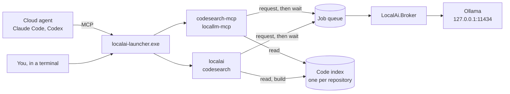
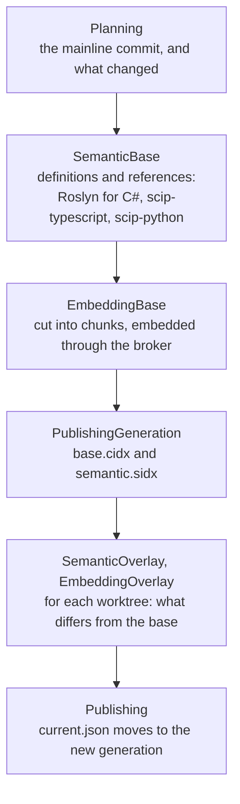
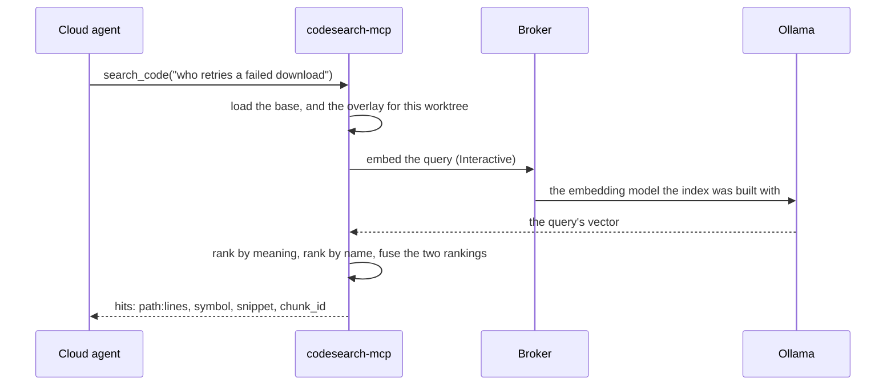
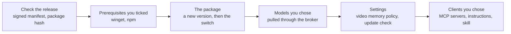

# How it works

[Contents](README.md#contents) · [Русская версия](how-it-works.ru.md)

**On this page**

- [The pieces](#the-pieces)
- [One queue in front of every model](#one-queue-in-front-of-every-model)
- [The code index](#the-code-index)
- [A search, step by step](#a-search-step-by-step)
- [Which model does what](#which-model-does-what)
- [How the saving is counted](#how-the-saving-is-counted)
- [What the installer does](#what-the-installer-does)

Local AI is a few small programs around two things it keeps on your disk: one queue of work
for the local models, and one code index per repository. This section follows a request
through them.

## The pieces

- **The launcher**, `%LOCALAPPDATA%\LocalAi\bin\launcher\localai-launcher.exe`, is the one
  path everything is registered against. `run <tool>` reads `bin\current.json` and starts the
  tool from the version it names under `bin\versions`, and it starts exactly four:
  `localai`, `codesearch`, `codesearch-mcp` and `locallm-mcp`. An update adds a version and
  moves the pointer, so nothing that points at the launcher has to change.
- **The MCP servers** are what Claude Code and Codex start. The installer registers them as
  `localai-launcher.exe run codesearch-mcp` and `run locallm-mcp`: twelve code-search tools
  and eleven local-model tools.
- **The broker**, `LocalAi.Broker`, is the only program that talks to Ollama. Nothing installs
  it as a service: the first tool that needs a model starts it in a hidden window, and it
  stays. There is one per runtime directory; a second copy finds the first one's lock and
  leaves.
- **The job queue** is a set of folders under `%LOCALAPPDATA%\LocalAi`. A tool writes its
  request there and waits for the answer; the broker takes the requests from it.
- **Ollama** runs the models, at `http://127.0.0.1:11434/` unless the broker is started with
  another address.

## One queue in front of every model

Every model call goes through the same queue — a search query, the embeddings of an index
build, a question to `ask_local`. That is how Claude, Codex and the command line use the
models at once without loading them over each other.

Each request carries a priority. A search query is `Interactive`, a question to a local model
is `Foreground`, and the embeddings of an index build are `Background`. The broker picks the
next job by priority first, then by whether its model is already in video memory, then by
the shortest expected job:

- a question you are waiting on does not queue behind an index build; it costs a model swap,
  and the trade is deliberate;
- among jobs of equal urgency, the model already loaded keeps working;
- a job that has waited long enough goes first whatever its priority;
- before it switches models, the broker waits a moment for more work for the same model.

Two identical requests that arrive while the first is still queued or running become one job.

By default a model has to fit entirely in video memory, and one that does not is refused
rather than run slowly. `localai policy set --residency` relaxes that, and an answer produced
under a relaxed policy names its shortfall beside the model.

## The code index

`localai sync` builds it — whether you run it, a Git hook runs it, or the agent calls
`index_refresh` — in this order:

- **The base** is built from a snapshot of the mainline commit: the branch the repository's
  manifest names, otherwise `dev`, otherwise `main`. Definitions come first on purpose, since
  a failed indexer aborts the build and should do so before the long embedding phase is paid
  for. An interrupted build resumes from its checkpoint.
- **An overlay** belongs to one worktree in one state — its tree and its uncommitted edits —
  and holds only the files that differ from the base, with the list of those it deleted. A
  search lays it over the base, so a branch costs its diff rather than a second index.
- **Chunks.** C# is parsed by Roslyn. Each type gets a chunk with its doc comment, its
  declaration and a one-line summary of every member; each method, constructor, operator,
  indexer and property with a real body gets its own. Fields and auto-properties stay in the
  type's chunk. TypeScript, JavaScript and Python files are cut on the definitions the SCIP
  indexers found. Everything else is cut into windows of 60 lines that overlap by 12.
- **Vectors** come from `qwen3-embedding:8b-q8_0`, 4096 numbers per chunk, at `Background`
  priority. The model is written into the index, and a search embeds its query with that
  model and no other.

On disk it lives under `%LOCALAPPDATA%\LocalAi\repositories\<id>`. The id comes from the
repository's Git common directory, so every worktree and every client share it.

| Path | What it holds |
| --- | --- |
| `current.json` | which generation is live |
| `generations\<generation>\` | `base.cidx`, `semantic.sidx`, and `manifest.json` with their checksums |
| `overlays\<generation>\<worktree>\<tree>\` | one overlay per worktree state; `clean` when nothing is uncommitted |
| `staging\` | a build in progress, and the checkpoint it resumes from |

## A search, step by step

- The base and the overlay must come from the same model and the same base commit;
  otherwise the search refuses rather than answer from code that is not there.
- **By meaning:** the cosine similarity between the query's vector and every chunk's.
- **By name:** each word of the query scores 3 in a chunk's symbol, 2 in its signature, and 1
  in its text or its path.
- The top 250 of each ranking are fused by reciprocal rank (k = 60). That is why one query
  finds both what you described and what you named.
- If the query cannot be embedded, the search answers from the ranking by name alone, and
  the answer records that no embeddings were used.

## Which model does what

`model-routing.json` holds the routes; the candidates are tried first, the fallbacks after.

| Profile | Used by | Candidates | Fallbacks |
| --- | --- | --- | --- |
| `VectorEmbedding` | the index and search queries | `qwen3-embedding:8b-q8_0` | `qwen3-embedding:8b-q8_0` |
| `ShortSummary` | `ask_local`, by default | `qwen3.5:9b`, `qwen2.5-coder:14b` | `qwen2.5-coder:14b`, `qwen3.5:9b` |
| `Extraction` | `ask_local` | `qwen3.5:9b`, `qwen2.5-coder:14b` | `qwen2.5-coder:14b`, `qwen3.5:9b` |
| `Classification` | `ask_local` | `qwen2.5-coder:14b`, `qwen3.5:9b` | `qwen3.5:9b`, `qwen2.5-coder:14b` |
| `CodeAnalysis`, `CodeReview` | `ask_local` | `gpt-oss:20b`, `qwen2.5-coder:14b` | `qwen3.5:9b` |
| `MultiFileSynthesis`, `Planning` | `ask_local` | `gpt-oss:20b`, `qwen3.5:9b`, `qwen2.5-coder:14b` | `qwen3.5:9b`, `qwen2.5-coder:14b` |
| `LogTriage` | `triage_log` | `qwen2.5-coder:14b` | `qwen3.5:9b` |
| `VisualAnalysis` | `read_image` | `qwen3-vl:8b-instruct-q8_0` | `qwen3.5:9b` |
| `Ocr` | `read_image` | `qwen3-vl:8b-instruct-q8_0`, `glm-ocr:bf16` | `qwen3-vl:8b-instruct-q8_0`, `qwen3.5:9b` |
| `ImageTranslation` | `read_image` | `qwen3-vl:8b-instruct-q8_0` | `translategemma:12b`, `qwen3.5:9b` |
| `PlainTranslation` | `translate_local`, plain text | `translategemma:12b` | `qwen3.5:9b` |
| `TechnicalTranslation` | `translate_local`, markdown | `translategemma:12b` | `qwen2.5-coder:14b`, `qwen3.5:9b` |

## How the saving is counted

Compare against the necessary context of the request, not entire candidate files. The
runtime requires an explicit task-input comparison basis before crediting file context;
retrieval alone does not establish that baseline. Previously read material is excluded,
and missing evidence produces an unknown estimate.

For an explicit text scenario, necessary unseen source context `S`, the full visible tool
response `V` and request `R` give the conservative comparison `S - V - 2R`. Local answer
generation is not automatically credited as avoided cloud generation. An explicit context
is an assumption supplied by the caller, not proof of the smallest possible cloud input.

`sourceContext: AlreadyPresent` excludes source credit; `Unknown` does not pretend it was
unseen. Skip a redundant local call when its remaining benefit cannot cover its overhead.
See [Understanding token estimates](token-comparison.md), including examples and
historical-runtime limits. This is an estimate, not a meter of billed tokens.

## What the installer does

- The release manifest is signed with ECDSA P-256 and checked against the key built into the
  installer; the package has to match the manifest.
- Prerequisites are installed machine-wide, only the ones you ticked, and Local AI never
  removes them: other programs may depend on them.
- Every step goes into a run journal. A run cut off halfway is reported the next time the
  installer starts, with an offer to undo what can be undone, and two runs cannot overlap.
- Removal takes Local AI out in this order: its processes, its entries in the client
  configurations, the Git hooks, its files, the PATH entry, the Apps & features entry, and
  the uninstaller's own copy last.

---

← [From the command line: not tokens, but time](from-the-command-line-not-tokens-but-time.md) · [Contents](README.md#contents) · [Dependencies](dependencies.md) →

<!-- Generated from the README by DocumentationSiteTests. -->
