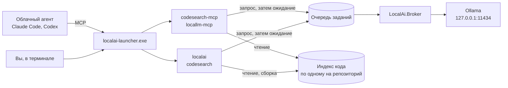
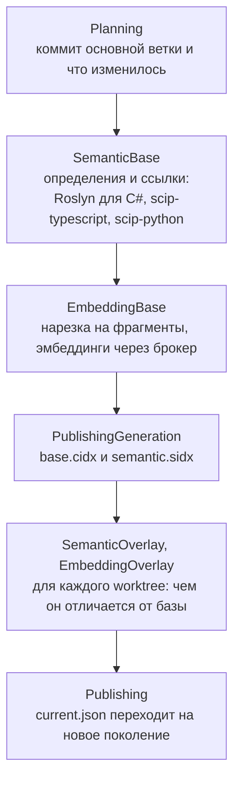
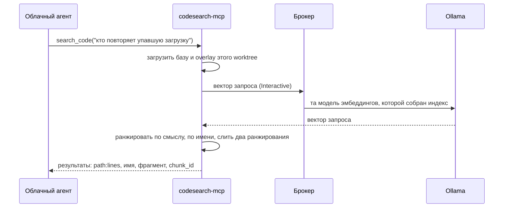
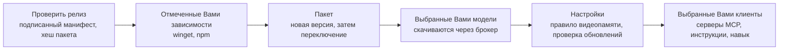

# Как это устроено

[Оглавление](README.ru.md#оглавление) · [English version](how-it-works.md)

**На этой странице**

- [Из чего состоит](#из-чего-состоит)
- [Одна очередь перед всеми моделями](#одна-очередь-перед-всеми-моделями)
- [Индекс кода](#индекс-кода)
- [Поиск по шагам](#поиск-по-шагам)
- [Какая модель что делает](#какая-модель-что-делает)
- [Как считается экономия](#как-считается-экономия)
- [Что делает установщик](#что-делает-установщик)

LocalAi — это несколько небольших программ вокруг двух вещей, которые хранятся у Вас на диске:
одной очереди работы для локальных моделей и одного индекса кода на каждый репозиторий. Ниже
видно, как запрос проходит через них.

## Из чего состоит

- **Launcher**, `%LOCALAPPDATA%\LocalAi\bin\launcher\localai-launcher.exe`, — единственный путь,
  на который всё зарегистрировано. `run <tool>` читает `bin\current.json` и запускает
  инструмент из той версии в `bin\versions`, которую тот называет, и запускает ровно четыре:
  `localai`, `codesearch`, `codesearch-mcp` и `locallm-mcp`. Обновление добавляет версию и
  переставляет указатель, поэтому всё, что указывает на launcher, менять не нужно.
- **Серверы MCP** запускают Claude Code и Codex. Установщик регистрирует их как
  `localai-launcher.exe run codesearch-mcp` и `run locallm-mcp`: двенадцать инструментов поиска
  по коду и одиннадцать — для локальных моделей.
- **Брокер**, `LocalAi.Broker`, — единственная программа, которая обращается к Ollama. Службой
  его никто не ставит: его запускает в скрытом окне первый инструмент, которому нужна модель, и
  дальше он работает сам. На один каталог рантайма приходится один брокер; вторая копия
  находит блокировку первой и завершается.
- **Очередь заданий** — это набор папок в `%LOCALAPPDATA%\LocalAi`. Инструмент кладёт туда свой
  запрос и ждёт ответа; брокер забирает запросы оттуда.
- **Ollama** выполняет модели по адресу `http://127.0.0.1:11434/`, если брокер не запущен с
  другим адресом.

## Одна очередь перед всеми моделями

Любое обращение к модели идёт через одну и ту же очередь: поисковый запрос, эмбеддинги при сборке
индекса, вопрос к `ask_local`. Поэтому Claude, Codex и командная строка пользуются моделями
одновременно и не загружают их поверх друг друга.

У каждого запроса есть приоритет. Поисковый запрос — `Interactive`, вопрос к локальной модели —
`Foreground`, эмбеддинги сборки индекса — `Background`. Следующее задание брокер выбирает
сначала по приоритету, затем по тому, загружена ли его модель в видеопамять, затем по
ожидаемой длительности — более короткое раньше:

- вопрос, ответа на который Вы ждёте, не стоит в очереди за сборкой индекса; за это платят
  сменой модели, и это сделано сознательно;
- среди заданий одной срочности продолжает работать уже загруженная модель;
- задание, которое ждёт слишком долго, идёт первым независимо от приоритета;
- прежде чем сменить модель, брокер коротко ждёт, не придёт ли ещё работа для той же модели.

Два одинаковых запроса, пока первый ещё в очереди или выполняется, становятся одним заданием.

По умолчанию модель должна целиком помещаться в видеопамять, и модель, которая не помещается,
получает отказ, а не работает медленно. `localai policy set --residency` ослабляет это правило,
и ответ, полученный при ослабленном правиле, называет нехватку рядом с именем модели.

## Индекс кода

Его собирает `localai sync` — запускаете ли его Вы, хук Git или агент через `index_refresh` —
в таком порядке:

- **База** строится из снимка коммита основной ветки: той, что названа в манифесте
  репозитория, иначе `dev`, иначе `main`. Определения строятся первыми намеренно: упавший
  индексатор прерывает сборку, и лучше узнать об этом до долгой фазы эмбеддингов. Прерванная
  сборка продолжается с контрольной точки.
- **Overlay** принадлежит одному worktree в одном состоянии — его дереву и незакоммиченным
  правкам — и содержит только файлы, которые отличаются от базы, и список удалённых. Поиск
  накладывает его на базу, поэтому ветка стоит своего диффа, а не второго индекса.
- **Фрагменты.** C# разбирает Roslyn. Каждый тип получает фрагмент со своим doc-комментарием,
  объявлением и однострочной сводкой каждого члена; свой фрагмент получает каждый метод,
  конструктор, оператор, индексатор и свойство с настоящим телом. Поля и автосвойства остаются
  во фрагменте типа. Файлы TypeScript, JavaScript и Python режутся по определениям, которые
  нашли индексаторы SCIP. Всё остальное режется на окна по 60 строк с перекрытием в 12.
- **Векторы** считает `qwen3-embedding:8b-q8_0`, 4096 чисел на фрагмент, с приоритетом
  `Background`. Модель записана в индексе, и поиск строит вектор запроса этой моделью и никакой
  другой.

На диске индекс лежит в `%LOCALAPPDATA%\LocalAi\repositories\<id>`. Идентификатор берётся из
общего каталога Git репозитория, поэтому он общий для всех его worktree и всех клиентов.

| Путь | Что там |
| --- | --- |
| `current.json` | какое поколение сейчас действует |
| `generations\<generation>\` | `base.cidx`, `semantic.sidx` и `manifest.json` с их контрольными суммами |
| `overlays\<generation>\<worktree>\<tree>\` | по overlay на каждое состояние worktree; `clean`, если незакоммиченного нет |
| `staging\` | сборка, которая идёт сейчас, и контрольная точка, с которой она продолжится |

## Поиск по шагам

- База и overlay должны быть собраны одной моделью и от одного базового коммита; иначе поиск
  отказывает, а не отвечает по коду, которого нет.
- **По смыслу:** косинусная близость вектора запроса к вектору каждого фрагмента.
- **По имени:** каждое слово запроса даёт 3 в имени фрагмента, 2 в его сигнатуре и 1 в тексте
  или пути.
- Первые 250 из каждого ранжирования сливаются по обратному рангу (k = 60). Поэтому один запрос
  находит и то, что Вы описали, и то, что Вы назвали.
- Если вектор запроса получить нельзя, поиск отвечает по одному ранжированию по имени, и в
  ответе отмечено, что эмбеддинги не использовались.

## Какая модель что делает

Маршруты лежат в `model-routing.json`; сначала пробуются основные модели, затем резервные.

| Профиль | Кто пользуется | Основные | Резервные |
| --- | --- | --- | --- |
| `VectorEmbedding` | индекс и поисковые запросы | `qwen3-embedding:8b-q8_0` | `qwen3-embedding:8b-q8_0` |
| `ShortSummary` | `ask_local` по умолчанию | `qwen3.5:9b`, `qwen2.5-coder:14b` | `qwen2.5-coder:14b`, `qwen3.5:9b` |
| `Extraction` | `ask_local` | `qwen3.5:9b`, `qwen2.5-coder:14b` | `qwen2.5-coder:14b`, `qwen3.5:9b` |
| `Classification` | `ask_local` | `qwen2.5-coder:14b`, `qwen3.5:9b` | `qwen3.5:9b`, `qwen2.5-coder:14b` |
| `CodeAnalysis`, `CodeReview` | `ask_local` | `gpt-oss:20b`, `qwen2.5-coder:14b` | `qwen3.5:9b` |
| `MultiFileSynthesis`, `Planning` | `ask_local` | `gpt-oss:20b`, `qwen3.5:9b`, `qwen2.5-coder:14b` | `qwen3.5:9b`, `qwen2.5-coder:14b` |
| `LogTriage` | `triage_log` | `qwen2.5-coder:14b` | `qwen3.5:9b` |
| `VisualAnalysis` | `read_image` | `qwen3-vl:8b-instruct-q8_0` | `qwen3.5:9b` |
| `Ocr` | `read_image` | `qwen3-vl:8b-instruct-q8_0`, `glm-ocr:bf16` | `qwen3-vl:8b-instruct-q8_0`, `qwen3.5:9b` |
| `ImageTranslation` | `read_image` | `qwen3-vl:8b-instruct-q8_0` | `translategemma:12b`, `qwen3.5:9b` |
| `PlainTranslation` | `translate_local`, обычный текст | `translategemma:12b` | `qwen3.5:9b` |
| `TechnicalTranslation` | `translate_local`, markdown | `translategemma:12b` | `qwen2.5-coder:14b`, `qwen3.5:9b` |

## Как считается экономия

Каждый ответ заканчивается строкой с моделью, временем и сэкономленными облачными токенами.
Экономия сравнивает два способа получить один и тот же ответ:

- **Вход.** Без инструмента облачный агент прочёл бы источники сам: файлы, лог, изображение. С
  инструментом он читает свой вызов и ответ целиком. Текст считается токенизатором `o200k_base`,
  изображения — по формуле плиток GPT-4o; оба названия напечатаны в строке.
- **Выход.** То, что написала локальная модель, агент иначе написал бы сам; с инструментом он
  пишет только вызов.
- Подсчёт исходит из того, что агент источники ещё не читал. Вызывающий, у которого они уже в
  контексте, сообщает это через `sourceContext: AlreadyPresent`, и эта часть не считается.
- Это оценка, и она так и подписана; это не расход Вашего аккаунта.

## Что делает установщик

- Манифест релиза подписан ECDSA P-256 и проверяется ключом, встроенным в установщик; пакет
  обязан совпасть с манифестом.
- Зависимости ставятся на весь компьютер, только отмеченные, и LocalAi их никогда не удаляет:
  от них могут зависеть другие программы.
- Каждый шаг записывается в журнал запуска. Запуск, прерванный на середине, установщик называет
  при следующем старте и предлагает откатить то, что откатывается; два запуска не могут идти
  одновременно.
- Удаление убирает LocalAi в таком порядке: его процессы, его записи в конфигурациях клиентов,
  хуки Git, его файлы, запись в PATH, запись в «Установка и удаление программ» и последней —
  собственную копию деинсталлятора.

---

← [Из консоли: не про токены, а про время](from-the-command-line-not-tokens-but-time.ru.md) · [Оглавление](README.ru.md#оглавление) · [Зависимости](dependencies.ru.md) →

<!-- Generated from the README by DocumentationSiteTests. -->
