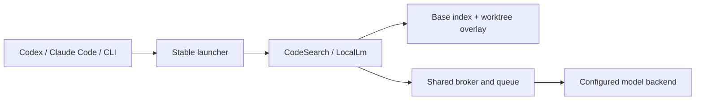

# Open-source project guide

[Русская версия](opensource.ru.md)

Local AI Toolkit is Windows developer tooling under the [MIT license](https://github.com/MrAliev/local-ai-toolkit/blob/main/LICENSE).
You can use, modify and redistribute the project's code, including commercially, subject
to that license. Dependencies and model weights retain their own licenses.

## Choose a starting point

| Your goal | Start here |
| --- | --- |
| Install the current release | [Installation](installing.md) and [downloads](https://github.com/MrAliev/local-ai-toolkit/releases/latest) |
| Understand the system | [How it works](how-it-works.md) and [responsibility map](architecture/responsibility-map.md) |
| Connect a repository | [Command-line walkthrough](using-it-from-the-command-line.md) |
| Check data handling | [Privacy](privacy.md) and [security policy](https://github.com/MrAliev/local-ai-toolkit/blob/main/SECURITY.md) |
| Understand token estimates | [Token comparison](token-comparison.md) |
| Contribute a change | [Contributing](https://github.com/MrAliev/local-ai-toolkit/blob/main/CONTRIBUTING.md) and [governance](governance.md) |
| Request help | [Support](support.md) |
| Publish a release | [Publication checklist](publication.md) and [code signing policy](code-signing-policy.md) |

## Project boundaries

The launcher gives clients a stable executable path. MCP servers and CLIs share a durable
broker; only that broker sends inference requests to the configured model backend.
Code search combines embeddings with symbol/name matching, using a repository base index
and worktree overlays. Repositories are connected explicitly.

Local inference does not mean that returned excerpts never reach the cloud: the calling
client receives them and controls what it forwards. A GPU policy is a resource constraint,
not a privacy guarantee. See [Privacy](privacy.md).

## Documentation surfaces

- The paired READMEs are the source for the section-by-section reference.
- GitHub Wiki is a navigable handbook with diagrams and expandable explanations.
- GitHub Pages adds an interactive architecture view and an illustrative token calculator.
  It does not read your repository, contact a model, or measure your account usage.
- Documentation changes are reviewed with code. The Wiki is published from versioned
  sources, so edits there should be proposed in this repository.

## Distribution and trust

Current releases use an ECDSA-signed manifest and package hashes. Authenticode onboarding
with SignPath Foundation is a separate process; do not assume a Windows publisher
signature until a release explicitly identifies it. GitHub attestations of uploaded
assets do not, on their own, prove those assets were built by CI from the tagged source.

See [code signing policy](code-signing-policy.md). No commercial support, availability
guarantee or certificate approval is promised by this documentation.
