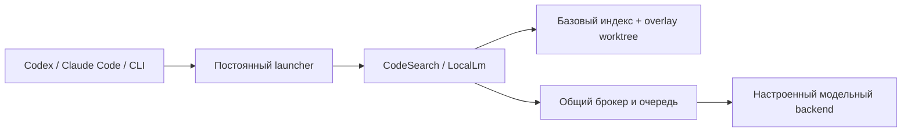

# Руководство по открытому проекту

[English version](opensource.md)

Local AI Toolkit — инструменты разработчика для Windows под [лицензией MIT](https://github.com/MrAliev/local-ai-toolkit/blob/main/LICENSE).
Код проекта можно использовать, изменять и распространять, в том числе коммерчески,
с соблюдением лицензии. У зависимостей и весов моделей остаются собственные лицензии.

## С чего начать

| Задача | Документация |
| --- | --- |
| Установить текущий релиз | [Установка](installing.ru.md) и [загрузки](https://github.com/MrAliev/local-ai-toolkit/releases/latest) |
| Понять устройство системы | [Как это работает](how-it-works.ru.md) и [карта ответственности](architecture/responsibility-map.ru.md) |
| Подключить репозиторий | [Пошаговая работа из CLI](using-it-from-the-command-line.ru.md) |
| Проверить обработку данных | [Конфиденциальность](privacy.ru.md) и [безопасность](https://github.com/MrAliev/local-ai-toolkit/blob/main/SECURITY.ru.md) |
| Разобраться в оценке токенов | [Сравнение токенов](token-comparison.ru.md) |
| Внести изменение | [Участие](https://github.com/MrAliev/local-ai-toolkit/blob/main/CONTRIBUTING.ru.md) и [управление проектом](governance.ru.md) |
| Получить помощь | [Поддержка](support.ru.md) |
| Опубликовать релиз | [Проверки публикации](publication.ru.md) и [политика подписи](code-signing-policy.ru.md) |

## Границы проекта

Launcher даёт клиентам постоянный путь запуска. MCP-серверы и CLI используют общий
долговечный брокер; только он отправляет запросы настроенному модельному backend.
Поиск сочетает embeddings с именами символов, используя базовый индекс репозитория
и overlays рабочих деревьев. Репозитории подключаются явно.

Локальное выполнение не означает, что возвращённые фрагменты никогда не попадут в облако:
вызывающий клиент получает их и управляет дальнейшей передачей. Политика GPU ограничивает
использование ресурсов, а не гарантирует конфиденциальность. См. [Конфиденциальность](privacy.ru.md).

## Где читать документацию

- Парные README служат источником справочника, разбитого на разделы.
- GitHub Wiki — руководство с навигацией, схемами и раскрывающимися пояснениями.
- GitHub Pages добавляет интерактивную архитектуру и учебный калькулятор токенов.
  Он не читает Ваш репозиторий, не обращается к модели и не измеряет расход аккаунта.
- Документация проходит ревью вместе с кодом. Wiki публикуется из версионируемых
  исходников; её изменения следует предлагать в этом репозитории.

## Распространение и доверие

Текущие релизы используют манифест с ECDSA-подписью и хеши пакета. Подключение Authenticode
через SignPath Foundation — отдельный процесс: наличие подписи издателя Windows следует
проверять по конкретному релизу. Аттестация загруженных файлов GitHub сама по себе
не доказывает, что файлы собраны CI из исходников тега.

См. [политику подписи](code-signing-policy.ru.md). Эта документация не обещает коммерческую
поддержку, гарантированную доступность или одобрение сертификата.
