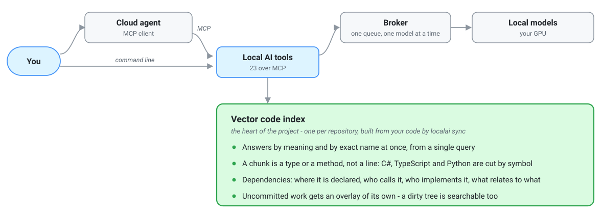

# Two ways to use it

[Contents](README.md#contents) · [Русская версия](two-ways-to-use-it.ru.md)

**As subagents to a cloud agent.** MCP clients can call Local AI's tools directly.
The agent delegates repetitive work and uses the results as context.

**Without a cloud agent, from the command line.** The same capabilities, but as helpers for
you: search code by meaning, triage a log, read an image, translate a document. It is the
same index and the same models either way, so nothing is lost by starting here and adding an
agent later.

**Why there is a broker in the middle.** There is one per runtime directory —
`%LOCALAPPDATA%\LocalAi`, so one per Windows user — and it holds the queue.
Agent clients and the command line share that queue. The broker schedules their
requests and reuses a model already loaded in video memory when possible.

**Model processing is local by default.** The broker sends your code and the prompts built
from it to Ollama at `http://127.0.0.1:11434/`, on this machine; a broker started with another
address sends them to that address. Which network interfaces Ollama itself listens on is
Ollama's own setting. The update check is off by default. Models and missing prerequisites
are downloaded when you ask for them.

Local tools return results to the client that called them, including model answers and
selected source excerpts. A cloud agent can include those results in requests to its cloud
provider. Local inference therefore does not guarantee that returned content stays on your
computer; the client's configuration and data policy govern that transfer.

---

[Contents](README.md#contents) · [What a cloud agent gets](what-a-cloud-agent-gets.md) →

<!-- Generated from the README by DocumentationSiteTests. -->
