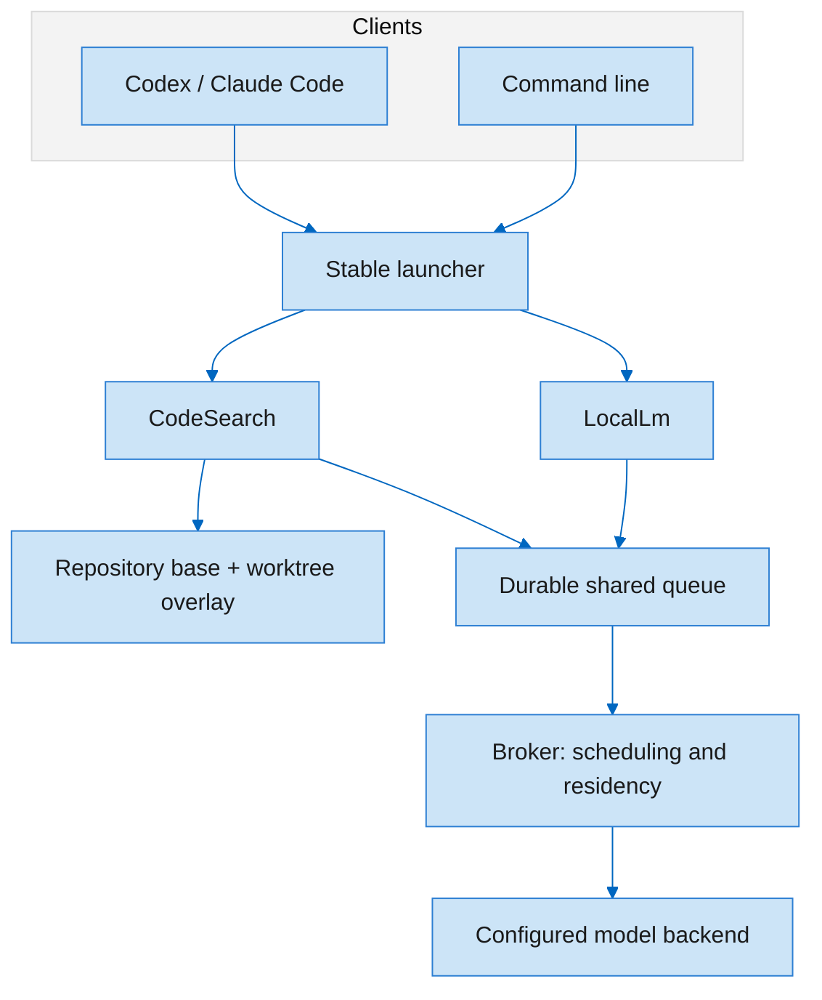
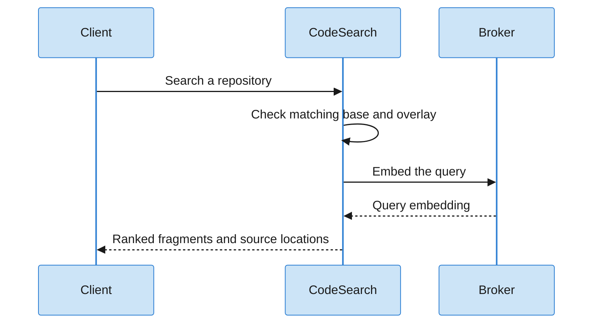

# Architecture · one shared inference boundary

[Русская версия](Architecture.ru.md) · [Home](Home.md)

| Boundary | Responsibility |
| --- | --- |
| Launcher | Stable executable path across installed runtime versions |
| CodeSearch | Locate matching code and navigate indexed symbols |
| LocalLm | Bounded tasks over files, logs, images and translation |
| Index | Base generation plus overlay matching the worktree state |
| Broker | Shared scheduling, backend access and residency checks |
| Calling client | Decide what results it forwards to a cloud service |

See [the full architecture](../how-it-works.md) and [responsibility map](../architecture/responsibility-map.md).
The drawings explain boundaries; they are not live telemetry.
