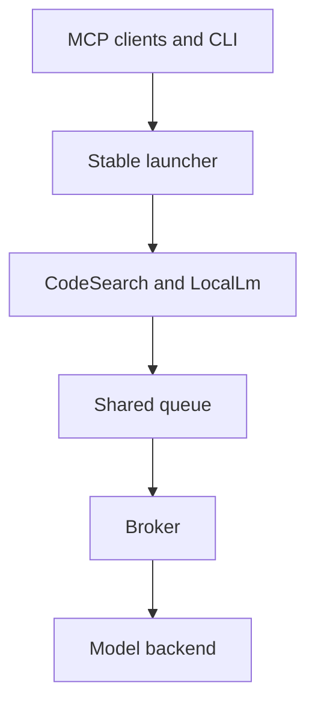
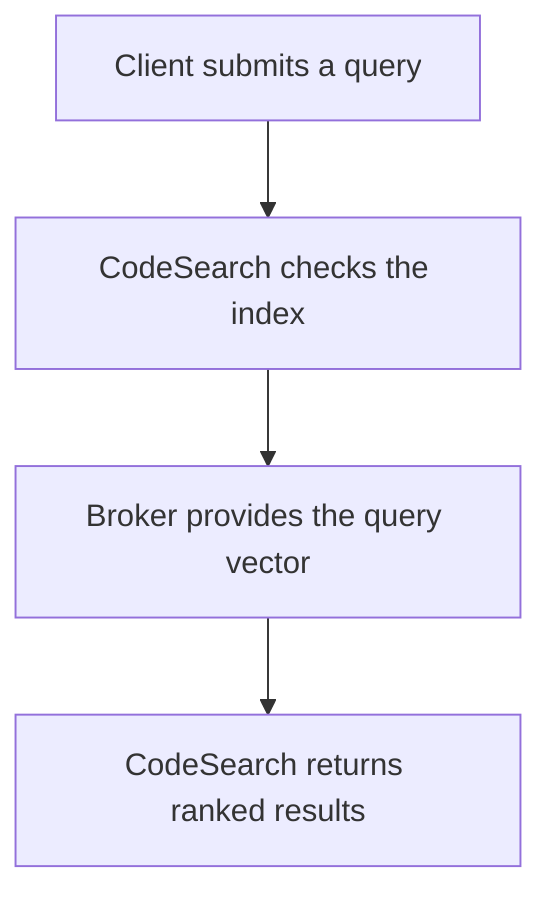

# Architecture · one shared inference boundary

[Русская версия](Architecture.ru.md) · [Home](Home.md)

See the [product contracts and release acceptance matrix](https://github.com/MrAliev/local-ai-toolkit/blob/main/README.md#product-contracts-and-release-acceptance) for owning components, source references, and checks.

Clients use a stable launcher to start CodeSearch and LocalLm. CodeSearch reads the index for the current worktree. When either tool needs a model, its request goes through the same broker and queue.

## What each component does

- **Launcher.** Stable executable path across installed runtime versions.
- **CodeSearch.** Locate matching code and navigate indexed symbols.
- **LocalLm.** Bounded tasks over files, logs, images and translation.
- **Index.** Base generation plus overlay matching the worktree state.
- **Broker.** Shared scheduling, backend access and residency checks.
- **Calling client.** Decide what results it forwards to a cloud service.

## How a search works

On each search, CodeSearch checks which index base and overlay match the worktree, requests a query vector from the broker, and returns ranked results with file paths and line ranges.

- [Full architecture](../how-it-works.md)
- [Responsibility map](../architecture/responsibility-map.md)
