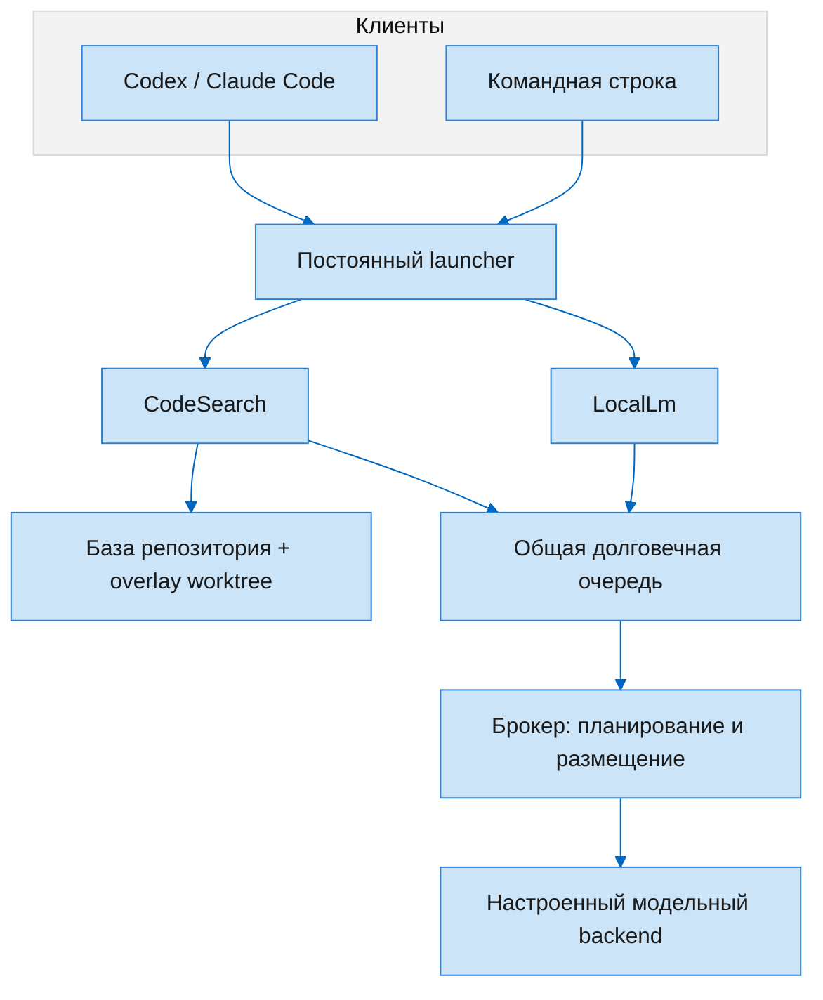
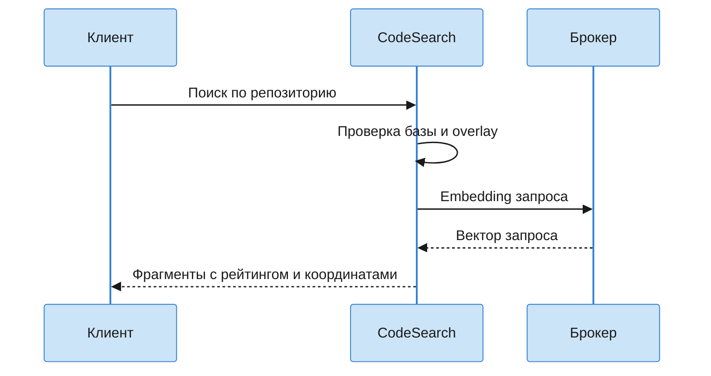

# Архитектура · общая граница модельных вычислений

[English version](Architecture.md) · [Главная](Home.ru.md)

| Граница | Ответственность |
| --- | --- |
| Launcher | Постоянный путь запуска при обновлениях runtime |
| CodeSearch | Поиск кода и навигация по индексированным символам |
| LocalLm | Ограниченные задачи по файлам, журналам, изображениям и переводу |
| Индекс | Базовое поколение и overlay состояния рабочего дерева |
| Брокер | Общее планирование, доступ к backend и проверки размещения |
| Вызывающий клиент | Решение о передаче результатов облачному сервису |

См. [полную архитектуру](../how-it-works.ru.md) и [карту ответственности](../architecture/responsibility-map.ru.md).
Схемы объясняют границы, а не показывают текущую телеметрию.
