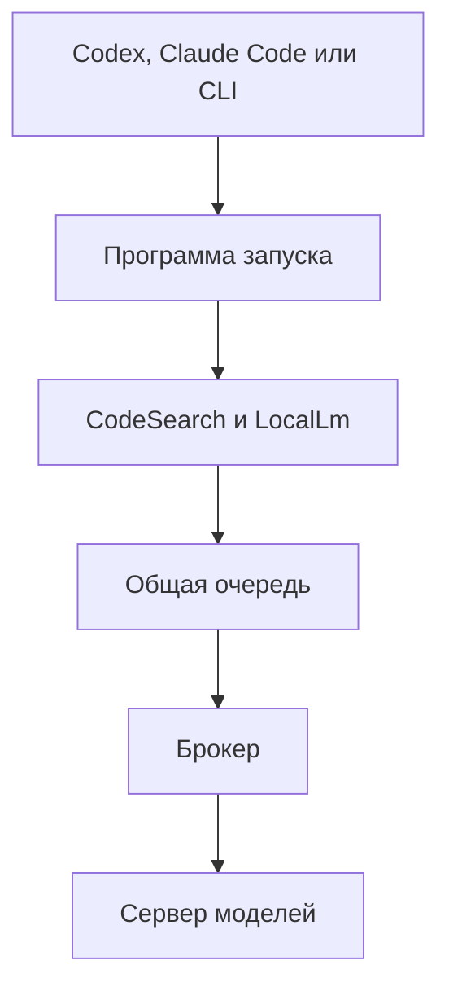
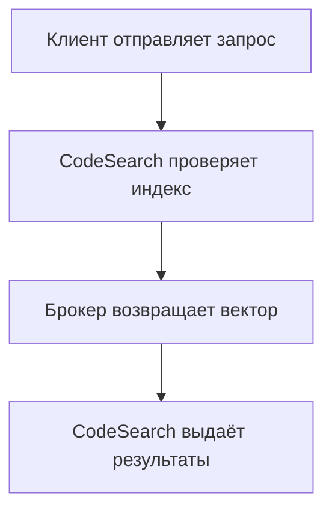

# Архитектура LocalAI

[English version](Architecture.md) · [Главная](Home.ru.md)

[Контракты продукта и приёмка релиза](https://github.com/MrAliev/local-ai-toolkit/blob/main/README.ru.md#контракты-продукта-и-приёмка-релиза) связывают поведение компонентов с реализацией и тестами.

Клиенты запускают CodeSearch и LocalLm через программу запуска. CodeSearch использует индекс текущего рабочего дерева. Если инструменту нужна модель, запрос поступает в общую очередь брокера.

## Что делает каждый компонент

- **Программа запуска.** Постоянный путь к `localai-launcher.exe` при обновлении LocalAI.
- **CodeSearch.** Поиск кода и навигация по индексированным символам.
- **LocalLm.** Разбор файлов, журналов и изображений, а также перевод в пределах заданных ограничений.
- **Индекс.** Базовая часть и слой изменений текущего рабочего дерева (`overlay`).
- **Брокер.** Планирование заданий в общей очереди, вызов сервера моделей и проверка размещения модели в памяти.
- **Вызывающий клиент.** Решение о передаче результатов облачному сервису.

## Как работает поиск

При поиске CodeSearch проверяет базовую часть индекса и слой изменений для текущего рабочего дерева. Затем он запрашивает у брокера вектор поискового запроса и возвращает подходящие фрагменты с путями и номерами строк.

- [Полная архитектура](../how-it-works.ru.md)
- [Карта ответственности](../architecture/responsibility-map.ru.md)
