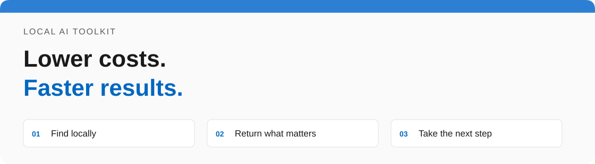
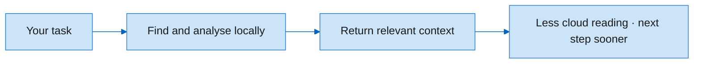

# Local AI Toolkit · Handbook

[Русская версия](Home.ru.md)

**Lower costs. Faster results.** Reduce paid cloud context with local search and analysis.
Find relevant code in a ready index and give your agent concise findings with source locations.

[Explore the interactive portal](https://mraliev.github.io/local-ai-toolkit/) · [Download](https://github.com/MrAliev/local-ai-toolkit/releases/latest) · [Source](https://github.com/MrAliev/local-ai-toolkit)

| Start | Understand | Operate | Contribute |
| --- | --- | --- | --- |
| [First repository](Getting-started.md) | [Architecture](Architecture.md) | [Token estimates](Token-estimates.md) | [Community](Community.md) |

## Where you save work

| Cost | Speed | Clear estimates |
| --- | --- | --- |
| Read locally first; send only necessary findings to the cloud. | Use semantic and symbol search in a ready index instead of opening candidate files one by one. | Compare against necessary request context, including tool overhead. |

Savings and latency depend on the task, index, queue and hardware. Initial indexing takes
time; local inference is not automatically faster, and a call can add token overhead.
[Explore the token comparison](Token-estimates.md).

## What you get

- Semantic and symbol-based code search, with source locations and worktree-aware indexes.
- Local file/log/image/translation tools, shared by MCP clients and the CLI.
- A durable broker and queue coordinating model work across projects.
- Explicit residency policies and usage notices that retain uncertainty.

What “local” does and does not mean

Inference uses the configured backend through the shared broker. Returned text and source
excerpts go to the calling client, which may forward them to a cloud provider.
[Read the privacy policy](../privacy.md).

How these pages stay current

Wiki sources live in the main repository under `docs/wiki`. Propose a PR there rather
than making an unreviewed copy here. The paired READMEs generate the full reference.
Diagrams and disclosure panels work in GitHub Wiki; the portal provides richer interactive
views and a local-only illustrative token calculator.

[Trust and signing](Trust-and-security.md) · [Full reference](../README.md) · [Support](../support.md)
