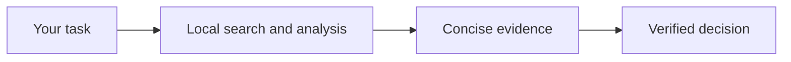

# Local AI Toolkit · Handbook

[Русская версия](Home.ru.md)

**Local context. Clear answers.** Repository-aware search and local-model tools for Windows.

[Explore the interactive portal](https://mraliev.github.io/local-ai-toolkit/) · [Download](https://github.com/MrAliev/local-ai-toolkit/releases/latest) · [Source](https://github.com/MrAliev/local-ai-toolkit)

| Start | Understand | Operate | Contribute |
| --- | --- | --- | --- |
| [First repository](Getting-started.md) | [Architecture](Architecture.md) | [Token estimates](Token-estimates.md) | [Community](Community.md) |

## What you get

- Semantic and symbol-based code search, with source locations and worktree-aware indexes.
- Local file/log/image/translation tools, shared by MCP clients and the CLI.
- A durable broker and queue coordinating model work across projects.
- Explicit residency policies and usage notices that retain uncertainty.

What “local” does and does not mean

Inference uses the configured backend through the shared broker. Returned text and source
excerpts go to the calling client, which may forward them to a cloud provider.
[Read the privacy policy](../privacy.md).

How these pages stay current

Wiki sources live in the main repository under `docs/wiki`. Propose a PR there rather
than making an unreviewed copy here. The paired READMEs generate the full reference.
Diagrams and disclosure panels work in GitHub Wiki; the portal provides richer interactive
views and a local-only illustrative token calculator.

[Trust and signing](Trust-and-security.md) · [Full reference](../README.md) · [Support](../support.md)
