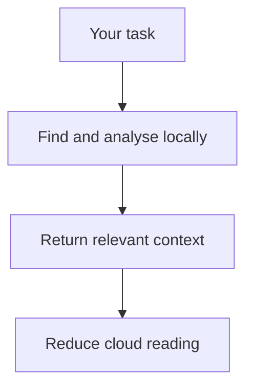

# Local AI Toolkit · Handbook

[Русская версия](Home.ru.md)

Reduce paid cloud context with local search and analysis.
Find relevant code in a ready index and give your agent concise findings with source locations.

## Start here

- [Install or update](Getting-started.md#install-or-update) for Windows requirements, release verification and upgrades.
- [Connect a repository and run your first search](Getting-started.md#connect-a-repository-and-run-your-first-search) for the PowerShell commands and expected result.
- [Diagnose a queue or an error](Getting-started.md#diagnose-a-queue-or-an-error) to inspect a running sync, request cancellation or collect an error report.

How a request moves through LocalAI

## Where you save work

- **Cost.** Read locally first and send necessary findings to the cloud.
- **Speed.** Search by meaning or symbol in a ready index to reach the relevant code directly.
- **Estimates.** Compare with the context the cloud would need and account for tool overhead.

Savings and latency depend on the task, index, queue and hardware. Initial indexing takes
time; local inference is not automatically faster, and a call can add token overhead.
[Explore the token comparison](Token-estimates.md).

## What you get

- Semantic and symbol-based code search, with source locations and worktree-aware indexes.
- Local file/log/image/translation tools, shared by MCP clients and the CLI.
- A durable broker and queue coordinating model work across projects.
- Explicit residency policies and usage notices that retain uncertainty.

What “local” does and does not mean

Inference uses the configured backend through the shared broker. Returned text and source
excerpts go to the calling client, which may forward them to a cloud provider.
[Read the privacy policy](../privacy.md).

How these pages stay current

Wiki sources live in the main repository under `docs/wiki`. Propose a PR there rather
than making an unreviewed copy here. The paired READMEs generate the full reference.
The portal offers interactive diagrams and an illustrative token calculator that runs in the browser.

## More guides and resources

- [Architecture](Architecture.md)
- [Trust and signing](Trust-and-security.md)
- [Full reference](../README.md)
- [Support](../support.md)
- [Community](Community.md)
- [Interactive portal](https://mraliev.github.io/local-ai-toolkit/)
- [Download](https://github.com/MrAliev/local-ai-toolkit/releases/latest)
- [Source](https://github.com/MrAliev/local-ai-toolkit)
