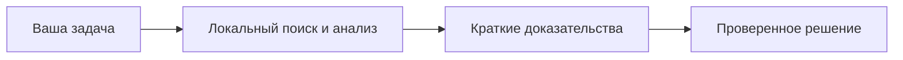

# Local AI Toolkit · Руководство

[English version](Home.md)

**Контекст рядом с кодом.** Поиск с учётом репозитория и локальные модели для Windows.

[Интерактивный портал](https://mraliev.github.io/local-ai-toolkit/?lang=ru) · [Скачать](https://github.com/MrAliev/local-ai-toolkit/releases/latest) · [Исходный код](https://github.com/MrAliev/local-ai-toolkit)

| Начать | Разобраться | Работать | Участвовать |
| --- | --- | --- | --- |
| [Первый репозиторий](Getting-started.ru.md) | [Архитектура](Architecture.ru.md) | [Оценка токенов](Token-estimates.ru.md) | [Сообщество](Community.ru.md) |

## Возможности

- Поиск по смыслу и символам с координатами и учётом рабочего дерева.
- Локальная работа с файлами, журналами, изображениями и переводами через MCP и CLI.
- Долговечный брокер и очередь, согласующие задачи разных проектов.
- Явные политики размещения и отчёты, сохраняющие неопределённость.

Что означает «локально» и где границы

Модели вызываются через общий брокер и настроенный backend. Ответы и фрагменты исходников
попадают к вызывающему клиенту, который может передавать их облачному провайдеру.
[Политика конфиденциальности](../privacy.ru.md).

Как обновляются страницы

Исходники Wiki находятся в основном репозитории в `docs/wiki`. Предлагайте PR там,
чтобы здесь не появлялась непроверенная копия. Полный справочник генерируется из парных README.
Схемы и раскрывающиеся панели работают в GitHub Wiki; портал добавляет более насыщенные
интерактивные представления и учебный калькулятор токенов без отправки данных.

[Доверие и подпись](Trust-and-security.ru.md) · [Полный справочник](../README.ru.md) · [Поддержка](../support.ru.md)
