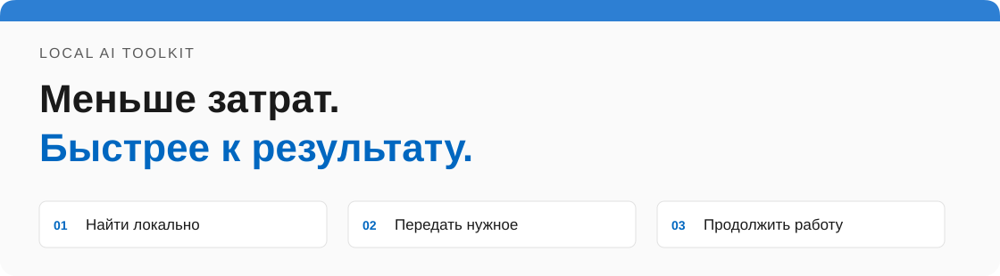
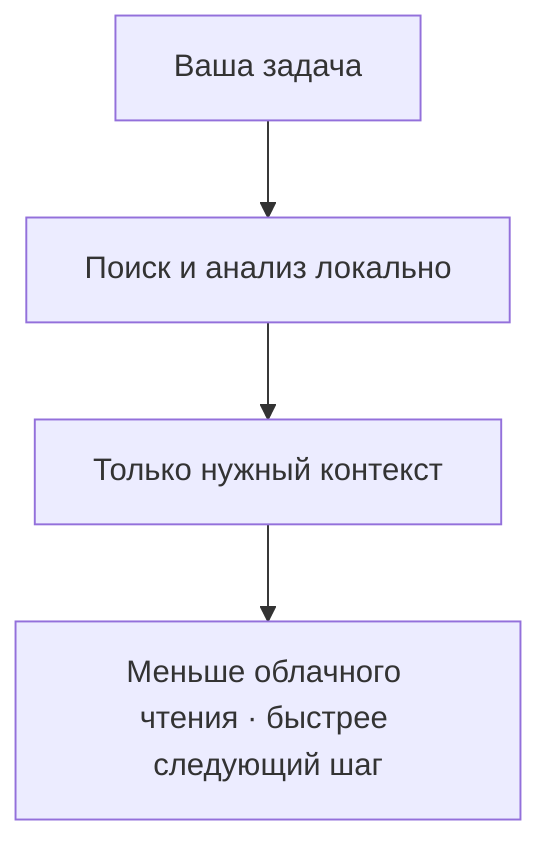

# Local AI Toolkit · Руководство

[English version](Home.md)

**Меньше затрат. Быстрее к результату.** Сокращайте платный облачный контекст с помощью
локального поиска и анализа. Находите нужный код в готовом индексе и передавайте агенту
краткие выводы с путями к файлам и номерами строк.

[Интерактивный портал](https://mraliev.github.io/local-ai-toolkit/?lang=ru) · [Скачать](https://github.com/MrAliev/local-ai-toolkit/releases/latest) · [Исходный код](https://github.com/MrAliev/local-ai-toolkit)

## С чего начать

- [Установить или обновить](Getting-started.ru.md#установить-или-обновить) — требования Windows, проверка пакета и обновление.
- [Подключить репозиторий и выполнить первый поиск](Getting-started.ru.md#подключить-репозиторий-и-выполнить-первый-поиск) — команды PowerShell и ожидаемый результат.
- [Разобраться с очередью или ошибкой](Getting-started.ru.md#разобраться-с-очередью-или-ошибкой) — ход синхронизации, отмена операции и данные для диагностики.

[Архитектура](Architecture.ru.md) · [Оценка токенов](Token-estimates.ru.md) · [Сообщество](Community.ru.md)

LocalAI ищет и анализирует нужные материалы локально. Агент получает результат и может продолжить работу, не открывая все исходные файлы.

## Где сокращается работа

| Затраты | Скорость | Понятная оценка |
| --- | --- | --- |
| Первое чтение — локально; в облако отправляются нужные выводы. | Поиск по смыслу и символам в готовом индексе вместо последовательного открытия файлов. | Сравнение с необходимым контекстом запроса с учётом накладных расходов. |

Экономия и время ответа зависят от задачи, индекса, очереди и оборудования. Первичная
индексация занимает время; локальные вычисления не всегда быстрее, а вызов может добавить
расход токенов. [Разобраться в оценке](Token-estimates.ru.md).

## Возможности

- Поиск по смыслу и символам в индексе текущего рабочего дерева.
- Локальная работа с файлами, журналами, изображениями и переводами через MCP и CLI.
- Общий брокер и очередь, которая сохраняет задания разных проектов на диске.
- Настраиваемые требования к размещению моделей в памяти и отчёты, которые указывают, когда данных для оценки токенов недостаточно.

Что означает «локально» и где границы

Общий брокер обращается к настроенному серверу моделей. Ответы и фрагменты исходников
попадают к вызывающему клиенту, который может передавать их облачному провайдеру.
[Политика конфиденциальности](../privacy.ru.md).

Как обновляются страницы

Исходники Wiki находятся в основном репозитории в `docs/wiki`. Предлагайте изменения через PR.
Полный справочник генерируется из английского и русского README. На портале есть интерактивные схемы и учебный калькулятор токенов, который работает в браузере.

[Доверие и подпись](Trust-and-security.ru.md) · [Полный справочник](../README.ru.md) · [Поддержка](../support.ru.md)
