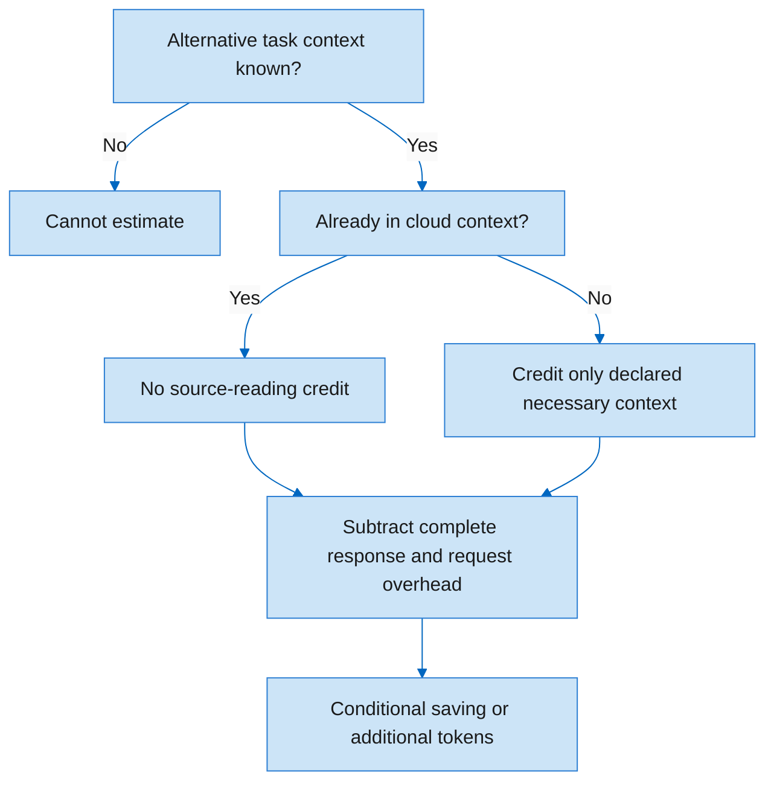

# Token estimates · evidence before a number

[Русская версия](Token-estimates.ru.md) · [Home](Home.md)

**Necessary request context is the baseline. Whole-file sizes are not a universal substitute.**

For an explicit text scenario: `S - V - 2R`, where `S` is necessary unseen source context,
`V` the complete visible response and `R` the request. Local generation is not automatically
credited as avoided cloud generation. Unknown provenance or an unknown baseline remains unknown.

Example: a 100,000-token file, a 4,000-token task

If the task needs 4,000 source tokens, the returned response is 600 and the request is 100,
the illustrative comparison is `4,000 - 600 - 200 = 3,200`, not 99,200.
If the source was already read, its credit becomes zero and the same call adds 800 tokens.
This example is not a measured result or an account charge.

[Try the illustrative calculator](https://mraliev.github.io/local-ai-toolkit/#tokens) ·
[Full methodology and limits](../token-comparison.md).
