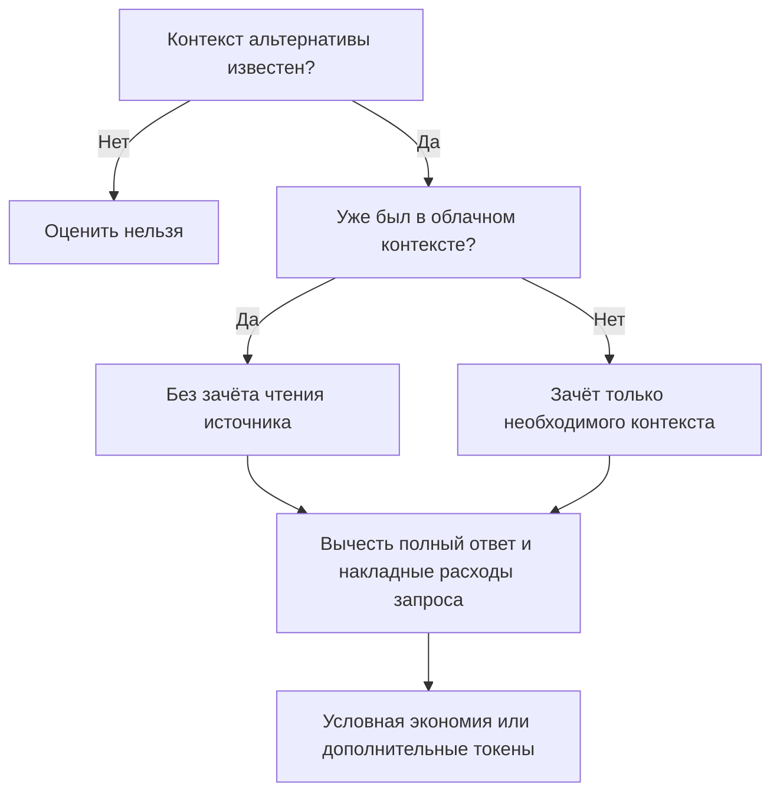

# Оценка токенов · сначала доказательства

[English version](Token-estimates.md) · [Главная](Home.ru.md)

**База сравнения — необходимый контекст запроса. Размер целого файла не заменяет её автоматически.**

Явный текстовый сценарий: `S - V - 2R`, где `S` — необходимый новый контекст источника,
`V` — полный видимый ответ, `R` — запрос. Локальная генерация автоматически
не считается сэкономленной облачной генерацией. Неизвестное происхождение или база дают неизвестную оценку.

Пример: файл на 100 000 токенов и задача на 4 000

Если задача требует 4 000 токенов источника, ответ занимает 600, а запрос — 100,
учебное сравнение: `4 000 - 600 - 200 = 3 200`, а не 99 200.
Если источник уже прочитан, зачёт становится нулевым, и тот же вызов добавляет 800 токенов.
Пример не является замером или расходом аккаунта.

[Учебный калькулятор](https://mraliev.github.io/local-ai-toolkit/?lang=ru#tokens) ·
[Полная методика и ограничения](../token-comparison.ru.md).
