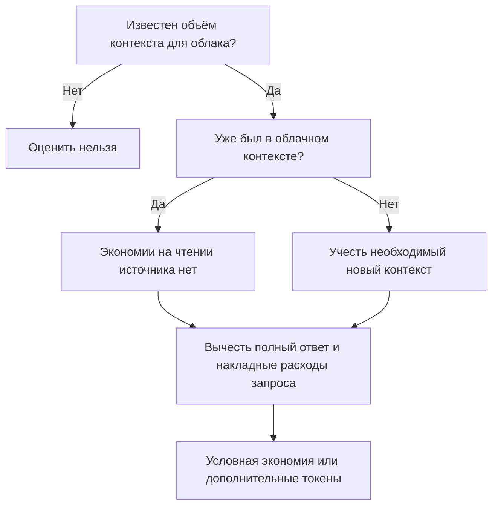

# Оценка токенов · сначала доказательства

[English version](Token-estimates.md) · [Главная](Home.ru.md)

Реализация и тесты учёта токенов указаны в [контрактах продукта](https://github.com/MrAliev/local-ai-toolkit/blob/main/README.ru.md#контракты-продукта-и-приёмка-релиза).

**База сравнения — необходимый контекст запроса. Размер целого файла не заменяет её автоматически.**

Оцените, какой контекст пришлось бы отправить в облако для этой задачи. Учтите только необходимые сведения, которых ещё нет в облачном контексте, и вычтите объём ответа и накладные расходы запроса. Если объём необходимого контекста неизвестен, оценку сделать нельзя.

Для текстовой задачи с явно заданным объёмом контекста расчёт выглядит так: `S - V - 2R`, где `S` — объём необходимого нового контекста, `V` — объём полного видимого ответа, `R` — объём запроса. Локальная генерация автоматически
не считается сэкономленной облачной генерацией. Если происхождение данных или база
сравнения неизвестны, оценка также остаётся неизвестной.

При разборе лога с пользовательским вопросом база сравнения обозначается как `UNKNOWN`:
нельзя засчитывать весь лог как контекст, который иначе пришлось бы передать в облако.
При разборе лога компилятора ответ модели на этот вопрос выводится отдельно от перечня
диагностик, прошедшего строгую проверку.

Пример: файл на 100 000 токенов и задача на 4 000

Если задача требует 4 000 токенов источника, ответ занимает 600, а запрос — 100,
учебное сравнение: `4 000 - 600 - 200 = 3 200`, а не 99 200.
Если источник уже прочитан, зачёт становится нулевым, и тот же вызов добавляет 800 токенов.
Пример не является замером или расходом аккаунта.

[Учебный калькулятор](https://mraliev.github.io/local-ai-toolkit/?lang=ru#tokens) ·
[Полная методика и ограничения](../token-comparison.ru.md).
