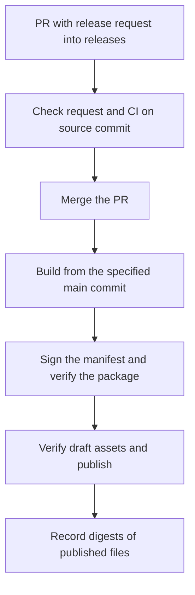

# Trust, privacy and signing

[Русская версия](Trust-and-security.ru.md) · [Home](Home.md)

| What you are checking | What the project provides |
| --- | --- |
| Where model calls go | The shared broker calls the configured model backend. The calling client can forward returned data to another service. |
| Package integrity | The ECDSA signature verifies the release manifest. The manifest binds the package hash to the release. |
| Which files were published | The release workflow verifies uploaded files and records their digests. To trace the build to source, check the source commit and build attestation. |
| Windows publisher identity | Authenticode signing for project executables is tracked in [#210](https://github.com/MrAliev/local-ai-toolkit/issues/210). |

## How releases are signed and published

Open a pull request targeting the protected `releases` branch with `.github/release-request.json`. It names the version and an exact source commit that passed **Build and test** on `main`. After the PR checks pass and it is merged, **Release from PR** builds from the specified commit, signs the manifest automatically, and verifies the package. It checks the files uploaded to the draft before publishing and records the digests of the published files.

Keep the package intact after signing its manifest. See the [release runbook](../publication.md) for the release request fields, prereleases and verification steps.

Authenticode is a separate step for signing Windows binaries owned by the project. The planned process and rules for third-party DLLs are in the [code signing policy](../code-signing-policy.md).

[Privacy](../privacy.md) · [Report a vulnerability privately](../../SECURITY.md).
