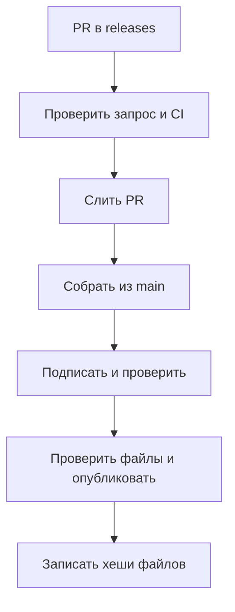

# Доверие, конфиденциальность и подпись

[English version](Trust-and-security.md) · [Главная](Home.ru.md)

## Что можно проверить

- **Куда уходят запросы к модели.** Общий брокер обращается к настроенному серверу моделей. Клиент может передать полученные данные другому сервису.
- **Целостность пакета.** ECDSA-подпись позволяет проверить манифест релиза. В манифесте указан хеш пакета.
- **Какие файлы опубликованы.** Сценарий релиза проверяет загруженные файлы и фиксирует их хеши. Чтобы связать сборку с исходным кодом, сверьте коммит и аттестацию сборки.
- **Издатель приложений Windows.** Подпись исполняемых файлов проекта через Authenticode отслеживается в [#210](https://github.com/MrAliev/local-ai-toolkit/issues/210).

## Как подписывается и публикуется релиз

Откройте PR с файлом `.github/release-request.json` в защищённую ветку `releases`. В запросе на выпуск укажите версию и точный коммит из `main`, для которого прошла проверка **Build and test**.

После успешных проверок и слияния PR сценарий **Release from PR** собирает пакет из указанного коммита, автоматически подписывает манифест и проверяет пакет. Перед публикацией он проверяет загруженные в черновик файлы, затем фиксирует хеши опубликованных файлов.

Не изменяйте пакет после подписания манифеста. Поля запроса, правила предварительных выпусков и шаги проверки описаны в [руководстве по публикации](../publication.ru.md).

Authenticode предназначена для подписи собственных исполняемых файлов проекта под Windows. План внедрения и правила для сторонних DLL описаны в [политике подписи](../code-signing-policy.ru.md).

- [Политика конфиденциальности](../privacy.ru.md)
- [Сообщить об уязвимости приватно](../../SECURITY.ru.md)
