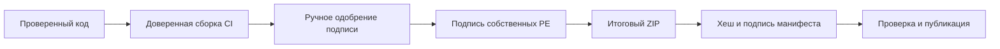

# Доверие, конфиденциальность и подпись

[English version](Trust-and-security.md) · [Главная](Home.ru.md)

| Уровень | Текущая граница |
| --- | --- |
| Локальные вычисления | Брокер использует настроенный backend; клиент может передать ответы дальше |
| Целостность пакета | ECDSA-подпись манифеста и хеш пакета |
| Аттестация assets | Фиксирует опубликованные байты; не заменяет provenance сборки из кода |
| Издатель Windows | Подключение SignPath планируется; сертификат не заявляется |

Это **целевой маршрут подписи**, а не доказательство существования подписанного релиза.
Не подписывайте чужие DLL как собственный код. Не меняйте пакет после вычисления
хеша и подписи манифеста.

[Политика подписи](../code-signing-policy.ru.md) · [Конфиденциальность](../privacy.ru.md) ·
[Проверки публикации](../publication.ru.md) · [Приватное сообщение об уязвимости](../../SECURITY.ru.md).
